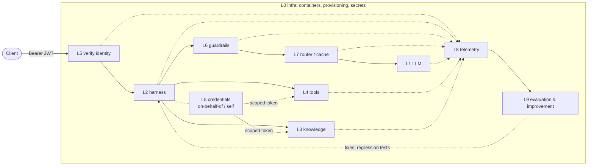

# agent-layers

An open-source, runtime-agnostic agent platform assembled from ten layers (L0-L9). Every layer is a thin contract
with a free reference implementation you can replace. The reference agent runtime is
[reinloop](https://github.com/aantenore/reinloop).

## Principle

For every layer:

1. **Standard.** Use an open standard where one exists.
2. **Extension point.** Anything can be plugged in. A tool, for example, can be any JS function.
3. **Reference implementation.** Free, open source, swappable.
4. **Adapter SDK.** Where no standard exists, reinloop exports a TypeScript interface plus a conformance check, so
   any technology can be adapted.

Each layer is tested live against its reference implementation, not against mocks.

## Layers

| L | Layer | Standard | Extension point | Reference (free, swappable) | Adapter SDK |
|---|---|---|---|---|---|
| 0 | [Infra](docs/layers/L0-infra.md) | OCI images + Compose Spec; OpenTofu (HCL) for provisioning; Helm later | compose files per layer, tofu modules | Docker Compose (local); OpenTofu module skeleton (docs only); OpenBao for secrets (docs only) | - |
| 1 | [LLM](docs/layers/L1-llm.md) | OpenAI Chat Completions (de facto), Anthropic Messages | reinloop `Provider.generate` | Ollama on host, model `qwen2.5:3b` | Provider conformance check |
| 2 | [Harness](docs/layers/L2-harness.md) | Markdown agent files (common subagent frontmatter), Agent Skills (`SKILL.md`), MCP server exposure | Middleware, patterns, plugins | reinloop | - |
| 3 | [Knowledge](docs/layers/L3-knowledge.md) | MCP tools/resources | `KnowledgeSource` | Qdrant + mcp-server-qdrant (vector); Markdown "LLM wiki" folder (zero infra); Docling for ingestion (docs) | `KnowledgeSource` + conformance |
| 4 | [Tools](docs/layers/L4-tools.md) | MCP; OpenAPI 3 | `defineTool` (any JS function) | MCP reference servers; declarative HTTP tools + OpenAPI import against go-httpbin | - |
| 5 | [Identity & access](docs/layers/L5-identity.md) | OIDC/OAuth 2 (JWT; RFC 8693 token exchange = on-behalf-of; client credentials = own identity); OpenID AuthZEN for authorization | `IdentityVerifier`, `CredentialProvider`, `Authorizer` | Keycloak + OPA | Authorizer adapters (`opa`, `authzen`) |
| 6 | [Guardrails](docs/layers/L6-guardrails.md) | none | `Guard` | Microsoft Presidio (PII) + LLM Guard (prompt injection etc.) | `Guard` + HTTP guard contract + conformance |
| 7 | [Cache & router](docs/layers/L7-cache-router.md) | OpenAI-compatible gateway | `CacheStore`, `ModelRouter` | LiteLLM proxy + Valkey; reinloop in-process memory/file cache | `ModelRouter` |
| 8 | [Telemetry & observability](docs/layers/L8-telemetry.md) | OpenTelemetry OTLP + GenAI semantic conventions | `Sink` | OTel Collector + Langfuse + Jaeger | - |
| 9 | [Evaluation & improvement](docs/layers/L9-eval.md) | none (promptfoo is the de facto tool) | `Evaluator` | promptfoo + `reinloop replay` + a diagnose agent that attributes failures to a layer | `Evaluator` + dataset/result JSONL |

The I/O contract of every layer is in [docs/contracts.md](docs/contracts.md); JSON Schemas are in [contracts/](contracts).

## Architecture



Request flow: the client authenticates, L5 verifies the token, L2 runs the agent, L6 checks input and output, L7
routes and caches model calls to L1. During a run L2 calls L4 tools and L3 knowledge, with credentials issued by L5.
Every layer emits telemetry to L8, and L8 feeds L9. L0 runs underneath all of it.

## Quickstart

Requirements: Node >= 22.18, Docker with Compose, and [Ollama](https://ollama.com) running on the host.

```bash
git clone https://github.com/aantenore/agent-layers && cd agent-layers
cp .env.example .env
ollama pull qwen2.5:3b          # L1 reference model
npm install                     # installs reinloop (optional if you use REINLOOP_SRC)

make test LAYER=l2-harness      # live test: reinloop answers a prompt through Ollama
make up LAYER=l3-knowledge      # start one layer's containers
make test LAYER=l3-knowledge
make up-all                     # start every layer that has a compose.yml
make down-all
```

To run against a local reinloop checkout instead of the installed package, set `REINLOOP_SRC` to its `src/index.ts`.
Tests skip with a clear message when the service they need is not reachable.

## Status

| L | Layer | Status |
|---|---|---|
| 0 | Infra | in progress |
| 1 | LLM | in progress |
| 2 | Harness | in progress |
| 3 | Knowledge | in progress |
| 4 | Tools | in progress |
| 5 | Identity & access | in progress |
| 6 | Guardrails | in progress |
| 7 | Cache & router | in progress |
| 8 | Telemetry & observability | in progress |
| 9 | Evaluation & improvement | in progress |

## Improvement loop

L9 closes the loop. Production traces become evaluation data, and failures are traced back to the layer that caused them.

1. **Traces.** Production runs are recorded as OTLP traces (L8).
2. **Per-layer evaluators.** Each layer is scored on its own terms:
   - knowledge: RAGAS metrics (faithfulness, context precision/recall)
   - LLM: judge evals on answer quality
   - tools: tool correctness (right tool, right arguments)
   - identity: policy decisions (denied when it should be, allowed when it should be)
   - guardrails: false positives and misses
   - cache: hit rate and stale hits
3. **Dataset.** Failed cases are appended to the dataset (JSONL `EvalCase`, tagged with a `layer`).
4. **Diagnosis.** A diagnose agent reads the failing run and emits `{runId, layer, evidence, fix}`, attributing the failure to one layer.
5. **Fix.** The change is made where the failure lives: prompt optimisation (DSPy, Opik), retrieval tuning, better tool descriptions, policy or guard rules.
6. **Regression tests.** The failing cases stay in the dataset and run on every change (promptfoo, `reinloop replay` against another agent or model).
7. **Release.**

Future: L10, interface/channel, with [LibreChat](https://github.com/danny-avila/LibreChat) (MIT) as the reference.

## Licenses

This repository is MIT. References are used as separate processes or services, never vendored.

| Component | License | Layer |
|---|---|---|
| reinloop | MIT | L2 |
| Ollama | MIT | L1 |
| Qdrant | Apache-2.0 | L3 |
| mcp-server-qdrant | Apache-2.0 | L3 |
| Docling | MIT | L3 (docs) |
| go-httpbin | MIT | L4 |
| Keycloak | Apache-2.0 | L5 |
| OPA | Apache-2.0 | L5 |
| Presidio | MIT | L6 |
| LLM Guard | MIT | L6 |
| LiteLLM | MIT core (the `enterprise/` directory is under a separate commercial license and is not used) | L7 |
| Valkey | BSD-3-Clause | L7 |
| OpenTelemetry Collector | Apache-2.0 | L8 |
| Langfuse | MIT core (the `ee/` directories are under a separate commercial license and are not used) | L8 |
| Jaeger | Apache-2.0 | L8 |
| promptfoo | MIT | L9 |
| OpenTofu | MPL-2.0 | L0 (docs) |
| OpenBao | MPL-2.0 | L0 (docs) |
| LibreChat | MIT | L10 (future) |

All of the above are OSI-approved licenses (for the split-licensed projects, only the open-source parts are used).
Phoenix (Elastic License 2.0) and Llama Guard (Llama Community License) are deliberately excluded because their
licenses are not OSI-approved.

Model weights are licensed separately from the tools that serve them. The default `qwen2.5:3b` is a reference for
local testing; its weights are published under the Qwen Research License, not Apache-2.0. Check the license of the
model you ship. `LLM_MODEL` can point to any model Ollama serves (for example `qwen2.5:7b`, Apache-2.0).

## Layout

```
contracts/    JSON Schemas for the data shapes crossing layer boundaries
docs/         contracts.md and one doc per layer
layers/lN-*/  compose file, config, tests and reference wiring for each layer
lib/          shared helpers for tests (reinloop loader, readiness polling)
```

## License

MIT. See [LICENSE](LICENSE).
