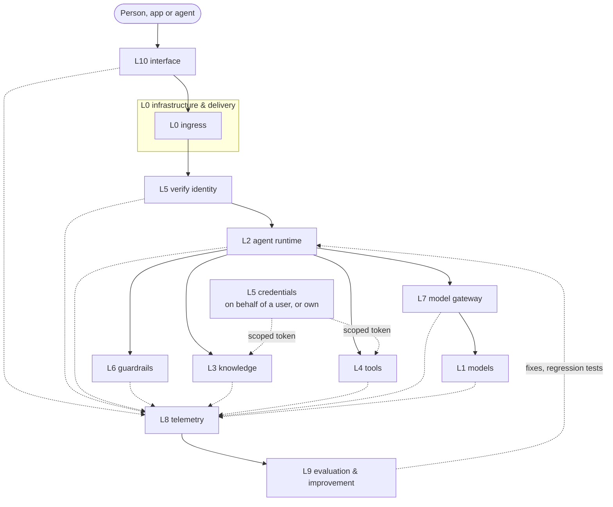

# agent-layers

An open-source, runtime-agnostic agent platform with eleven layers, L0 to L10. L0-L9 cover what runs; L10 is the
interface. Every layer is a thin contract with a free reference implementation you can replace. The reference agent
runtime is [reinloop](https://github.com/aantenore/reinloop).

The canonical overview, with the five-field description of every layer, the request flow, cross-cutting concerns and
the lifecycle, is [docs/stack.md](docs/stack.md).

## Principle

**Standard where it exists. SDK + conformance check where it does not. The reference is always free and swappable.**

Every layer is described with the same five fields:

1. **Responsibility.** What the layer does.
2. **Standard.** The open standard it speaks, where one exists.
3. **Extension point.** The code you write to plug in something new. A tool, for example, can be any JS function.
4. **Reference implementation.** Free, open source, swappable.
5. **Adapter SDK + conformance.** Where no standard exists, reinloop exports a TypeScript interface plus a conformance
   check, so any technology can be adapted.

Each layer is tested live against its reference implementation, not against mocks.

## Layers

| L | Layer | Standard | Extension point | Reference (free, swappable) | Adapter SDK |
|---|---|---|---|---|---|
| 0 | [Infrastructure & delivery](docs/layers/L0-infra.md) | OCI, Compose Spec, Kubernetes API / Helm, OpenTofu (HCL), Vault-compatible secrets API | Deploy target adapter (`compose` or `k8s`); OpenTofu modules per cloud | Docker Compose, Traefik (ingress), OpenBao (secrets), OpenTofu; Argo CD for GitOps | Deploy-target contract |
| 1 | [Models](docs/layers/L1-llm.md) | OpenAI Chat Completions, Anthropic Messages | `Provider` | Ollama + `qwen3:4b` | Provider conformance check |
| 2 | [Agent runtime](docs/layers/L2-harness.md) | Markdown agent files, Agent Skills, MCP server exposure, CloudEvents triggers | Middleware, patterns, `RunStore` | reinloop | - |
| 3 | [Knowledge & memory](docs/layers/L3-knowledge.md) | Per source: SQL, SPARQL + RDF / OWL / SKOS, GQL / Cypher, files + git, Agent Skills; MCP for transport only. None for documents and memory | `KnowledgeSource` | Qdrant + mcp-server-qdrant; Markdown wiki folder; Apache Jena Fuseki and MCP Toolbox for Databases next; Docling for ingestion | `KnowledgeSource` + conformance |
| 4 | [Tools](docs/layers/L4-tools.md) | MCP; OpenAPI 3 | `defineTool` (any JS function) | MCP reference servers; declarative HTTP tools + OpenAPI import | - |
| 5 | [Identity & access](docs/layers/L5-identity.md) | OIDC/OAuth 2, RFC 8693 token exchange (on behalf of a user), client credentials (own identity), OpenID AuthZEN | `IdentityVerifier`, `CredentialProvider`, `Authorizer` | Keycloak + OPA | Authorizer adapters (`opa`, `authzen`) |
| 6 | [Guardrails](docs/layers/L6-guardrails.md) | none | `Guard` | Presidio (PII) + LLM Guard | `Guard` + HTTP guard contract + conformance |
| 7 | [Model gateway](docs/layers/L7-cache-router.md) | OpenAI-compatible gateway | `CacheStore`, `ModelRouter` | LiteLLM + Valkey; in-process cache and rule router | `ModelRouter` |
| 8 | [Telemetry & observability](docs/layers/L8-telemetry.md) | OpenTelemetry OTLP + GenAI semantic conventions | `Sink` | OTel Collector + Langfuse + Jaeger | - |
| 9 | [Evaluation & improvement](docs/layers/L9-eval.md) | none (promptfoo is the de facto tool) | `Evaluator` | promptfoo + `reinloop replay` + a diagnose agent that attributes failures to a layer | `Evaluator` + dataset/result JSONL |
| 10 | [Interfaces & channels](docs/layers/L10-interface.md) | OpenAI-compatible chat API, MCP server, A2A, AG-UI | Channel adapters | LibreChat | Channel adapter + conformance |

Knowledge is not only RAG. L3 covers documents, structured data, graphs and ontologies, a curated wiki, long-term
memory and procedural know-how. MCP standardises how an agent reaches a source (transport), not what a search returns
(result), so L3 fixes the result as `Passage { id, text, source, score, metadata }` and adapters translate each
backend into it. That uniform result lets L8 trace and L9 evaluate retrieval quality for every backend.

Rules that span layers (governance and compliance, security, cost) are in [docs/cross-cutting](docs/cross-cutting),
and the path from design to operation is in [docs/lifecycle.md](docs/lifecycle.md).

The I/O contract of every layer is in [docs/contracts.md](docs/contracts.md); JSON Schemas are in [contracts/](contracts).

## Architecture



The client reaches the agent through an L10 channel; L0 ingress routes it and L5 verifies the token. L2 runs the
agent, L6 checks input, output and tool traffic, and L7 routes and caches model calls to L1. During a run L2 calls L4
tools and L3 knowledge with credentials issued by L5. Every layer emits telemetry to L8, and L8 feeds L9. L0 runs
underneath all of it. See [docs/stack.md](docs/stack.md).

## Quickstart

Requirements: Node >= 22.18, Docker with Compose, and [Ollama](https://ollama.com) running on the host.

```bash
git clone https://github.com/aantenore/agent-layers && cd agent-layers
cp .env.example .env
ollama pull qwen3:4b            # L1 reference model
npm install                     # installs reinloop (optional if you use REINLOOP_SRC)

make test LAYER=l2-harness      # live test: reinloop answers a prompt through Ollama
make up LAYER=l3-knowledge      # start one layer's containers
make test LAYER=l3-knowledge
make up-all                     # start every layer that has a compose.yml
make down-all
```

To run against a local reinloop checkout instead of the installed package, set `REINLOOP_SRC` to its `src/index.ts`.
Tests skip with a clear message when the service they need is not reachable.

## Status

| L | Layer | Status |
|---|---|---|
| 0 | Infrastructure & delivery | base done |
| 1 | Models | in progress |
| 2 | Agent runtime | base done |
| 3 | Knowledge & memory | in progress |
| 4 | Tools | in progress |
| 5 | Identity & access | in progress |
| 6 | Guardrails | in progress |
| 7 | Model gateway | in progress |
| 8 | Telemetry & observability | in progress |
| 9 | Evaluation & improvement | in progress |
| 10 | Interfaces & channels | planned |

## Improvement loop

L9 closes the loop. Production traces become evaluation data, and failures are traced back to the layer that caused them.

1. **Traces.** Production runs are recorded as OTLP traces (L8).
2. **Per-layer evaluators.** Each layer is scored on its own terms:
   - knowledge: RAGAS metrics (faithfulness, context precision/recall)
   - LLM: judge evals on answer quality
   - tools: tool correctness (right tool, right arguments)
   - identity: policy decisions (denied when it should be, allowed when it should be)
   - guardrails: false positives and misses
   - cache: hit rate and stale hits
3. **Dataset.** Failed cases are appended to the dataset (JSONL `EvalCase`, tagged with a `layer`).
4. **Diagnosis.** A diagnose agent reads the failing run and emits `{runId, layer, evidence, fix}`, attributing the failure to one layer.
5. **Fix.** The change is made where the failure lives: prompt optimisation (DSPy, Opik), retrieval tuning, better tool descriptions, policy or guard rules.
6. **Regression tests.** The failing cases stay in the dataset and run on every change (promptfoo, `reinloop replay` against another agent or model).
7. **Release.** The change ships through the L0 pipeline; see [docs/lifecycle.md](docs/lifecycle.md).

## Licenses

This repository is MIT. References are used as separate processes or services, never vendored.

| Component | License | Layer |
|---|---|---|
| reinloop | MIT | L2 |
| Ollama | MIT | L1 |
| Qdrant | Apache-2.0 | L3 |
| Apache Jena Fuseki | Apache-2.0 | L3 (next) |
| MCP Toolbox for Databases | Apache-2.0 | L3 (next) |
| mcp-server-qdrant | Apache-2.0 | L3 |
| Docling | MIT | L3 (docs) |
| Graphiti | Apache-2.0 | L3 (optional) |
| LightRAG | MIT | L3 (optional) |
| go-httpbin | MIT | L4 |
| Keycloak | Apache-2.0 | L5 |
| OPA | Apache-2.0 | L5 |
| Presidio | MIT | L6 |
| LLM Guard | MIT | L6 |
| LiteLLM | MIT core (the `enterprise/` directory is under a separate commercial license and is not used) | L7 |
| Valkey | BSD-3-Clause | L7 |
| OpenTelemetry Collector | Apache-2.0 | L8 |
| Langfuse | MIT core (the `ee/` directories are under a separate commercial license and are not used) | L8 |
| Jaeger | Apache-2.0 | L8 |
| promptfoo | MIT | L9 |
| Docker Compose | Apache-2.0 | L0 |
| Traefik | MIT | L0 (docs) |
| Argo CD | Apache-2.0 | L0 (docs) |
| OpenTofu | MPL-2.0 | L0 (docs) |
| OpenBao | MPL-2.0 | L0 (docs) |
| LibreChat | MIT | L10 (planned) |
| A2A | Apache-2.0 | L10 (planned) |
| AG-UI | MIT | L10 (planned) |

All of the above are OSI-approved licenses (for the split-licensed projects, only the open-source parts are used).
Phoenix (Elastic License 2.0) and Llama Guard (Llama Community License) are deliberately excluded because their
licenses are not OSI-approved.

Model weights are licensed separately from the tools that serve them. The default `qwen3:4b` is Apache-2.0
(`qwen2.5:3b`, for comparison, is under the Qwen Research License, which is not OSI-approved). Check the license of
the model you ship. `LLM_MODEL` can point to any model Ollama serves.

## Layout

```
contracts/    JSON Schemas for the data shapes crossing layer boundaries
docs/         stack.md (overview), contracts.md, lifecycle.md, cross-cutting/ and one doc per layer
layers/lN-*/  compose file, config, tests and reference wiring for each layer
lib/          shared helpers for tests (reinloop loader, readiness polling)
```

## License

MIT. See [LICENSE](LICENSE).
