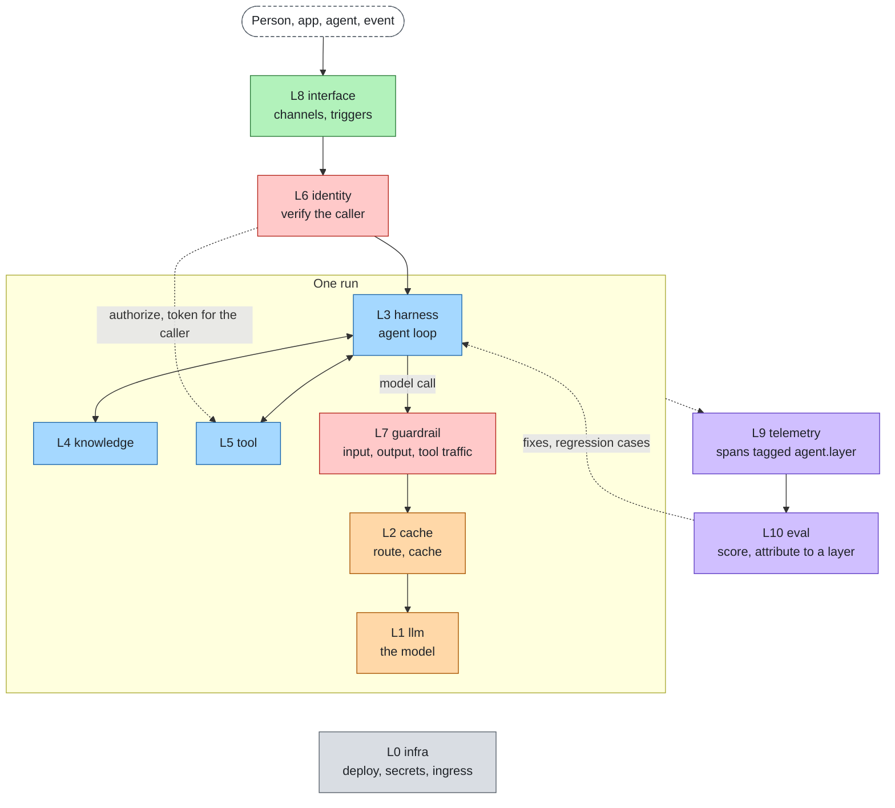

# agent-layers


agent-layers composes the eleven layers an agent needs, from a laptop prototype to production: infrastructure,
models, model access, runtime, knowledge, tools, identity, guardrails, interfaces, telemetry and evaluation.

It does not implement any of them. The core defines a port for each layer; adapters map an open standard, or a
technology's native API, onto a port; a stack config picks one adapter per port, per profile. The agent runtime is
an adapter too, so it can be replaced like anything else.

- **Why it exists and how it compares:** [docs/product.md](docs/product.md)
- **How it works:** [docs/architecture.md](docs/architecture.md)
- **The layers on one page:** [docs/stack.md](docs/stack.md)
- **Every diagram, and the colour conventions:** [docs/diagrams.md](docs/diagrams.md)
- **Start a project, write an adapter, go to production:** [docs/guide.md](docs/guide.md)
- **Adapters, status and maturity:** [docs/adapters.md](docs/adapters.md)
- **Every limit, its default and safe range:** [docs/limits.md](docs/limits.md)
- **The vertical slice, results and open gaps:** [docs/slice.md](docs/slice.md)
- **Replace one layer by configuration alone, as a re-runnable matrix:** [docs/swap.md](docs/swap.md)
- **The language-neutral spec:** [spec/](spec/README.md)
- **The SDK language (shapes, vocabularies, `ext`, mappings):** [spec/language.md](spec/language.md)

## Principle

**Product first, standards adapt.** Ports are designed from what a developer building and shipping an agent needs to
call. The data that crosses a port is written in one language owned by this project ([spec/language.md](spec/language.md),
version 1.0); standards and technologies appear only as adapters, which translate to it at the edges. Vocabularies and
boundary mappings are configurable, shapes are not; extra data goes in namespaced `ext`. A new technology is an
adapter plus its conformance test, never a core change.

## The eleven layers

| Plane | L | Layer (id) | The question it answers |
|---|---|---|---|
| Foundation | L0 | Infrastructure & delivery (`infra`) | Where does it run and how does it get there? |
| Model | L1 | Models (`llm`) | Who thinks? |
| Model | L2 | Model access (`cache`) | Which model, at what cost and latency? |
| Agent | L3 | Agent runtime (`harness`) | How does the agent loop run and keep state? |
| Agent | L4 | Knowledge & memory (`knowledge`) | What does it know? |
| Agent | L5 | Tools (`tool`) | What can it do? |
| Control | L6 | Identity & access (`identity`) | Who is it, on whose behalf, and what is allowed? |
| Control | L7 | Guardrails (`guardrail`) | Is this content acceptable? |
| Experience | L8 | Interfaces, channels & triggers (`interface`) | Who talks to it and what starts it? |
| Insight | L9 | Telemetry & observability (`telemetry`) | What happened? |
| Insight | L10 | Evaluation & improvement (`eval`) | Was it good, and if not, which layer failed? |

Ports per layer, reference adapters and the request flow are in [docs/stack.md](docs/stack.md).

## Request through the stack

A channel starts a run, identity verifies the caller, the runtime loops over knowledge and tools, and model calls pass
the guards, the cache and the router before they reach the model. Every step is traced and scored.



## Quickstart

Requirements: Node >= 22.18. Docker and a local model server are optional (the `local` profile and the reference
setups use them).

```bash
git clone https://github.com/aantenore/agent-layers && cd agent-layers
npm install

cd examples/minimal
node --conditions=@agent-layers/source ../../packages/cli/src/cli.ts check      # config, adapters, readiness, conformance
node --conditions=@agent-layers/source ../../packages/cli/src/cli.ts dev        # talk to the agent, one trace line per layer
node --conditions=@agent-layers/source --test "tests/**/*.test.ts"              # smoke dataset, offline
node --conditions=@agent-layers/source ../../packages/cli/src/cli.ts diff prototype production
```

Outside the repository, start from the published packages: `npx @agent-layers/cli init my-agent`, `npm install`,
then `npx agent-layers check`, `dev`, `test`, `eval` and `deploy --profile production`. `examples/minimal` is what
`init` generates: all eleven layers wired, a prototype profile on zero-dependency adapters, and pilot and production
profiles that name the reference adapters.

## Layout

```
spec/            language-neutral source of truth: schemas/, ports/, VERSIONING.md
packages/core    @agent-layers/core: ports, adapter registry, pipelines, stack config, compose (zero dependencies)
packages/conformance  @agent-layers/conformance: one suite per port
packages/cli     @agent-layers/cli: init, dev, check, test, eval, deploy, diff, layers
adapters/<name>  @agent-layers/adapter-<name>: one package per standard or technology; _template to start one
examples/        sample projects (minimal)
reference/<id>/  reference setup per layer id: compose files, configs and live tests
scripts/         docs tooling: adapter catalog generator and docs check
docs/            product, architecture, stack, guide, adapters, layers/<id>.md, cross-cutting/
```

## Development

```bash
npm install                                          # workspaces, dev dependencies only
npx tsc -p packages/core && npx tsc -p packages/cli  # typecheck one package
npm test -w @agent-layers/core                       # tests of one package
make test LAYER=knowledge                            # live test of one reference setup (layer id)
npm run docs:check                                   # links, layer tables, ports, env, adapter catalog
```

Contributions: [CONTRIBUTING.md](CONTRIBUTING.md). Core paths need a spec change first. Releases:
[RELEASING.md](RELEASING.md). Vulnerabilities: report them privately, see [SECURITY.md](SECURITY.md).

## Licenses of the reference technologies

This repository is MIT. Reference technologies are used as separate processes or services through adapters, never vendored.

| Component | License | Layer (id) |
|---|---|---|
| reinloop | MIT | harness |
| Ollama | MIT | llm |
| Qdrant | Apache-2.0 | knowledge |
| Apache Jena Fuseki | Apache-2.0 | knowledge (next) |
| MCP Toolbox for Databases | Apache-2.0 | knowledge (next) |
| mcp-server-qdrant | Apache-2.0 | knowledge |
| Docling | MIT | knowledge (docs) |
| Graphiti | Apache-2.0 | knowledge (optional) |
| LightRAG | MIT | knowledge (optional) |
| go-httpbin | MIT | tool |
| Keycloak | Apache-2.0 | identity |
| OPA | Apache-2.0 | identity |
| Presidio | MIT | guardrail |
| LLM Guard | MIT | guardrail |
| LiteLLM | MIT core (the `enterprise/` directory is under a separate commercial license and is not used) | cache |
| Valkey | BSD-3-Clause | cache |
| OpenTelemetry Collector | Apache-2.0 | telemetry |
| Langfuse | MIT core (the `ee/` directories are under a separate commercial license and are not used) | telemetry |
| Jaeger | Apache-2.0 | telemetry |
| promptfoo | MIT | eval |
| Docker Compose | Apache-2.0 | infra |
| Traefik | MIT | infra (docs) |
| Argo CD | Apache-2.0 | infra (docs) |
| OpenTofu | MPL-2.0 | infra (docs) |
| OpenBao | MPL-2.0 | infra (docs) |
| LibreChat | MIT | interface (planned) |
| A2A | Apache-2.0 | interface (planned) |
| AG-UI | MIT | interface (planned) |

All of the above are OSI-approved licenses (for the split-licensed projects, only the open-source parts are used).
Phoenix (Elastic License 2.0) and Llama Guard (Llama Community License) are deliberately excluded because their
licenses are not OSI-approved.

Model weights are licensed separately from the tools that serve them. The default `qwen3:4b` is Apache-2.0
(`qwen2.5:3b`, for comparison, is under the Qwen Research License, which is not OSI-approved). Check the license of
the model you ship. `LLM_MODEL` can point to any model Ollama serves.

## License

MIT. See [LICENSE](LICENSE).
