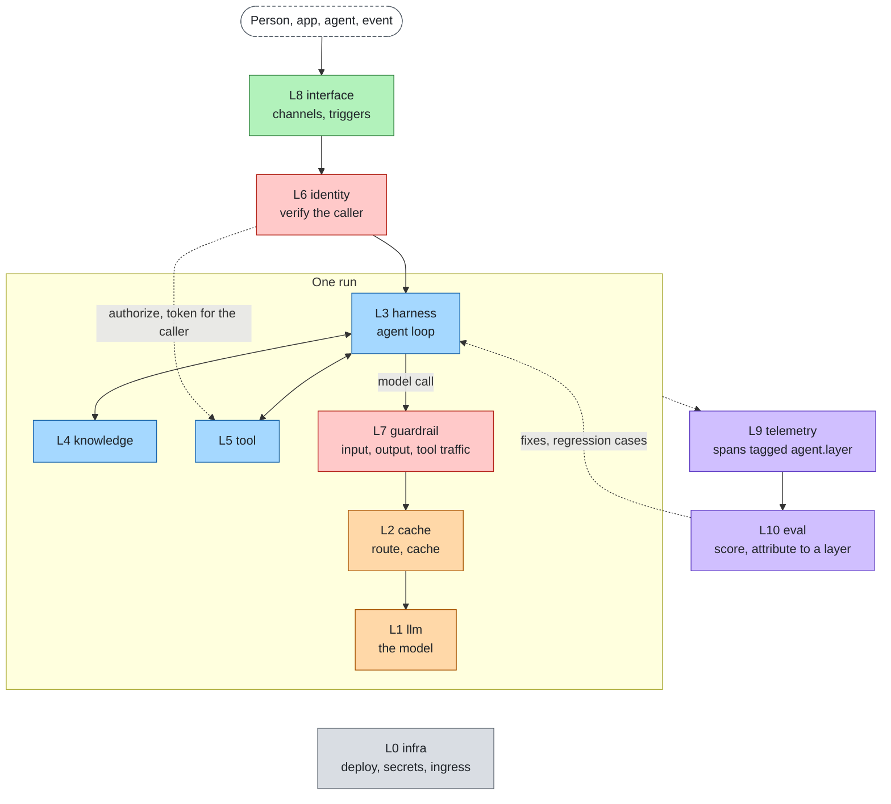

# agent-layers

[](https://www.npmjs.com/package/@agent-layers/core)
[](https://github.com/aantenore/agent-layers/actions/workflows/ci.yml)
[](LICENSE)
[](package.json)

**One config takes the same agent from a laptop prototype to production, with identity, policy and guardrails enforced in a gateway outside the agent.**

## What it proves

One agent, two profiles of the same `agent-layers.json`:

- `prototype` runs offline on zero-dependency adapters.
- `production` names your identity provider, policy engine, guardrail services and model gateway.

The agent files do not change between the two. Identity, authorization, guardrails and telemetry run in the gateway,
outside the agent's process, so they apply to an agent in any language and do not depend on its code. Before anything is deployed,
`check` and `diff` say exactly what the production profile changes and what it still lacks.

## In 60 seconds

Requirements: Node >= 22.18. No key, no Docker, no network after the install.

```bash
npx @agent-layers/cli init my-agent && cd my-agent
npm install
npm run check                          # config, adapters, readiness gate, conformance: ends with "check passed"
npm run dev                            # talk to the agent, one trace line per layer
npm run diff -- prototype production   # what production changes, and what it still needs
```

`diff` prints one line per slot, then the missing pieces (abridged here, and the last line wrapped):

```text
prototype → production
  model          changed  mock-model → openai-compatible
  runtime        changed  basic-runtime → reinloop
  tools          same     util=functions
  identity       changed  static-identity → oidc
  authorization  changed  rules-authorization → opa
  guardrails     changed  regex-guard → presidio, llm-guard
  telemetry      changed  console-telemetry → otlp
would need: GATEWAY_PUBLIC_ORIGIN, GATEWAY_URL, LLM_GUARD_URL, OIDC_AUDIENCE, OIDC_CLIENT_ID, OIDC_CLIENT_SECRET,
            OIDC_ISSUER, OPA_URL, PRESIDIO_ANALYZER_URL, PRESIDIO_ANONYMIZER_URL, SESSION_SECRET (not set)
```

- `changed`, `same`, `removed`: the adapter each slot uses in the two profiles. The agent, its tools and its
  knowledge are the same files in both.
- `would need: ...`: the environment variables the production profile reads that are not set. None has a localhost
  fallback, so nothing points at a development service by accident.
- `npm run check -- --profile production` fails on each of them by name until it is set. Then the readiness gate
  runs: a production-tier profile is refused on prototype-only adapters, or without identity, authorization,
  guardrails, telemetry and state. `npm run gateway -- --profile production` refuses to start a profile that fails it.

The first run answers from a scripted model (`mock-model`), which is why it needs no key. `npm run dev -- --profile
local` runs the same stack on a model served on your machine through an OpenAI-compatible endpoint (`.env.example`
in the project); runs recorded on real models, with their gaps, are in [docs/slice.md](docs/slice.md).

Always use the scoped name with `npx` (`npx @agent-layers/cli <command>`): the unscoped `agent-layers` name on npm
belongs to an unrelated package.

## Where to go next

- **Start a project, write an adapter, go to production:** [docs/guide.md](docs/guide.md)
- **Host a stack for any language (OpenAI-compatible, MCP, A2A, CloudEvents):** [docs/gateway.md](docs/gateway.md)
- **Threats, and what agent-layers enforces versus what is yours:** [docs/cross-cutting/security.md](docs/cross-cutting/security.md)
- **Every limit, its default and safe range:** [docs/limits.md](docs/limits.md)
- **The layers, slots and ports on one page:** [docs/stack.md](docs/stack.md)
- **Adapters, status and maturity:** [docs/adapters.md](docs/adapters.md)
- **Why it exists and how it compares:** [docs/product.md](docs/product.md)
- **How it works:** [docs/architecture.md](docs/architecture.md)
- **The vertical slice, results and open gaps:** [docs/slice.md](docs/slice.md)
- **Replace one layer by configuration alone, as a re-runnable matrix:** [docs/swap.md](docs/swap.md)
- **Every diagram, and the colour conventions:** [docs/diagrams.md](docs/diagrams.md)
- **The language-neutral spec:** [spec/](spec/README.md), and **the SDK language** (shapes, vocabularies, `ext`,
  mappings): [spec/language.md](spec/language.md)
- **Licences of the reference technologies:** [docs/licenses.md](docs/licenses.md)
- **Every documentation page, grouped:** [docs/README.md](docs/README.md)

## How it works

For teams that build an agent and have to run it against the company's identity, observability, model gateway and
policy systems. Unlike an agent framework, agent-layers owns neither the loop nor the integrations: the core defines
ports, adapters map an open standard or a technology onto a port, and a stack config picks one adapter per slot, per
profile. The runtime is an adapter too, so it can be replaced like anything else.

The stack config, abridged (`agent-layers.json`; the full file is what `init` writes):

```jsonc
"profiles": {
  "prototype": { "tier": "prototype", "layers": {
    "model":      { "adapter": "mock-model" },
    "runtime":    { "adapter": "basic-runtime" },
    "identity":   { "adapter": "static-identity" },
    "guardrails": [{ "adapter": "regex-guard" }],
    "telemetry":  [{ "adapter": "console-telemetry" }]
  } },
  "production": { "extends": "prototype", "tier": "production", "layers": {
    "model":      { "adapter": "openai-compatible", "options": { "baseUrl": "${env:GATEWAY_URL}" } },
    "runtime":    { "adapter": "reinloop" },
    "identity":   { "adapter": "oidc", "options": { "issuer": "${env:OIDC_ISSUER}" } },
    "guardrails": [{ "adapter": "presidio" }, { "adapter": "llm-guard" }],
    "telemetry":  [{ "adapter": "otlp" }]
  } }
}
```

**The gateway** (`npm run gateway`) hosts the same stack on the network, so a runtime or an app in any language
reaches it through four standards: OpenAI-compatible chat completions, MCP (streamable HTTP), A2A and CloudEvents.
It authenticates every request, caps concurrency and rate, and applies authorization, guardrails and telemetry
outside the agent's process. See [docs/gateway.md](docs/gateway.md).

**Status.** 0.x: the API can change between minor versions (see [CHANGELOG.md](CHANGELOG.md)). Adapters are
experimental unless [docs/adapters.md](docs/adapters.md) says otherwise. Deploy is Docker Compose today
(`compose-deploy`); Helm and OpenTofu files under `reference/infra` are references, not a deploy adapter.

## The eleven layers


Eleven layers, each made of one or more slots (22 in total): infrastructure, models, model routing and cache, runtime,
knowledge, tools, identity, guardrails, interfaces, telemetry and evaluation. A slot is a key under `layers` in the
config and fills one port. agent-layers implements none of them: it composes adapters for them.

The tables are in [docs/stack.md](docs/stack.md): [layers by plane](docs/stack.md#layers-by-plane), with the question
each one answers, its ports and reference adapters, and [layers, slots and ports](docs/stack.md#layers-slots-and-ports).

Four ports (`SecretPort`, `MemoryPort`, `IngestionPort`, `FeedbackPort`) are drafts with no reference adapter yet; see [docs/adapters.md](docs/adapters.md).

## Principle

**Product first, standards adapt.** Ports are designed from what a developer building and shipping an agent needs to
call. The data that crosses a port is written in one language owned by this project ([spec/language.md](spec/language.md),
versioned as described in [spec/VERSIONING.md](spec/VERSIONING.md)); standards and technologies appear only as adapters, which translate to it at the edges. Vocabularies and
boundary mappings are configurable, shapes are not; extra data goes in namespaced `ext`. A new technology is an
adapter plus its conformance test, never a core change.

## Request through the stack

A channel starts a run, identity verifies the caller, the runtime loops over knowledge and tools, and model calls pass
the guards, the cache and the router before they reach the model. Every step is traced and scored.



## From a clone

To work on the repository itself, or to run the example without the published packages:

```bash
git clone https://github.com/aantenore/agent-layers && cd agent-layers
npm install

cd examples/minimal
node --conditions=@agent-layers/source ../../packages/cli/src/cli.ts check      # config, adapters, readiness, conformance
node --conditions=@agent-layers/source ../../packages/cli/src/cli.ts dev        # talk to the agent, one trace line per layer
node --conditions=@agent-layers/source --test "tests/**/*.test.ts"              # smoke dataset, offline
node --conditions=@agent-layers/source ../../packages/cli/src/cli.ts diff prototype production
```

`examples/minimal` starts from the `init` template (all eleven layers wired, a prototype profile on zero-dependency
adapters, pilot and production profiles that name the reference adapters) and adds the `polyglot` and
`polyglot-local` profiles, which run the agent on Pydantic AI over A2A. A generated project has the same commands as
scripts: `npm run check`, `npm run dev`, `npm test`, `npm run eval` and `npm run deploy`.

## Layout

```
spec/            language-neutral source of truth: schemas/, ports/, VERSIONING.md
packages/core    @agent-layers/core: ports, adapter registry, pipelines, stack config, compose (zero dependencies)
packages/conformance  @agent-layers/conformance: one suite per port
packages/cli     @agent-layers/cli: init, dev, check, test, eval, deploy, up, down, diff, layers, gateway, version
packages/gateway @agent-layers/gateway: hosts a stack on the network (OpenAI-compatible, MCP, A2A, CloudEvents)
packages/adapters  @agent-layers/adapters: every adapter, one subpath export per standard or technology (src/<name>)
runtimes/pydantic-ai  a Pydantic AI agent served over A2A, using the gateway for model and tools (Python, not published)
examples/        sample projects (minimal, slice, swap) and adapter-package, the skeleton of an adapter
reference/<id>/  reference setup per layer id: compose files, configs and live tests
scripts/         docs and release tooling: adapter catalog, docs check, build, publish
docs/            product, architecture, stack, guide, adapters, layers/<id>.md, cross-cutting/
```

## Development

```bash
npm install                                          # workspaces, dev dependencies only
npx tsc -p packages/core && npx tsc -p packages/cli  # typecheck one package
npm test -w @agent-layers/core                       # tests of one package
make test LAYER=knowledge                            # live test of one reference setup (layer id)
npm run docs:check                                   # links, layer tables, ports, env, adapter catalog
```

Contributions: [CONTRIBUTING.md](CONTRIBUTING.md). Core paths need a spec change first. Releases:
[RELEASING.md](RELEASING.md). Vulnerabilities: report them privately, see [SECURITY.md](SECURITY.md).

## Ecosystem

The family: four projects, each usable alone.

- **[reinloop](https://github.com/aantenore/reinloop)**: the runtime. Agents as files, budgets, approvals, durable
  resume, OpenTelemetry, zero dependencies.
- **agent-layers** (this repository): the eleven-layer SDK, where reinloop is one runtime adapter.
- **[agent-plexus](https://github.com/aantenore/agent-plexus)**: multi-agent composition, where an agent-layers stack is
  the host.
- **[Lorebase](https://github.com/aantenore/lorebase)**: the governed, versioned knowledge graph agents read over MCP.

## License

MIT. See [LICENSE](LICENSE). The reference technologies are used as separate processes or services through adapters,
never vendored; their licences, and the note on model weights, are in [docs/licenses.md](docs/licenses.md).
