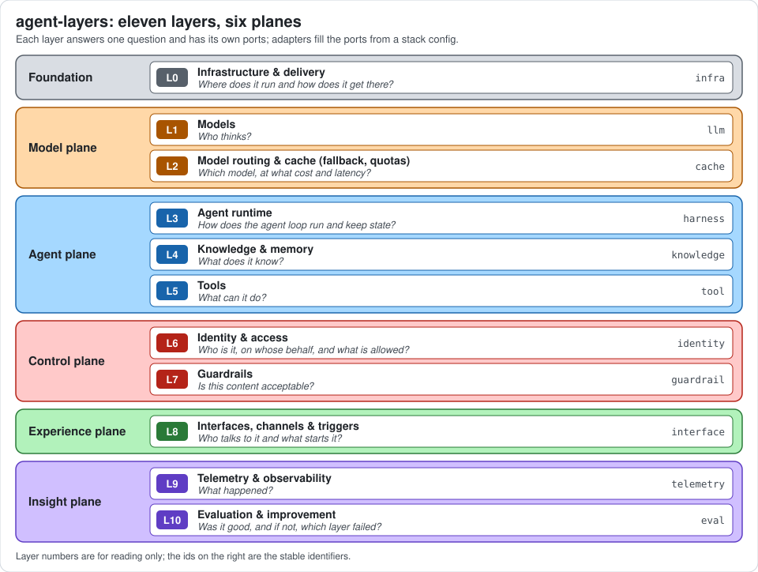

# agent-layers

[](https://www.npmjs.com/package/@agent-layers/core)
[](https://github.com/aantenore/agent-layers/actions/workflows/ci.yml)
[](LICENSE)
[](package.json)

**One config for the eleven layers of an agent, each one a swappable adapter, from a laptop prototype to production.**

For teams that build an agent and have to run it against the company's identity, observability, model gateway and
policy systems. Unlike an agent framework, agent-layers owns neither the loop nor the integrations: the core defines a
port per layer, adapters map an open standard or a technology onto a port, and a stack config picks one adapter per
port, per profile. The runtime is an adapter too. Moving a layer to production is a config change that
`npm run check` proves: a readiness gate refuses a production profile on prototype adapters.

```bash
npx @agent-layers/cli init my-agent && cd my-agent
npm install
npm run dev        # talk to the agent offline, one trace line per layer
npm run gateway    # the same stack over HTTP for any language
```

The stack config, abridged (`agent-layers.json`; the full file is what `init` writes):

```jsonc
"profiles": {
  "prototype": { "tier": "prototype", "layers": {
    "model":      { "adapter": "mock-model" },
    "runtime":    { "adapter": "basic-runtime" },
    "identity":   { "adapter": "static-identity" },
    "guardrails": [{ "adapter": "regex-guard" }],
    "telemetry":  [{ "adapter": "console-telemetry" }]
  } },
  "production": { "extends": "prototype", "tier": "production", "layers": {
    "model":      { "adapter": "openai-compatible", "options": { "baseUrl": "${env:GATEWAY_URL}" } },
    "runtime":    { "adapter": "reinloop" },
    "identity":   { "adapter": "oidc", "options": { "issuer": "${env:OIDC_ISSUER}" } },
    "guardrails": [{ "adapter": "presidio" }, { "adapter": "llm-guard" }],
    "telemetry":  [{ "adapter": "otlp" }]
  } }
}
```

**The gateway** hosts the same stack on the network, so a runtime or an app in any language reaches every layer
through four standards: OpenAI-compatible chat completions, MCP (streamable HTTP), A2A and CloudEvents. Identity,
authorization, guardrails and telemetry run in the gateway, outside the agent's process. See
[docs/gateway.md](docs/gateway.md).

**Status.** 0.x: the API can change between minor versions (see [CHANGELOG.md](CHANGELOG.md)). Adapters are
experimental unless [docs/adapters.md](docs/adapters.md) says otherwise. Deploy is Docker Compose today
(`compose-deploy`); Helm and OpenTofu files under `reference/infra` are references, not a deploy adapter.



agent-layers composes the eleven layers an agent needs, from a laptop prototype to production: infrastructure,
models, model access, runtime, knowledge, tools, identity, guardrails, interfaces, telemetry and evaluation.

It does not implement any of them. The core defines a port for each layer; adapters map an open standard, or a
technology's native API, onto a port; a stack config picks one adapter per port, per profile. The agent runtime is
an adapter too, so it can be replaced like anything else.

- **Every documentation page, grouped:** [docs/README.md](docs/README.md)
- **Why it exists and how it compares:** [docs/product.md](docs/product.md)
- **How it works:** [docs/architecture.md](docs/architecture.md)
- **The layers on one page:** [docs/stack.md](docs/stack.md)
- **Every diagram, and the colour conventions:** [docs/diagrams.md](docs/diagrams.md)
- **Start a project, write an adapter, go to production:** [docs/guide.md](docs/guide.md)
- **Host a stack for any language (OpenAI-compatible, MCP, A2A, CloudEvents):** [docs/gateway.md](docs/gateway.md)
- **Adapters, status and maturity:** [docs/adapters.md](docs/adapters.md)
- **Every limit, its default and safe range:** [docs/limits.md](docs/limits.md)
- **Threats, and what agent-layers enforces versus what is yours:** [docs/cross-cutting/security.md](docs/cross-cutting/security.md)
- **The vertical slice, results and open gaps:** [docs/slice.md](docs/slice.md)
- **Replace one layer by configuration alone, as a re-runnable matrix:** [docs/swap.md](docs/swap.md)
- **The language-neutral spec:** [spec/](spec/README.md)
- **The SDK language (shapes, vocabularies, `ext`, mappings):** [spec/language.md](spec/language.md)

## Principle

**Product first, standards adapt.** Ports are designed from what a developer building and shipping an agent needs to
call. The data that crosses a port is written in one language owned by this project ([spec/language.md](spec/language.md),
versioned as described in [spec/VERSIONING.md](spec/VERSIONING.md)); standards and technologies appear only as adapters, which translate to it at the edges. Vocabularies and
boundary mappings are configurable, shapes are not; extra data goes in namespaced `ext`. A new technology is an
adapter plus its conformance test, never a core change.

## The eleven layers

| Plane | L | Layer (id) | The question it answers |
|---|---|---|---|
| Foundation | L0 | Infrastructure & delivery (`infra`) | Where does it run and how does it get there? |
| Model | L1 | Models (`llm`) | Who thinks? |
| Model | L2 | Model access (`cache`) | Which model, at what cost and latency? |
| Agent | L3 | Agent runtime (`harness`) | How does the agent loop run and keep state? |
| Agent | L4 | Knowledge & memory (`knowledge`) | What does it know? |
| Agent | L5 | Tools (`tool`) | What can it do? |
| Control | L6 | Identity & access (`identity`) | Who is it, on whose behalf, and what is allowed? |
| Control | L7 | Guardrails (`guardrail`) | Is this content acceptable? |
| Experience | L8 | Interfaces, channels & triggers (`interface`) | Who talks to it and what starts it? |
| Insight | L9 | Telemetry & observability (`telemetry`) | What happened? |
| Insight | L10 | Evaluation & improvement (`eval`) | Was it good, and if not, which layer failed? |

Ports per layer, reference adapters and the request flow are in [docs/stack.md](docs/stack.md).

## Request through the stack

A channel starts a run, identity verifies the caller, the runtime loops over knowledge and tools, and model calls pass
the guards, the cache and the router before they reach the model. Every step is traced and scored.


## Quickstart

Requirements: Node >= 22.18. Docker and a local model server are optional (the `local` profile and the reference
setups use them).

```bash
git clone https://github.com/aantenore/agent-layers && cd agent-layers
npm install

cd examples/minimal
node --conditions=@agent-layers/source ../../packages/cli/src/cli.ts check      # config, adapters, readiness, conformance
node --conditions=@agent-layers/source ../../packages/cli/src/cli.ts dev        # talk to the agent, one trace line per layer
node --conditions=@agent-layers/source --test "tests/**/*.test.ts"              # smoke dataset, offline
node --conditions=@agent-layers/source ../../packages/cli/src/cli.ts diff prototype production
```

Outside the repository, start from the published packages: `npx @agent-layers/cli init my-agent`, `npm install`,
then `npm run check`, `npm run dev`, `npm test`, `npm run eval` and `npm run deploy` (the project's scripts; the
unscoped `agent-layers` name on npm belongs to an unrelated package). `examples/minimal` starts
from the `init` template (all eleven layers wired, a prototype profile on zero-dependency adapters, pilot and
production profiles that name the reference adapters) and adds the `polyglot` and `polyglot-local` profiles, which run
the agent on Pydantic AI over A2A.

## Layout

```
spec/            language-neutral source of truth: schemas/, ports/, VERSIONING.md
packages/core    @agent-layers/core: ports, adapter registry, pipelines, stack config, compose (zero dependencies)
packages/conformance  @agent-layers/conformance: one suite per port
packages/cli     @agent-layers/cli: init, dev, check, test, eval, deploy, up, down, diff, layers, gateway, version
packages/gateway @agent-layers/gateway: hosts a stack on the network (OpenAI-compatible, MCP, A2A, CloudEvents)
packages/adapters  @agent-layers/adapters: every adapter, one subpath export per standard or technology (src/<name>)
runtimes/pydantic-ai  a Pydantic AI agent served over A2A, using the gateway for model and tools (Python, not published)
examples/        sample projects (minimal, slice, swap) and adapter-package, the skeleton of an adapter
reference/<id>/  reference setup per layer id: compose files, configs and live tests
scripts/         docs and release tooling: adapter catalog, docs check, build, publish
docs/            product, architecture, stack, guide, adapters, layers/<id>.md, cross-cutting/
```

## Development

```bash
npm install                                          # workspaces, dev dependencies only
npx tsc -p packages/core && npx tsc -p packages/cli  # typecheck one package
npm test -w @agent-layers/core                       # tests of one package
make test LAYER=knowledge                            # live test of one reference setup (layer id)
npm run docs:check                                   # links, layer tables, ports, env, adapter catalog
```

Contributions: [CONTRIBUTING.md](CONTRIBUTING.md). Core paths need a spec change first. Releases:
[RELEASING.md](RELEASING.md). Vulnerabilities: report them privately, see [SECURITY.md](SECURITY.md).

## Ecosystem

The family: four projects, each usable alone.

- **[reinloop](https://github.com/aantenore/reinloop)**: the runtime. Agents as files, budgets, approvals, durable
  resume, OpenTelemetry, zero dependencies.
- **agent-layers** (this repository): the eleven-layer SDK, where reinloop is one runtime adapter.
- **[agent-plexus](https://github.com/aantenore/agent-plexus)**: multi-agent composition, where an agent-layers stack is
  the host.
- **[Lorebase](https://github.com/aantenore/lorebase)**: the governed, versioned knowledge graph agents read over MCP.

## Licenses of the reference technologies

This repository is MIT. Reference technologies are used as separate processes or services through adapters, never vendored.

| Component | License | Layer (id) |
|---|---|---|
| reinloop | MIT | harness |
| Ollama | MIT | llm |
| Qdrant | Apache-2.0 | knowledge |
| Apache Jena Fuseki | Apache-2.0 | knowledge (next) |
| MCP Toolbox for Databases | Apache-2.0 | knowledge (next) |
| mcp-server-qdrant | Apache-2.0 | knowledge |
| Docling | MIT | knowledge (docs) |
| Graphiti | Apache-2.0 | knowledge (optional) |
| LightRAG | MIT | knowledge (optional) |
| go-httpbin | MIT | tool |
| Keycloak | Apache-2.0 | identity |
| OPA | Apache-2.0 | identity |
| Presidio | MIT | guardrail |
| LLM Guard | MIT | guardrail |
| LiteLLM | MIT core (the `enterprise/` directory is under a separate commercial license and is not used) | cache |
| Valkey | BSD-3-Clause | cache |
| OpenTelemetry Collector | Apache-2.0 | telemetry |
| Langfuse | MIT core (the `ee/` directories are under a separate commercial license and are not used) | telemetry |
| Jaeger | Apache-2.0 | telemetry |
| promptfoo | MIT | eval (reference runner; EvaluatorPort adapter planned) |
| Docker Compose | Apache-2.0 | infra |
| Traefik | MIT | infra (docs) |
| Argo CD | Apache-2.0 | infra (docs) |
| OpenTofu | MPL-2.0 | infra (docs) |
| OpenBao | MPL-2.0 | infra (docs) |
| LibreChat | MIT | interface (planned) |
| A2A | Apache-2.0 | interface, harness (`a2a` adapter: channel and runtime) |
| AG-UI | MIT | interface (planned) |

All of the above are OSI-approved licenses (for the split-licensed projects, only the open-source parts are used).
Phoenix (Elastic License 2.0) and Llama Guard (Llama Community License) are deliberately excluded because their
licenses are not OSI-approved.

Model weights are licensed separately from the tools that serve them. The default `qwen3:4b` is Apache-2.0
(`qwen2.5:3b`, for comparison, is under the Qwen Research License, which is not OSI-approved). Check the license of
the model you ship. `LLM_MODEL` can point to any model Ollama serves.

## License

MIT. See [LICENSE](LICENSE).
