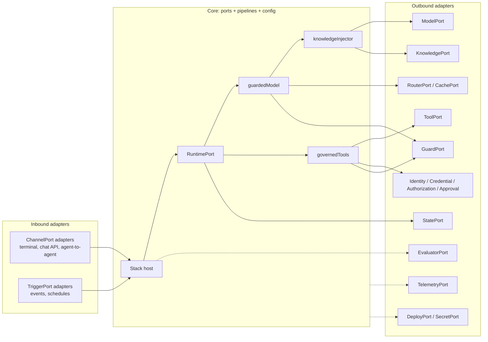
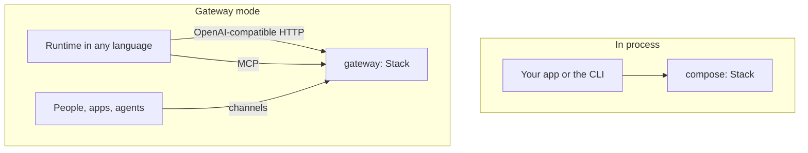

# Architecture

agent-layers composes the eleven layers of an agent stack. It does not implement any of them. The core defines
**ports**, the interfaces a developer needs to build and ship an agent; **adapters** map a standard or a
technology's native API onto a port; **pipelines** glue the ports together; a **stack config** says which adapter
fills each port, per **profile**. The agent runtime is one adapter among others, never the container.

> The core never implements a layer. It defines the ports; adapters map standards or native APIs onto them.

## The eleven layers

Each layer answers one question. Layers have stable ids (`infra`, `llm`, ...); the numbers are presentation only.

| Plane | L | Layer (id) | The question it answers | Ports |
|---|---|---|---|---|
| Foundation | L0 | Infrastructure & delivery (`infra`) | Where does it run and how does it get there? | DeployPort, SecretPort |
| Model | L1 | Models (`llm`) | Who thinks? | ModelPort |
| Model | L2 | Model access: routing, fallback, quotas, cache (`cache`) | Which model, at what cost and latency? | RouterPort, CachePort |
| Agent | L3 | Agent runtime (`harness`) | How does the agent loop run and keep state? | RuntimePort, StatePort |
| Agent | L4 | Knowledge & memory (`knowledge`) | What does it know? | KnowledgePort, MemoryPort, IngestionPort |
| Agent | L5 | Tools (`tool`) | What can it do? | ToolPort |
| Control | L6 | Identity & access (`identity`) | Who is it, on whose behalf, and what is allowed? | IdentityPort, CredentialPort, AuthorizationPort, ApprovalPort |
| Control | L7 | Guardrails (`guardrail`) | Is this content acceptable? | GuardPort |
| Experience | L8 | Interfaces, channels & triggers (`interface`) | Who talks to it and what starts it? | ChannelPort, TriggerPort |
| Insight | L9 | Telemetry & observability (`telemetry`) | What happened? | TelemetryPort |
| Insight | L10 | Evaluation & improvement (`eval`) | Was it good, and if not, which layer failed? | EvaluatorPort, FeedbackPort |

Boundary rules:

- Read-only context retrieval is `knowledge`; anything with side effects is `tool`.
- Who may do what is `identity`; whether the content is acceptable is `guardrail`.
- CachePort is listed under `cache` but any layer may use it (tool results, embeddings, retrieval).

## Hexagonal model



- **Ports** are owner-defined, thin and versioned (`PORT_VERSIONS`, semver per port, see
  [spec/VERSIONING.md](../spec/VERSIONING.md)). They are designed from what a developer calls, informed by the
  dominant standard where one exists, but they are not that standard.
- **Escape hatch.** Requests carry `extra` passthrough fields and instances may expose `native()`, so a technology's
  specific features stay reachable without widening the common interface to the lowest common denominator.
- **Outbound adapters** consume something as a port: an OpenAI-compatible endpoint as ModelPort, Markdown files as
  KnowledgePort, a rule list as AuthorizationPort.
- **Inbound adapters** expose the stack through something: a terminal, an OpenAI-compatible HTTP API, an MCP
  server, an agent-to-agent endpoint. They implement ChannelPort or TriggerPort and talk to the stack through its
  `ChannelHost` (agents, run, verify).
- An adapter package is named after what it maps (`adapter-openai-compatible`, `adapter-markdown-knowledge`) and may
  ship both directions as separate descriptors.

## Composition pipelines

The core's own logic is glue, independent of any runtime:

| Pipeline | Wraps | Order |
|---|---|---|
| `guardedModel` | ModelPort | input guards (new user content) → cache lookup → router → model → cache store → output guards |
| `knowledgeInjector` | ModelPort | search sources with the last user message → prepend a delimited block marked untrusted |
| `governedTools` | several ToolPorts | prefix names `<source>__<tool>` → local policy → approval (for `ask`) → authorization → `tool_args` guards → call with credentials bound to the caller → `tool_result` guards |

`compose()` builds `guardedModel(knowledgeInjector(model))`, so guards see the user's text before any retrieval, a
cache hit skips retrieval and the model, and output guards run on cached answers too. Blocks on input or output end
the run with status `stopped` and reason `guardrail:<guard>:<stage>`; denials and blocks on tools are error results
the model can react to. Authorization and guards fail closed. Identity flows in every `CallContext`; its token is never
written to telemetry, and attribute keys that look like secrets are masked.

Every step is a span with a mandatory `agent.layer` attribute, so each layer can be traced and evaluated on its own.

## Runtimes are adapters

RuntimePort binds an `AgentSpec` (`name`, `instructions`, `model`, tool globs, knowledge sources, `params`) to a
runnable agent that uses the stack's composed model and tools. A runtime adapter can be:

- **in process**: a JavaScript runtime package, or the small `basic-runtime` loop used for prototypes and tests;
- **remote over a standard**: for example an agent-to-agent client adapter that turns an agent written in any
  language into a RuntimePort.

Swapping the runtime changes one line of config. The agent file, tools, knowledge and policies stay.

## In-process and gateway modes



- **In process.** `compose(config)` returns a `Stack` inside your process. Fastest; TypeScript only.
- **Gateway.** `@agent-layers/gateway` (planned) hosts a composed stack on the network: ModelPort as an
  OpenAI-compatible API, ToolPort as an MCP server, plus the configured inbound channels. Any runtime in any language
  then gets the guarded, cached, governed and traced layers by pointing at two URLs, and enforcement sits outside the
  agent process.

## Profiles: same stack from prototype to production

A config defines `profiles` that `extend` each other and list only the slots that differ. Adapters declare `tiers`
(`prototype`, `production`); a profile declares its `tier`. The readiness gate (`agent-layers check --profile`)
fails when a production-tier profile uses a prototype-only adapter or lacks a required slot (default: identity,
authorization, guardrails, telemetry, state). Agent specs and code never change between profiles.

## Data flow of one run

```mermaid
sequenceDiagram
  participant C as Channel (interface)
  participant H as Stack host
  participant R as RuntimePort (harness)
  participant G as GuardPort (guardrail)
  participant X as Cache / Router (cache)
  participant K as KnowledgePort (knowledge)
  participant M as ModelPort (llm)
  participant A as Authorization (identity)
  participant T as ToolPort (tool)
  C->>H: message + credential
  H->>H: IdentityPort.verify
  H->>R: run(input, ctx{identity})
  R->>G: input guards
  R->>X: cache lookup, router
  R->>K: search (identity-scoped)
  R->>M: chat
  M-->>R: tool call
  R->>A: policy, approval, authorization
  R->>G: tool_args guards
  R->>T: callTool (bound credentials)
  R->>G: tool_result guards
  R->>M: chat
  R->>G: output guards
  R-->>C: answer
  Note over H,T: every step: a span with agent.layer (telemetry); runs feed evaluators (eval)
```

## Extension rules

1. A new technology is an adapter plus its conformance test, never a core change.
2. A core change starts with a spec change: the port page in `spec/ports/`, its schema, and a version bump.
3. Adapters depend only on `@agent-layers/core` (peer) and test with `@agent-layers/conformance` (dev).
4. Technology and standard names appear only in adapter packages and reference setups, never in the core.

## Naming

| Thing | Convention | Example |
|---|---|---|
| Layer id | stable lowercase word | `knowledge` |
| Port | `<Name>Port` | `KnowledgePort` |
| Adapter package | `@agent-layers/adapter-<standard or technology>` | `@agent-layers/adapter-markdown-knowledge` |
| Adapter name in config | the package suffix | `"adapter": "markdown-knowledge"` |
| Slot | config key under `layers` | `knowledge`, `guardrails`, `telemetry` |
| Tool name seen by the model | `<source>__<tool>` | `util__convert_temperature` |
| Reference setup | `reference/<layer id>/` | `reference/knowledge/` |
