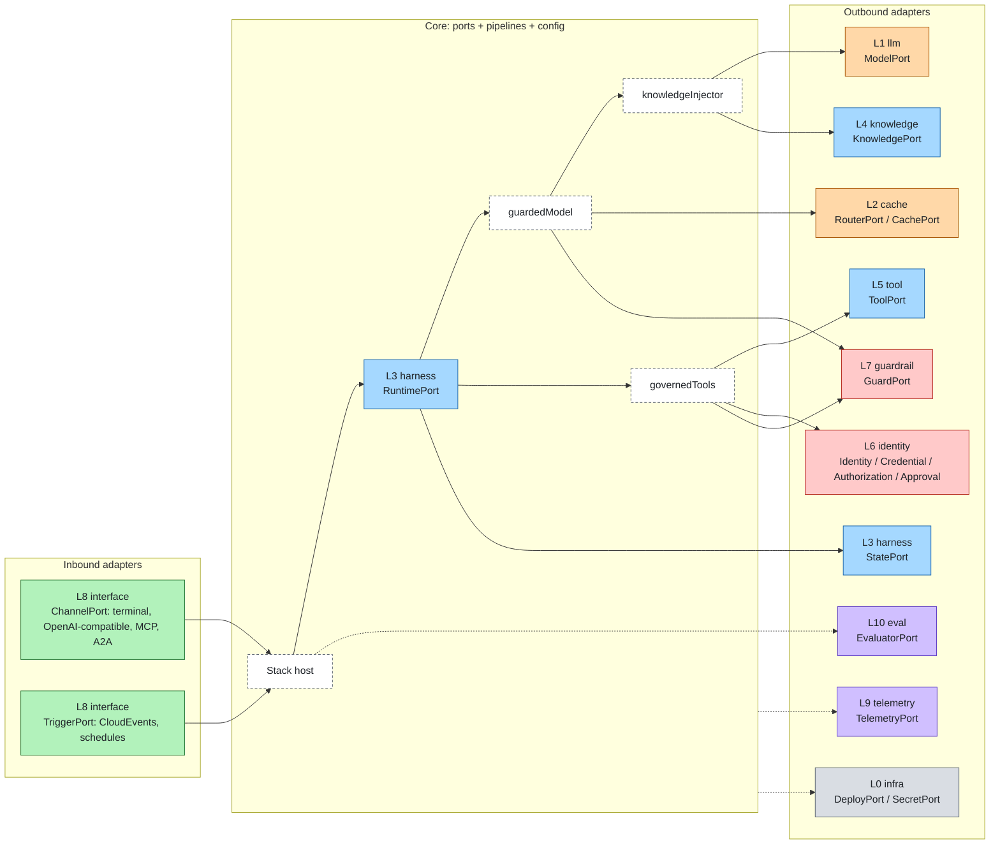
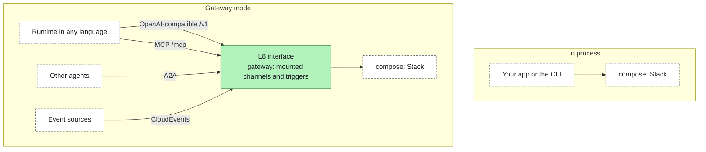
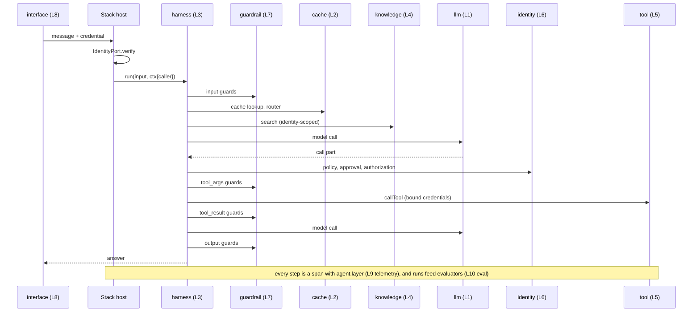

# Architecture

agent-layers composes the eleven layers of an agent stack. It does not implement any of them. The core defines
**ports**, the interfaces a developer needs to build and ship an agent; **adapters** map a standard or a
technology's native API onto a port; **pipelines** glue the ports together; a **stack config** says which adapter
fills each port, per **profile**. The agent runtime is one adapter among others, never the container.

> The core never implements a layer. It defines the ports; adapters map standards or native APIs onto them.

## The eleven layers

Each layer answers one question. Layers have stable ids (`infra`, `llm`, ...); the numbers are presentation only.

| Plane | L | Layer (id) | The question it answers | Ports |
|---|---|---|---|---|
| Foundation | L0 | Infrastructure & delivery (`infra`) | Where does it run and how does it get there? | DeployPort, SecretPort |
| Model | L1 | Models (`llm`) | Who thinks? | ModelPort |
| Model | L2 | Model access: routing, fallback, quotas, cache (`cache`) | Which model, at what cost and latency? | RouterPort, CachePort |
| Agent | L3 | Agent runtime (`harness`) | How does the agent loop run and keep state? | RuntimePort, StatePort |
| Agent | L4 | Knowledge & memory (`knowledge`) | What does it know? | KnowledgePort, MemoryPort, IngestionPort |
| Agent | L5 | Tools (`tool`) | What can it do? | ToolPort |
| Control | L6 | Identity & access (`identity`) | Who is it, on whose behalf, and what is allowed? | IdentityPort, CredentialPort, AuthorizationPort, ApprovalPort |
| Control | L7 | Guardrails (`guardrail`) | Is this content acceptable? | GuardPort |
| Experience | L8 | Interfaces, channels & triggers (`interface`) | Who talks to it and what starts it? | ChannelPort, TriggerPort |
| Insight | L9 | Telemetry & observability (`telemetry`) | What happened? | TelemetryPort |
| Insight | L10 | Evaluation & improvement (`eval`) | Was it good, and if not, which layer failed? | EvaluatorPort, FeedbackPort |

Boundary rules:

- Read-only context retrieval is `knowledge`; anything with side effects is `tool`.
- Who may do what is `identity`; whether the content is acceptable is `guardrail`.
- CachePort is listed under `cache` but any layer may use it (tool results, embeddings, retrieval).

## Hexagonal model

- **Ports** are owner-defined, thin and versioned (`PORT_VERSIONS`, semver per port, see
  [spec/VERSIONING.md](../spec/VERSIONING.md)). They are designed from what a developer calls, informed by the
  dominant standard where one exists, but they are not that standard.
- **One language.** The data that crosses a port is written in one language owned by this project (shapes such as
  `ModelRequest`, `ToolResult`, `Caller`, `AccessQuestion`), fixed and minimal at the core and versioned as a whole at
  1.0. Standards appear only inside adapters, which translate at the edges. See [spec/language.md](../spec/language.md)
  and [ADR 0001](decisions/0001-sdk-language.md).
- **Escape hatches.** Data that a shape does not cover goes in `ext`, namespaced keys that adapters declare as
  `produces` / `reads` and the core copies without reading. Operations that a port does not cover stay reachable
  through `native()`. Both keep a technology's specific features available without widening the common interface to
  the lowest common denominator.
- **Outbound adapters** consume something as a port: an OpenAI-compatible endpoint as ModelPort, Markdown files as
  KnowledgePort, a rule list as AuthorizationPort.
- **Inbound adapters** expose the stack through something: a terminal, an OpenAI-compatible HTTP API, an MCP
  server, an A2A endpoint, a CloudEvents receiver. They implement ChannelPort or TriggerPort: `serve` when they run
  by themselves (a terminal), `mount` when a host server (the gateway) serves their routes on the web-standard
  `Request`/`Response` types. They reach the stack through its `ChannelHost` (agents, run, stream, verify, and the
  governed model and tools) or, for triggers, a `TriggerSink`.
- An adapter package is named after what it maps (`adapter-openai-compatible`, `adapter-markdown-knowledge`) and may
  ship both directions as separate descriptors.

## Composition pipelines

The core's own logic is glue, independent of any runtime:

| Pipeline | Wraps | Order |
|---|---|---|
| `guardedModel` | ModelPort | input guards (new user content) → cache lookup → router → model → cache store → output guards |
| `knowledgeInjector` | ModelPort | search sources with the last user message → prepend a delimited block marked untrusted |
| `governedTools` | several ToolPorts | prefix names `<source>__<tool>` → local policy → approval (for `ask`) → authorization → `tool_args` guards → call with credentials bound to the caller → `tool_result` guards |

`compose()` builds `guardedModel(knowledgeInjector(model))`, so guards see the user's text before any retrieval, a
cache hit skips retrieval and the model, and output guards run on cached answers too. Blocks on input or output end
the run with status `stopped` and a structured reason (`{code: "guard_block", layer, by, stage}`); denials and blocks on tools are error results
the model can react to. Authorization and guards fail closed. The caller flows in every `CallContext`; its credential is never
written to telemetry, and attribute keys that look like secrets are masked.

Every step is a span with a mandatory `agent.layer` attribute, so each layer can be traced and evaluated on its own.
The core names its spans, events and metrics `agent.*` only; the `otlp` adapter writes the `gen_ai.*` names for dashboards.

## Runtimes are adapters

RuntimePort binds an `AgentSpec` (`name`, `instructions`, `model`, tool globs, knowledge sources, `settings`) to a
runnable agent that uses the stack's composed model and tools. A runtime adapter can be:

- **in process**: a JavaScript runtime package, or the small `basic-runtime` loop used for prototypes and tests;
- **remote over a standard**: the `a2a` runtime adapter turns an agent written in any language, served over A2A,
  into a RuntimePort.

Swapping the runtime changes one line of config. The agent file, tools, knowledge and policies stay.

## In-process and gateway modes

- **In process.** `compose(config)` returns a `Stack` inside your process. Fastest; TypeScript only.
- **Gateway.** `@agent-layers/gateway` hosts a composed stack on the network. Inbound adapters that implement
  `mount` share one server: the governed ModelPort as an OpenAI-compatible API, the governed ToolPort and knowledge
  sources as an MCP server, the agents over A2A, and CloudEvents as a trigger. The gateway checks `Origin` and `Host`,
  authenticates every request through the IdentityPort and logs it on the `interface` layer, so identity,
  authorization, guardrails and telemetry run outside the agent process, for runtimes in any language. See
  [gateway.md](gateway.md).

## Profiles: same stack from prototype to production

A config defines `profiles` that `extend` each other and list only the slots that differ. Adapters declare `tiers`
(`prototype`, `production`); a profile declares its `tier`. The readiness gate (`agent-layers check --profile`)
fails when a production-tier profile uses a prototype-only adapter or lacks a required slot (default: identity,
authorization, guardrails, telemetry, state) or sets an unsafe limit to `"unbounded"` ([limits.md](limits.md)). Agent
specs and code never change between profiles.

## Data flow of one run

## Extension rules

1. A new technology is an adapter plus its conformance test, never a core change.
2. A core change starts with a spec change: the port page in `spec/ports/`, its schema, and a version bump.
3. Adapters depend only on `@agent-layers/core` (peer) and test with `@agent-layers/conformance` (dev).
4. Technology and standard names appear only in adapter packages and reference setups, never in the core. The core
   speaks one language; each adapter translates its standard to it and back.
5. Extra data goes in `ext`, never in a new field: keys are `<adapter>.<name>`, declared in the descriptor
   (`ext: { produces, reads, safe? }`) and checked by conformance (`checkExt`). The core never reads an adapter key.
6. What a deployment may tune is configuration at the edges: `vocabularies` (extra values that behave like a core
   value) and `mappings` (rules that turn a standard's document into a shape and back). Shapes and field names are not
   configurable. See [stack.md](stack.md).

## Naming

| Thing | Convention | Example |
|---|---|---|
| Layer id | stable lowercase word | `knowledge` |
| Port | `<Name>Port` | `KnowledgePort` |
| Adapter package | `@agent-layers/adapter-<standard or technology>` | `@agent-layers/adapter-markdown-knowledge` |
| Adapter name in config | the package suffix | `"adapter": "markdown-knowledge"` |
| Slot | config key under `layers` | `knowledge`, `guardrails`, `telemetry` |
| Tool name seen by the model | `<source>__<tool>` | `util__convert_temperature` |
| Reference setup | `reference/<layer id>/` | `reference/knowledge/` |
