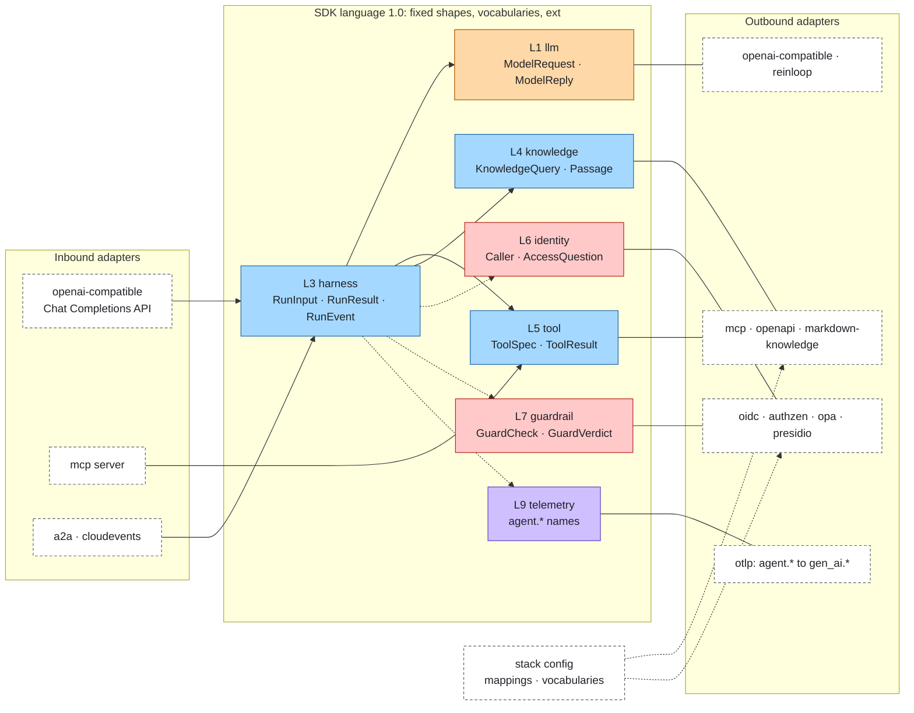

# 0001. The SDK speaks its own language

Status: Accepted · Date: 2026-10-31 · Decided by: project owner · Supersedes: none

The data that crosses a port is written in one language owned by this project. It is fixed and minimal at the core,
versioned, and extensible through declared extensions. Vocabularies and boundary mappings are configurable. Standards
and technologies (OpenAI Chat Completions, MCP, A2A, AuthZEN, OPA, OIDC, OpenTelemetry, CloudEvents, Presidio, ...)
appear only inside adapters, which translate at the edges.

## Context

[architecture.md](../architecture.md#extension-rules) already says that technology and standard names never appear in
the core, and that ports are "informed by the dominant standard ... but they are not that standard". The code drifted
from that rule: several shapes are a standard's wire format under another name. The table lists every place found.
Line numbers refer to commit `f02598b`.

| # | Where | What is borrowed | From |
|---|---|---|---|
| 1 | `packages/core/src/ports/model.ts:12-16` (`ChatMessage`) | roles `developer`, `tool`; fields `tool_calls`, `tool_call_id`; `content: string \| parts \| null` | OpenAI Chat Completions |
| 2 | `ports/model.ts:6-10` (`ToolCall`) | `type: "function"`, `function.name`, `function.arguments` as a JSON string | OpenAI |
| 3 | `ports/model.ts:18-21` (`ChatTool`), `tools.ts:18` (`toChatTools`) | `{type: "function", function: {parameters}}` built inside the core | OpenAI |
| 4 | `ports/model.ts:23` (`Usage`) | `prompt_tokens`, `completion_tokens`, `total_tokens` | OpenAI |
| 5 | `ports/model.ts:25-35` (`ChatRequest`) | `tool_choice`, `max_tokens`, `extra`; the comment says names "follow the most common wire format" | OpenAI |
| 6 | `ports/model.ts:38-67` | `FinishReason` values `stop`, `length`, `tool_calls`, `content_filter`; `choices[]` with `index`; `ChatChunk.delta`, `ToolCallDelta` | OpenAI |
| 7 | `adapters/openai-compatible/src/wire.ts:14` | `messages: req.messages` sent as is: the core shape *is* the wire | OpenAI |
| 8 | `ports/tool.ts:11`, `ports/tool.ts:22-26` | `ToolSpec.inputSchema`; `ToolOutcome.content`, `isError` | MCP |
| 9 | `ports/identity.ts:27-32` (`AccessRequest`) | `subject` / `action` / `resource` / `context`, each with `properties` | OpenID AuthZEN |
| 10 | `ports/identity.ts:36-39` (`AccessDecision`) | `decision: boolean`, `context.reason` | AuthZEN |
| 11 | `adapters/opa/src/pdp.ts` = `adapters/authzen/src/pdp.ts` (identical files) | OPA's free-form `input` is AuthZEN-shaped: one standard leaks into another technology | AuthZEN |
| 12 | `ports/identity.ts:5,9` (`Identity.subject`, `claims`) | JWT `sub` and the full claim set, passed to guards through `publicIdentity` (`ports/guard.ts:14`) | JWT / OIDC |
| 13 | `adapters/oidc/src/identity.ts:91` (`rolesOf`) | Keycloak claim layout (`realm_access`, `resource_access`) hard-coded as the meaning of roles | Keycloak |
| 14 | `telemetry.ts:8` (`SAFE_PREFIX = 'gen_ai.'`), `compose.ts:201`, `pipeline/guarded-model.ts:108-124`, `pipeline/governed-tools.ts:61,141`, `pipeline/guards.ts:34`, `packages/gateway/src/index.ts:114` | `gen_ai.*` attributes, metric `gen_ai.client.token.usage`, span names `chat`, `execute_tool`, `invoke_agent`; mixed with unprefixed `run.id`, `guard.name`, `cache.hit` | OpenTelemetry GenAI semantic conventions |
| 15 | `adapters/layer-signals/src/signals.ts`, `packages/cli/src/trace.ts:4` | evaluation and the CLI parse `gen_ai.tool.name` back out of telemetry | OpenTelemetry |
| 16 | `ports/telemetry.ts:17-21` (`TraceContext`) | field names `traceparent`, `tracestate` | W3C Trace Context |
| 17 | `ports/runtime.ts:58-66` (`Trigger`) | `id`, `type`, `source`, `time`, `data` | CloudEvents |
| 18 | `adapters/cloudevents/src/index.ts:186` | the event `id` is replaced by a random one; `subject` is dropped | CloudEvents |
| 19 | `ports/runtime.ts:17` (`AgentSpec.params`), `adapters/basic-runtime/src/loop.ts:16`, `adapters/reinloop/src/index.ts:48` | agent files carry `temperature`, `max_tokens`, `stop` | OpenAI |
| 20 | `ports/runtime.ts:33`, `errors.ts:40` | `RunResult.reason` is the string `guardrail:<guard>:<stage>`, parsed by `a2a/src/server.ts:48` (`stateOfRun`) and `layer-signals` (`GUARDRAIL_REASON`) | implicit, unversioned |
| 21 | `ports/runtime.ts:24` (`RunEvent`) | event types `run_start`, `model_response` (with `finish_reason`), `tool_call`, `tool_result` exist only in adapters (`basic-runtime`, `reinloop`) and are consumed by `layer-signals` | implicit, OpenAI-flavoured |
| 22 | `adapters/a2a/src/client.ts:53` (`runStatus`), `a2a/src/wire.ts:16` | A2A task states squeezed into free-text reasons; A2A metadata carries usage in OpenAI shape | A2A, OpenAI |
| 23 | `adapters/presidio/src/index.ts:60` | `GuardVerdict.reason` = `PII detected: <Presidio entity types>`, read by telemetry and eval | Presidio |
| 24 | `ports/knowledge.ts:5-11`, `pipeline/knowledge.ts:50` | `Passage.metadata` is a free bag; passages from all sources are sorted by raw `score` (BM25 and cosine mixed) | none (missing rule) |
| 25 | `ChatRequest.extra`, `ChatResponse.extra`, `ToolSpec.meta` (`mcp/src/tools.ts:76` writes un-namespaced `meta.mcp`), `Passage.metadata`, `Identity.claims`, `AgentSpec.params` | six escape hatches with six conventions | none |

Two effects follow. First, every adapter that is not OpenAI pays a translation through OpenAI: `reinloop`
(`adapters/reinloop/src/convert.ts`) converts the core shape into its own neutral parts and back, and an MCP tool's
JSON arguments travel as a JSON string. Second, the parts of the language that matter most to composition (run
reasons, run events, telemetry names) are not written down anywhere, so adapters written independently agree only by
reading each other's code.

## Decision

1. **One language, owned here.** The SDK defines its own shapes with its own names. A shape is fixed and minimal: a
   field enters the core only when the core reads it or when two or more adapters of different standards need it
   ("rule of two"). Everything else goes in `ext`.
2. **Versioned as a whole.** The language is version 1.0. All ports move to `1.0.0` together; after that each port
   keeps its own semver as [spec/VERSIONING.md](../../spec/VERSIONING.md) describes.
3. **Configurable at the edges, never in the middle.** Vocabularies (sets of allowed values) can grow through config;
   mappings between a standard and the language are config. The inner shapes and their field names are not
   configurable.
4. **Standards only in adapters.** Each adapter translates its standard to the language and back. N standards need
   N translations to one language, not N×M translations between standards.

Why not a configurable inner language: composition needs one fixed contract. If the inner language could be renamed
per stack, an authorization adapter written by one team and a tool adapter written by another would no longer agree on
where `risk` lives, conformance suites could not be shared, and every published adapter would need a mapping for every
stack it joins.

### Naming rules

| Rule | Example |
|---|---|
| Short plain-English names, camelCase fields | `inputTokens`, `callId` |
| `type` only discriminates a union; `kind` classifies | `{type: "text"}`, `caller.kind` |
| Times are ISO 8601 strings named `at` or `<x>At` | `trigger.at`, `approval.expiresAt` |
| Identifiers are `id` or `<x>Id` | `runId`, `callId` |
| Telemetry names start with `agent.` | `agent.tool.call` |
| No name that belongs to one standard unless it is ordinary English | `source`, `data` stay; `tool_calls`, `inputSchema`, `traceparent` go |
| JSON Schema is the one schema notation, on purpose: every tool standard already uses it | `ToolSpec.params` |

### Shapes

Types: `S` string, `N` number, `B` boolean, `[T]` list, `{K: V}` map, `Ext` the extension bag (next section).
"Req" marks required fields. Every shape below has an optional `ext?: Ext` unless noted.

#### Model exchange (ModelPort, RouterPort, CachePort)

| Shape | Field | Type | Req | Notes |
|---|---|---|---|---|
| `ModelRequest` | `model` | S | yes | A router may replace it. |
| | `messages` | [`Message`] | yes | At least one. |
| | `tools` | [`ToolInfo`] | | Tools the model may call. |
| | `toolMode` | `"auto"` \| `"none"` \| `"required"` \| `{tool: S}` | | Default `auto`. |
| | `settings` | `ModelSettings` | | |
| `ModelSettings` | `temperature`, `maxOutputTokens`, `stop` | N, N, [S] | | Same shape in `AgentSpec.settings`. |
| `Message` | `role` | `"system"` \| `"user"` \| `"assistant"` \| `"tool"` | yes | Closed vocabulary. |
| | `parts` | [`Part`] | yes | Always a list, never a bare string or null. |
| `Part` | `{type: "text", text: S}` | | | The only part the core reads. |
| | `{type: "media", mediaType: S, url?: S, data?: S}` | | | `data` is base64. Passed through. |
| | `{type: "call", id: S, tool: S, args: {S: Any}, invalid?: S}` | | | `args` is an object; `invalid` holds the raw text when the model's arguments did not parse. |
| | `{type: "result", callId: S, ok: B, text: S, data?: Any}` | | | A `ToolResult` answering one call. |
| | `{type: "reasoning", text: S}` | | | The model's reasoning, when the backend returns it. Kept in history, never shown as output. |
| | `{type: "<ns>.<name>", ...}` | | | Adapter-defined part, passed through untouched, never read by the core. |
| `ToolInfo` | `name`, `description`, `params` | S, S, JSON Schema | name, params | What the model sees of a `ToolSpec`. |
| `ModelReply` | `model` | S | yes | Model that answered. |
| | `message` | `Message` | yes | Role `assistant`. One answer: no `choices`. |
| | `finish` | `Finish` | yes | |
| | `usage` | `Usage` | | |
| | `id` | S | | Backend response id. |
| `Usage` | `inputTokens`, `outputTokens` | N, N | yes | Cached or reasoning tokens go in `ext`. |
| `ModelDelta` | `{type: "text", text}` | | | Streamed text. |
| | `{type: "reasoning", text}` | | | Streamed reasoning. |
| | `{type: "call", index: N, id?, tool?, argsText?}` | | | Fragments of call `index`; `argsText` concatenates to JSON. |
| | `{type: "end", finish, usage?, model?, id?}` | | | Exactly one, last. |

Invariants: `system` messages hold only text parts; `tool` messages only `result` parts; `user` messages text and
media; `assistant` messages text, `reasoning` and `call` parts; `finish` is `tools` exactly when the reply has at least
one `call` part. A core helper `assembleDeltas`
replaces `assembleChunks`.

#### Tools (ToolPort)

| Shape | Field | Type | Req | Notes |
|---|---|---|---|---|
| `ToolSpec` | `name` | S | yes | Prefixed `<source>__<tool>` by the core. |
| | `description` | S | yes | |
| | `params` | JSON Schema (object) | yes | Was `inputSchema`. |
| | `risk` | `Risk` | | Missing means `exec`. |
| | `layer` | `Layer` | | `knowledge` for knowledge-as-tool. |
| | `audience` | S | | Credential audience of the protected service. |
| | `attrs` | {S: S \| N \| B \| [S]} | | Plain attributes a policy may read (owner, tags). Copied to `AccessQuestion.target.attrs`. |
| `ToolResult` | `ok` | B | yes | Was `!isError`. Errors are results, not exceptions. |
| | `text` | S | yes | What the model reads. Was `content`. |
| | `data` | Any | | Structured result. |

#### Knowledge (KnowledgePort, MemoryPort, IngestionPort)

| Shape | Field | Type | Req | Notes |
|---|---|---|---|---|
| `KnowledgeQuery` | `text` | S | yes | Was `query`. |
| | `k` | N | | Passages wanted. |
| | `filter` | {S: S \| N \| B \| [S]} | | Equality on `attrs`; a list means any of. |
| | `caller` | `Caller` | | For per-user filtering. |
| | `signal` | Signal | | |
| `Passage` | `id`, `text` | S, S | yes | |
| | `source` | S | yes | Instance name; the core fills it when the adapter does not. |
| | `title`, `url` | S, S | | |
| | `score` | N | | Higher is better. Comparable only within one source (see [multi-source knowledge](#multi-source-knowledge)). |
| | `attrs` | {S: S \| N \| B \| [S]} | | Filterable attributes. Replaces `metadata`. |
| `Document` | `id`, `text` | S, S | yes | Was `KnowledgeDocument`. Also `source?`, `title?`, `url?`, `attrs?`. |
| `MemoryScope` | `caller`, `agent`, `session` | S, S, S | | `caller` was `subject`: the caller id. |
| `MemoryItem` | `id?`, `text`, `attrs?` | | text | |

#### Identity and caller (IdentityPort, CredentialPort, `CallContext`)

| Shape | Field | Type | Req | Notes |
|---|---|---|---|---|
| `Caller` | `id` | S | yes | Was `subject`. |
| | `kind` | `"user"` \| `"agent"` | yes | |
| | `roles`, `scopes` | [S], [S] | yes | Empty list, never absent. |
| | `name` | S | | Display name. |
| | `credential` | S | | The inbound credential. Never serialised, logged or traced. Was `token`. |
| `PublicCaller` | `Caller` without `credential` | | | What guards, events and access questions see. Replaces `publicIdentity`. |
| `CallContext` | `runId`, `agent` | S, S | yes | |
| | `caller` | `Caller` | | Was `identity`. Absent means anonymous. |
| | `sessionId`, `signal`, `telemetry`, `credentials` | | | Unchanged. |
| | `trace` | `{parent: S, state?: S}` | | Was `{traceparent, tracestate}`. Opaque to the core: the telemetry adapter that wrote the value owns its format (W3C Trace Context for `otlp`); channels copy it in and out unchanged. |

Raw JWT claims leave `Caller`: an identity adapter keeps them only if configured, under `ext["oidc.claims"]`.

#### Access question and decision (AuthorizationPort, ApprovalPort)

| Shape | Field | Type | Req | Notes |
|---|---|---|---|---|
| `AccessQuestion` | `caller` | `PublicCaller` \| `{kind: "anonymous", id: "anonymous", roles: [], scopes: []}` | yes | Anonymous is explicit, never the agent. |
| | `action` | `Action` | yes | `call` for a tool. |
| | `target` | `{kind: S, id: S, layer: Layer, risk: Risk, agent: S, attrs?: {...}}` | yes | `kind` is `tool` today. |
| | `args` | {S: Any} | | Only when the adapter is configured to send arguments. |
| `AccessDecision` | `allowed` | B | yes | Was `decision`. Fail closed: errors are a deny. |
| | `reason` | S | | Kept inside the stack, never shown to the caller. |
| `ApprovalRequest` | `question`, `agent`, `runId`, `reason?`, `expiresAt?` | | first three | `question` was `access`. |
| `Approval` | `id`, `status`, `request`, `decidedBy?`, `reason?` | | first three | `status` from the approval vocabulary. |

#### Guards (GuardPort)

| Shape | Field | Type | Req | Notes |
|---|---|---|---|---|
| `GuardCheck` | `stage`, `text`, `agent`, `runId` | `Stage`, S, S, S | yes | Was `GuardInput`. |
| | `tool`, `caller` | S, `PublicCaller` | | |
| `GuardVerdict` | `action` | `"allow"` \| `"block"` \| `"redact"` | yes | |
| | `text` | S | | Required for `redact`. |
| | `labels` | [`GuardLabel`] | | What was found, from the guard label vocabulary. Native names (Presidio entity types) go in `ext`. |
| | `reason` | S | | Human text, internal only; never parsed. |

#### Runs (RuntimePort, StatePort, ChannelPort)

| Shape | Field | Type | Req | Notes |
|---|---|---|---|---|
| `AgentSpec` | `name`, `instructions`, `model`, `tools` | S, S, S, [S] | yes | |
| | `knowledge` | [S] | | |
| | `settings` | `ModelSettings` | | Replaces the model keys of `params`; other keys move to `ext`. |
| `RunInput` | `S` \| `{messages: [Message]}` | | | |
| `RunResult` | `runId`, `status`, `output` | S, `RunStatus`, S | yes | |
| | `reason` | `{code: StopCode, layer?: Layer, by?: S, stage?: Stage, detail?: S}` | | Replaces the `guardrail:<guard>:<stage>` string. Required when `status` is not `completed`. `detail` is internal text, never parsed. |
| | `usage`, `costUsd`, `events` | `Usage`, N, [`RunEvent`] | | |
| `RunEvent` | `type` | `EventType` | yes | Core types below; adapter types are `<ns>.<name>`. |
| | `at` | S | | |

Core event types and their fixed payloads: `run.start {runId, agent}`, `model.reply {turn, model, finish, calls}`,
`tool.call {id, tool}`, `tool.result {id, tool, ok, durationMs?}`, `text {text}`, `run.end {status, reason?, usage?,
costUsd?}`. Adapter events (`reinloop.compaction`, `reinloop.args_invalid`) are stored and replayed but never read by
the core.

A run that stops for a human answer ends with status `waiting` instead of `stopped`: reason `needs_input` or
`needs_auth`; for a pending approval `{code: "needs_input", layer: "identity", by: <approval instance>, detail:
<approval id>}`. The governed tool result that asked for the approval carries `ext["sdk.approval"]` (the approval id),
so a runtime can end the run without parsing text. A later run with the same session resumes the conversation.

#### Triggers and channels (TriggerPort, ChannelPort)

| Shape | Field | Type | Req | Notes |
|---|---|---|---|---|
| `Trigger` | `id`, `kind`, `source` | S, S, S | yes | `id` is the SDK's; the upstream event id goes in `ext`. `kind` was `type`. |
| | `at`, `agent`, `data` | S, S, Any | | `at` was `time`. |
| `InboundContext` | `caller?`, `requestId`, `signal`, `origin`, `trace?` | | | `caller` was `identity`. This is the channel envelope; the payload is a `RunInput`. |

#### Evaluation (EvaluatorPort, FeedbackPort)

| Shape | Field | Type | Req | Notes |
|---|---|---|---|---|
| `EvalCase` | `id`, `input` | S, `RunInput` | yes | Also `expected?`, `tags?`, `layer?`. |
| `EvalScore` | `metric`, `value` | S, N in [0, 1] | yes | Also `layer?`, `reason?`. |
| `EvalResult` | `id`, `runId`, `output`, `status`, `scores` | | yes | Also `usage?`, `costUsd?`. |
| `Feedback` | `runId` | S | yes | Also `id?`, `agent?`, `rating?` in [-1, 1], `label?`, `comment?`, `by?` (was `subject`), `at?` (was `time`). |

#### Telemetry naming (TelemetryPort)

The port operations do not change. What changes is the names the core emits: only `agent.*`. Standard names
(`gen_ai.*`, `error.type`, `service.name`) are produced by the telemetry adapter that speaks the standard. Adapter
spans and attributes use the adapter's namespace (`a2a.task.state`, `judge-eval.score`).

| Kind | Now | Language 1.0 |
|---|---|---|
| span | `invoke_agent` | `agent.run` |
| span | `chat` | `agent.model.call` |
| span | `cache.lookup`, `router.select` | `agent.cache.lookup`, `agent.router.select` |
| span | `execute_tool` | `agent.tool.call` |
| span | `authorize`, `guard.check`, `knowledge.search` | `agent.access.check`, `agent.guard.check`, `agent.knowledge.search` |
| event | `knowledge.error` | `agent.knowledge.error` |
| metric | `gen_ai.client.token.usage` + `gen_ai.token.type` | `agent.model.tokens` + `agent.tokens.kind` (`input` \| `output`) |
| metric | `agent.tool.calls`, `agent.policy.decisions`, `agent.guardrail.actions` | `agent.tool.calls`, `agent.access.decisions`, `agent.guard.actions` |
| attribute | `agent.layer` | `agent.layer` (unchanged, still mandatory) |
| attribute | `run.id`, `gen_ai.agent.name`, `run.status`, `run.reason` | `agent.run.id`, `agent.name`, `agent.run.status`, `agent.run.reason` (the `StopCode`) |
| attribute | `gen_ai.request.model`, `gen_ai.response.model` | `agent.model.requested`, `agent.model.used` |
| attribute | `gen_ai.usage.input_tokens`, `gen_ai.usage.output_tokens`, `gen_ai.response.finish_reasons` | `agent.tokens.input`, `agent.tokens.output`, `agent.model.finish` |
| attribute | `gen_ai.tool.name`, `tool.source`, `tool.outcome` | `agent.tool.name`, `agent.tool.source`, `agent.tool.outcome` |
| attribute | `guard.name`, `guard.stage`, `guard.action` | `agent.guard.name`, `agent.guard.stage`, `agent.guard.action` |
| attribute | `policy.decision`, `policy.reason` | `agent.access.decision`, `agent.access.reason` |
| attribute | `cache.hit`, `router.model`, `knowledge.source`, `knowledge.k`, `knowledge.passages` | same names under `agent.` |
| attribute | `trigger.type`, `error.message` | `agent.trigger.kind`, `agent.error` |

`sanitizeAttributes` trusts `agent.tokens.*` instead of `gen_ai.*` as the safe prefix.

## The language at the centre



Solid arrows are calls in the language. Plain lines join a shape to the adapters that translate it. Dotted arrows are
governance, observation and configuration.

## Vocabularies

A vocabulary is a closed set of values defined by the SDK. The core branches only on core values. Config may add
values or aliases where the table allows it.

| Vocabulary | Core values | Extensible | Used by |
|---|---|---|---|
| layer | the eleven ids in `LAYERS` | no | everything |
| message role | `system`, `user`, `assistant`, `tool` | aliases only | `Message` |
| part type | `text`, `media`, `call`, `result`, `reasoning` | namespaced types pass through | `Part` |
| finish | `end`, `limit`, `tools`, `refused`, `other` | values with `like` | `ModelReply` |
| risk | `read`, `write`, `exec` | values with `like` | `ToolSpec`, policy |
| policy effect | `allow`, `ask`, `deny` | no | policy rules |
| action | `call` | values with `like` | `AccessQuestion` |
| guard stage | `input`, `output`, `tool_args`, `tool_result` | no | `GuardCheck` |
| guard action | `allow`, `block`, `redact` | no | `GuardVerdict` |
| guard label | `pii`, `secret`, `injection`, `toxicity`, `policy`, `other` | values with `like` | `GuardVerdict.labels` |
| run status | `completed`, `failed`, `stopped`, `waiting` | no | `RunResult` |
| stop code | `guard_block`, `denied`, `aborted`, `timeout`, `limit`, `needs_input`, `needs_auth`, `rejected`, `error` | values with `like` | `RunResult.reason` |
| event type | `run.start`, `model.reply`, `tool.call`, `tool.result`, `text`, `run.end` | namespaced types | `RunEvent` |
| caller kind | `user`, `agent` (`anonymous` only in `AccessQuestion`) | no | `Caller` |
| approval status | `pending`, `approved`, `denied`, `expired` | no | `Approval` |

Config extends a vocabulary with a `vocabularies` block (also allowed per profile):

```json
{ "vocabularies": {
  "risk": { "add": { "admin": { "like": "exec" } } },
  "guardLabel": { "add": { "pii.health": { "like": "pii" } } },
  "finish": { "aliases": { "pause": "other" } },
  "role": { "aliases": { "developer": "system" } } } }
```

Validation rules, checked when the config loads:

- An added value needs `like`, a core value of the same vocabulary. Core logic sees the `like` value; adapters and
  telemetry see the added value. A policy rule on `risk: ["exec"]` therefore also matches `admin`.
- Names match `^[a-z][a-z0-9_.-]{0,63}$` and must not collide with a core value, another added value or an alias.
- An alias maps a name to an existing value; it is resolved by adapters at the edge and never reaches the core.
- Vocabularies marked "no" reject any `add` or `aliases` entry.
- At run time, an adapter that receives a value outside the vocabulary maps it to `other` where the vocabulary has
  one, keeps the native value in `ext`, and otherwise fails the call. Identity and authorization fail closed.
- Adapters may declare additions in their descriptor (`vocabularies`), with the same rules; config wins on conflict.

## Extensions

`ext` is the one escape hatch for data. It replaces `extra`, `meta`, `metadata` (the non-filterable part), `claims`
and `params`. The operation escape hatch, `native()`, stays as it is.

| Rule | Detail |
|---|---|
| Shape | `ext?: {[key: S]: Any}`, JSON values only. |
| Keys | `<namespace>.<name>`. The namespace is the adapter name (`qdrant.collection`, `openai.response_format`, `mcp.annotations`). `sdk.` is reserved for the core. |
| Who writes | The adapter that produces the shape, only keys it declares in `produces`, plus `sdk.*` written by the core. Mappings may write keys in the adapter's own namespace. |
| Who reads | Any adapter, only keys it declares in `reads`. |
| Core | Copies `ext` unchanged wherever a shape passes through. Never reads, branches on, logs or traces an adapter key. |
| Telemetry | Not exported unless the producing adapter lists the key as safe; secret masking still applies. |
| Size | Bounded by a configurable limit (`limits.extBytes`, listed with the other limits). Oversized bags are dropped with an event. |
| Promotion | A key read by two or more adapters of different namespaces is a candidate for a core field in the next minor. |

Descriptors declare both lists: `ext: { produces: ['qdrant.collection'], reads: [] }`. Conformance: every suite gains `checkExt`, which fails when an adapter writes a key that is not namespaced, not
declared, or in another adapter's namespace. Config loading warns when a declared `reads` key is produced by no adapter
in the profile, and fails when a mapping reads an `/ext/...` key that nothing produces.

## Boundary mappings

A mapping says how a standard's document becomes a language shape (`in`) or how a language shape becomes a
standard's document (`out`), beyond the adapter's built-in translation. Mapping rules live at adapters' edges. The core
never applies them inside its own logic: `compose` hands each adapter its rules through `AdapterContext.mappings`, and
the adapter calls `mappings.in(native, shape)` or `mappings.out(shape, wire)` where it translates.

### Where they live

A top-level `mappings` block, `{ "<instance key>": { "in": [rules], "out": [rules] } }`, and the same block under
`profiles.<name>.mappings`. Keys name an adapter instance: the slot for single slots (`identity`, `authorization`), `<slot>.<instance>` for keyed
slots (`tools.crm`, `knowledge.handbook`), `<slot>.<name>` for list slots (`guardrails.pii`). A profile's list for a key
replaces the base list; `null` removes it. Each adapter publishes its built-in translation as default rules in its
descriptor (`mappingDefaults`), so the effective rules are always readable.

### Rule set

Rules run in order. For `in`, the source is the native document (read-only) and the target is the shape produced by
the adapter's defaults. For `out`, the source is the language shape and the target is the wire document.

| Field | Meaning |
|---|---|
| `from` | JSON Pointer into the source, or a list of pointers (for `join`). Omit for a constant. |
| `to` | JSON Pointer into the target. Writing a path copies; copying then `drop`ping the old path renames. |
| `default` | Value used when `from` is missing or null. |
| `map` | Value table: `{ "<source value>": <target value>, "*": <fallback> }`. Keys are the source scalar as a string. A value the table does not list, without `"*"`, is not written. |
| `join` | `"union"` concatenates lists without duplicates; a string joins strings with that separator. |
| `split` | Separator that turns a string into a list. |
| `drop` | JSON Pointer removed from the target. |
| `fn` | `"<module path>#<export>"`: `(source, target, ctx) => target`, synchronous and pure. The escape hatch for anything the rules cannot say. Loaded relative to the config file, like plugins. |

Validation at config load: pointers parse; `to` and `drop` must address a field of the shape's schema (or a declared
`/ext/<key>` in the adapter's namespace); `map` targets must be valid vocabulary values; `fn` modules must load. At
run time the mapped shape is validated against its schema in development and test profiles. A mapping error in the
`identity` or `authorization` slot rejects the credential or denies the call.

### Examples

OIDC claims to caller roles and scopes (Keycloak today is this list, as defaults instead of code):

```json
"identity": { "in": [
  { "from": ["/realm_access/roles", "/resource_access/agent-api/roles", "/groups"], "to": "/roles", "join": "union" },
  { "from": "/scope", "to": "/scopes", "split": " " },
  { "from": "/preferred_username", "to": "/name" },
  { "from": "/tenant", "to": "/ext/oidc.tenant" }
]}
```

Tool metadata to access question attributes, in two hops: the MCP tool adapter maps annotations into `ToolSpec`, the
core copies `attrs` into `AccessQuestion.target.attrs`, and the AuthZEN adapter maps them onto its wire:

```json
"tools.crm": { "in": [
  { "from": "/annotations/destructiveHint", "to": "/risk", "map": { "true": "exec", "false": "write" }, "default": "exec" },
  { "from": "/_meta/owner", "to": "/attrs/owner" }
]},
"authorization": { "out": [
  { "from": "/target/attrs/owner", "to": "/resource/properties/owner" },
  { "from": "/caller/ext/oidc.tenant", "to": "/subject/properties/tenant" }
]}
```

Knowledge source metadata to passage fields:

```json
"knowledge.handbook": { "in": [
  { "from": "/payload/title", "to": "/title" },
  { "from": "/payload/source_url", "to": "/url" },
  { "from": "/payload/lang", "to": "/attrs/lang", "default": "en" },
  { "drop": "/attrs/internal_notes" }
]}
```

Guard findings to labels work the same way: a `map` table from Presidio entity types to `pii` in the `guardrails.<name>` rules.

## Multi-source knowledge

Scores from different sources are not comparable: BM25 from `markdown-knowledge` is unbounded, a vector store returns
a similarity in [0, 1] or a distance. Today `pipeline/knowledge.ts:50` sorts them together, so one source wins by
scale, not relevance.

Decision: passages from two or more sources are merged by reciprocal rank fusion (RRF).

- Fused score of a passage: the sum over sources of `weight_s / (rrfK + rank_s)`, `rank_s` starting at 1.
- Config: `pipeline.knowledge.fusion: { method: "rrf" | "raw", rrfK: 60, weights: { "<source>": 1 } }`. `rrfK` and
  weights are limits with ranges like the other pipeline limits.
- After fusion `score` is the fused score. The core writes the source's own score to `ext["sdk.raw_score"]` and its
  rank to `ext["sdk.rank"]`.
- Duplicates (same `source` and `id`) are kept once, at their best rank. Ties break on rank, then source order in
  config, then `id`.
- `method: "raw"` is opt-in and keeps today's behaviour (sort by raw `score`), for owners who know their sources share
  one scorer. The raw score and the rank are written to `ext` the same way.
- One source: its order is kept; `score` and `ext` are written the same way, so consumers see one rule.
- Knowledge exposed as tools (one tool per source) is not fused.

## Standard to language mappings

What each existing standard adapter translates, and what it keeps in `ext` or loses.

### OpenAI Chat Completions (`openai-compatible`, outbound ModelPort and inbound ChannelPort)

| Language | Standard | Kept / lost |
|---|---|---|
| `ModelRequest.model` | `model` | |
| role `system` | `system`, `developer` | `developer` in: becomes `system`, original in `ext["openai.role"]` for the round trip |
| `text`, `media` parts | `content` string or parts (`text`, `image_url`, `input_audio`) | string content becomes one text part |
| `call` part `{id, tool, args}` | `tool_calls[] {id, type: "function", function: {name, arguments}}` | `arguments` parsed; unparseable text kept in `invalid` |
| `tool` message with `result` part | `role: "tool"`, `tool_call_id`, `content` | `ok: false` has no wire field: lost out, `true` assumed in |
| `ToolInfo {name, description, params}` | `tools[] {type: "function", function: {name, description, parameters}}` | |
| `toolMode` | `tool_choice` | |
| `settings.temperature`, `maxOutputTokens`, `stop` | `temperature`, `max_tokens` (or `max_completion_tokens`), `stop` | |
| `ext["openai.*"]` | `response_format`, `seed`, `top_p`, `logit_bias`, `parallel_tool_calls`, ... | today's passthrough list |
| `ModelReply.message` | `choices[0].message` | `n > 1` only through `ext`: `ext["openai.n"]` out, the other choices in `ext["openai.choices"]` |
| `finish` `end`, `limit`, `tools`, `refused` | `stop`, `length`, `tool_calls` (or `function_call`), `content_filter` | unknown: `other`, native in `ext` |
| `reasoning` part | `reasoning_content` or `reasoning` of the message, where the backend returns one | not sent back unless the backend accepts it |
| `Usage.inputTokens`, `outputTokens` | `prompt_tokens`, `completion_tokens` | details (cached, reasoning) in `ext["openai.usage"]` |
| `ModelDelta` | chunk `choices[0].delta`, `stream_options.include_usage` | |
| inbound run: `RunResult.status` | `finish_reason`: `completed` → `stop`, `stopped` → `content_filter`, `failed` → HTTP 500 | reason stays inside |

### Model Context Protocol (`mcp`, outbound ToolPort and KnowledgePort, inbound ChannelPort)

| Language | Standard | Kept / lost |
|---|---|---|
| `ToolSpec.name` | `tool.name` | prefixed `<source>__` by the core |
| `description`, `params` | `description`, `inputSchema` | |
| `risk` | `annotations.readOnlyHint` → `read`; `destructiveHint: false` → `write`; else `exec` | out: `readOnlyHint = risk read`, `destructiveHint = risk exec` |
| `attrs`, `ext` | `title`, `annotations`, `_meta` | `ext["mcp.annotations"]`, `ext["mcp.meta"]` (was un-namespaced `meta.mcp`) |
| call `args` | `arguments` (object) | no string round trip any more |
| `ToolResult.text` | text items of `content[]`, joined | images and resources: `ext["mcp.content"]` |
| `ToolResult.data`, `ok` | `structuredContent`, `!isError` | |
| `Passage` | tool result parsed as JSON list or `<entry>` blocks | `metadata` through the `in` mapping; raw score as `score` before fusion |
| inbound: governed tools and knowledge tools | `tools/list`, `tools/call` | caller from the bearer credential |

### Agent2Agent (`a2a`, outbound RuntimePort and inbound ChannelPort)

| Language | Standard | Kept / lost |
|---|---|---|
| `RunInput` | `message.parts` | text parts joined; data parts as JSON; files lost |
| `sessionId` | `contextId` | inbound: scoped per caller (hashed) |
| `runId` | task `id` | |
| `completed` | `completed` | |
| `stopped` + `aborted` | `canceled` | |
| `stopped` + `guard_block` | `rejected` (inbound) | guard name and stage stay inside |
| `stopped` + `rejected` | `rejected` (outbound) | |
| `waiting` + `needs_input` / `needs_auth` | `input-required` / `auth-required` | was free text |
| `failed` + `error` | `failed` | |
| `output` | artifact text or status message | |
| `usage`, `costUsd` | task `metadata["agent-layers"] = {usage, costUsd}` in language names | was OpenAI-shaped `usage` |
| agent names | agent card `skills` | |

### OpenID AuthZEN (`authzen`, AuthorizationPort)

| Language | Standard | Kept / lost |
|---|---|---|
| `caller.id`, `caller.kind` | `subject.id`, `subject.type` | `anonymous` stays explicit |
| `caller.roles`, `scopes` | `subject.properties.roles`, `scopes`, `authenticated` | |
| `action` | `action.name` | |
| `target.kind`, `target.id` | `resource.type`, `resource.id` | |
| `target.risk`, `layer`, `agent`, `attrs` | `resource.properties.*` | |
| `args` | `context.args` | only with `includeArgs` |
| `AccessDecision.allowed` | `decision` | |
| `reason` | `context.reason`, `context.reason_user` | other `context` keys in `ext["authzen.context"]` |

### Open Policy Agent (`opa`, AuthorizationPort)

OPA has no request schema of its own, so its `input` is the `AccessQuestion` as is, in language names
(`input.caller.roles`, `input.target.risk`). The copy of the AuthZEN translation (`opa/src/pdp.ts`) goes away. The
result stays `true`/`false` or `{allow, reason}` → `{allowed, reason}`. The reference Rego policies
(`reference/identity/policies`) are rewritten to these names as part of the migration (step 7).

### OIDC and JWT (`oidc`, IdentityPort and CredentialPort)

| Language | Standard | Kept / lost |
|---|---|---|
| `Caller.id` | `sub` | |
| `Caller.kind` | `agent` when `azp`/`client_id` is an allow-listed agent client and `sub` is its service account; else `user` | unchanged logic |
| `roles` | `realm_access.roles` ∪ `roles` ∪ `resource_access.<client>.roles` | now default `in` rules, replaceable |
| `scopes` | `scope` (space separated) ∪ `scp` | |
| `name` | `preferred_username` (default rule) | |
| `credential` | the bearer token | never serialised |
| `ext["oidc.claims"]` | verified claims | opt-in (`keepClaims`); today every claim reaches guards |
| `CredentialPort.token(audience, {caller, scopes})` | RFC 8693 token exchange: `subject_token` = `caller.credential`, `audience`, `scope` | |

### OpenTelemetry OTLP (`otlp`, TelemetryPort)

| Language | Standard | Kept / lost |
|---|---|---|
| span `agent.run` | `invoke_agent <agent>`, `gen_ai.operation.name`, `gen_ai.agent.name` | |
| span `agent.model.call` | `chat <model>`, kind CLIENT, `gen_ai.request.model`, `gen_ai.response.model` | |
| `agent.tokens.input`, `agent.tokens.output` | `gen_ai.usage.input_tokens`, `gen_ai.usage.output_tokens` | |
| `agent.model.finish` | `gen_ai.response.finish_reasons` | `end` → `stop`, `limit` → `length`, `tools` → `tool_calls`, `refused` → `content_filter` |
| span `agent.tool.call`, `agent.tool.name` | `execute_tool <tool>`, `gen_ai.tool.name` | |
| metric `agent.model.tokens` + `agent.tokens.kind` | `gen_ai.client.token.usage` + `gen_ai.token.type` | |
| span duration of `agent.model.call` | `gen_ai.client.operation.duration` | derived by the adapter, as today |
| other `agent.*` (`agent.layer`, `agent.guard.*`, `agent.access.*`) | exported under the same names | no semantic convention exists |
| `CallContext.trace {parent, state}` | `traceparent`, `tracestate` | the adapter parses and validates the value; an invalid one starts a new trace |

Dashboards built on `gen_ai.*` keep working through OTLP. `console-telemetry` and `jsonl-telemetry` write language
names.

### CloudEvents (`cloudevents`, TriggerPort)

| Language | Standard | Kept / lost |
|---|---|---|
| `Trigger.kind` | `type` | |
| `Trigger.source` | `source` | |
| `Trigger.at` | `time` | |
| `Trigger.data` | `data`, through the route's input template | |
| `ext["cloudevents.id"]` | `id` | was lost; needed to deduplicate redeliveries |
| `ext["cloudevents.subject"]` | `subject` | was dropped |
| `ext["cloudevents.*"]` | `datacontenttype`, `dataschema`, extension attributes | |

## Consequences

### Ports

Every port moves to `1.0.0` in one release, including the three whose shapes do not change, so the language has one
baseline. From then on a minor of any port is backward compatible.

| Port | Layer | Now | New | What changes |
|---|---|---|---|---|
| DeployPort, SecretPort | `infra` | 0.1.0 | 1.0.0 | baseline only |
| ModelPort | `llm` | 0.1.0 | 1.0.0 | `ModelRequest`, `ModelReply`, `ModelDelta`, `Message`, parts |
| CachePort | `cache` | 0.1.0 | 1.0.0 | baseline; keys are computed over `ModelRequest` |
| RouterPort | `cache` | 0.1.0 | 1.0.0 | `select(ModelRequest)` |
| RuntimePort | `harness` | 0.2.0 | 1.0.0 | `AgentSpec.settings`, `RunResult.reason`, core event types |
| StatePort | `harness` | 0.1.0 | 1.0.0 | `RunEvent` types |
| KnowledgePort | `knowledge` | 0.1.0 | 1.0.0 | `KnowledgeQuery.text`, `Passage` fields, fusion |
| MemoryPort | `knowledge` | 0.1.0 | 1.0.0 | `MemoryScope.caller`, `MemoryItem.attrs` |
| IngestionPort | `knowledge` | 0.1.0 | 1.0.0 | `Document` |
| ToolPort | `tool` | 0.1.0 | 1.0.0 | `ToolSpec.params`, `attrs`; `ToolResult`; `CallContext.caller` |
| IdentityPort | `identity` | 0.1.0 | 1.0.0 | returns `Caller` |
| CredentialPort | `identity` | 0.2.0 | 1.0.0 | `caller` option |
| AuthorizationPort | `identity` | 0.2.0 | 1.0.0 | `AccessQuestion`, `AccessDecision.allowed` |
| ApprovalPort | `identity` | 0.2.0 | 1.0.0 | `question` field |
| GuardPort | `guardrail` | 0.1.1 | 1.0.0 | `GuardCheck`, `labels` |
| ChannelPort | `interface` | 0.2.0 | 1.0.0 | `InboundContext.caller`, host returns language shapes |
| TriggerPort | `interface` | 0.2.0 | 1.0.0 | `Trigger.kind`, `at` |
| TelemetryPort | `telemetry` | 0.2.0 | 1.0.0 | `agent.*` naming rule, `trace {parent, state}` |
| EvaluatorPort | `eval` | 0.2.0 | 1.0.0 | `EvalCase.input`, core event types |
| FeedbackPort | `eval` | 0.1.0 | 1.0.0 | `by`, `at` |

### Schemas

| Now | New |
|---|---|
| `chat-request.json`, `chat-response.json` | `model-request.json`, `model-reply.json`, plus `model-delta.json`, `message.json` |
| `identity.json` | `caller.json` |
| `access-request.json`, `access-decision.json` | `access-question.json`, `access-decision.json` (fields renamed) |
| `tool-spec.json`, `tool-outcome.json` | `tool-spec.json` (`params`, `attrs`), `tool-result.json` |
| `passage.json`, `knowledge-document.json` | `passage.json` (fields), `document.json` |
| `guard-request.json`, `guard-verdict.json` | `guard-check.json`, `guard-verdict.json` (`labels`) |
| `run-result.json`, `agent-spec.json`, `trigger.json`, `eval-case.json`, `eval-result.json`, `feedback.json`, `approval.json` | same names, fields updated; new `run-event.json` |
| `stack-config.json` | adds `mappings`, `vocabularies`, `pipeline.knowledge.fusion` |
| (new) `common.json` | `$defs` for `Ext`, `Attrs`, vocabularies |
| `service-spec.json` | unchanged |

### Packages to update

Effort: S under half a day, M one to two days, L more.

| Package | Effort | Why |
|---|---|---|
| `packages/core` | L | port types, pipeline, telemetry names, policy, fusion, mappings engine, vocabularies |
| `packages/conformance` | M | all suites, `checkExt`, mapping checks |
| `packages/gateway`, `packages/cli` | M, S | caller, trigger attributes, trace labels |
| `openai-compatible` | L | real translation both ways instead of passthrough |
| `mcp` | L | tools, knowledge and server; args as objects; ext namespace |
| `a2a` | M | status and stop codes, metadata in language names |
| `reinloop` | M | simpler: its parts map almost one to one |
| `basic-runtime`, `mock-model` | M | messages as parts, event types, settings |
| `otlp` | M | `agent.*` to `gen_ai.*` table |
| `oidc` | M | claims through default mapping rules, `Caller` |
| `layer-signals` | M | attribute names, structured reasons, event types |
| `opa`, `authzen`, `rules-authorization` | S each | `AccessQuestion`; OPA drops the AuthZEN copy |
| `presidio`, `llm-guard`, `regex-guard`, `http-guard` | S each | `GuardCheck`, `labels` |
| `markdown-knowledge`, `http-knowledge` | S each | passage fields |
| `functions`, `http-tools`, `openapi` | S each | `params`, `ToolResult` |
| `cloudevents`, `terminal-channel` | S each | `Trigger`, caller |
| `static-identity`, `memory-approval`, `rule-router`, `static-router`, `memory-cache` | S each | renamed shapes |
| `memory-state`, `sqlite-state` | S each | event types; old logs are not migrated |
| `console-telemetry`, `jsonl-telemetry`, `judge-eval`, `expected-eval`, `compose-deploy`, `_template` | S each | names, `portVersion` |
| `runtimes/pydantic-ai`, `reference/*`, `examples/*` | S to M | A2A metadata, Rego policies, agent files |

### Docs to update

`spec/ports/*.md` (all 21 pages and the index), `spec/VERSIONING.md` (language version), `docs/architecture.md`
(escape hatch paragraph, extension rules), `docs/stack.md`, `docs/guide.md` (writing an adapter: ext, mappings),
`docs/layers/*.md` (shape names; the telemetry span tree), `docs/cross-cutting/cost.md`, `docs/contracts.md` if new
limits are added, adapter READMEs, and `docs/adapters.md` regenerated.

### Compatibility

The project is pre-1.0, so a clean break is acceptable and chosen. No dual shapes and no runtime shims. Only cheap
compatibility is kept:

- Stack config: `mappings`, `vocabularies` and `fusion` are optional; existing stack files load unchanged.
- Agent files: `params` is removed at 1.0. The loader rejects it with an error that names `settings` and `ext`; there
  is no warning period.
- Dashboards: the OTLP adapter emits the GenAI names, so existing `gen_ai.*` dashboards keep working.
- Stored session logs with old event types are not converted.

### Risks

| Risk | Mitigation |
|---|---|
| Lowest common denominator: features of one backend disappear | `ext` for data, `native()` for operations, namespaced part and event types pass through, rule of two for promotion |
| `ext` abuse: adapters coordinate through private keys and recreate a hidden language | declared `produces`/`reads`, `checkExt` in conformance, size limit, core never reads, promotion rule |
| Mappings grow into a programming language | fixed rule set; anything else is an `fn` in a file the owner reviews |
| Translation cost on every hop | pure object mapping, negligible next to a model call; the OpenAI inbound-to-outbound path now translates twice, measured once in the slice |
| Wrong translation goes unnoticed | per-adapter round-trip tests (standard → language → standard) in conformance, mapped output validated in dev and test |

## Migration plan

Steps run in order; inside a step, work splits by the file owners listed. Each step runs only the tests of the
packages it touches plus `npm run docs:check` where docs change; the full suite runs only before the release, when
the owner asks for it. Live proof is the slice once, at step 7.

| # | Step | Owns | Proof |
|---|---|---|---|
| 1 | Write the language spec: new and renamed schemas, `common.json`, port pages with the new shapes, versions at 1.0.0, a language page linked from `spec/README.md` (vocabularies, `ext`, mappings, naming rules) | `spec/` | each schema compiles with the core validator; every example on a port page validates against its schema |
| 2 | Core types and vocabularies: `ports/*.ts`, `layers.ts`, new `vocab.ts` and `ext.ts`, `PORTS` versions | `packages/core/src/ports`, new files | `npm run typecheck -w packages/core`; `docs:check` (ports check compares spec and core versions) |
| 3 | Core behaviour: pipeline, `compose.ts`, `policy.ts`, `chat.ts` (becomes message helpers), `tools.ts`, `telemetry.ts` names, RRF fusion | `packages/core/src/pipeline`, the listed files | core tests of these modules; fusion tests with mixed BM25 and cosine lists |
| 4 | Mappings engine and config: `mappings.ts` (pure), `config.ts`, `config-schema.ts`, `stack-config.json`, `AdapterContext.mappings`, descriptor `ext`, `mappingDefaults`, `vocabularies`. Starts after the configurable-limits work on these files has landed | `packages/core/src/config*`, `adapter.ts`, `spec/schemas/stack-config.json` | unit tests for every rule kind and the four examples above; config validation tests for bad pointers, unknown vocab values, unproduced `ext` reads |
| 5 | Conformance: suites on the new shapes, `checkExt`, round-trip helper | `packages/conformance` | conformance tests against the mock adapters |
| 6 | Adapters, in parallel by group: model (`openai-compatible`, `mock-model`, routers, `memory-cache`); agent (`mcp`, `functions`, `http-tools`, `openapi`, knowledge adapters, runtimes, state); control (`oidc`, `static-identity`, `opa`, `authzen`, `rules-authorization`, `memory-approval`, guards); experience (`cloudevents`, `terminal-channel`); insight (telemetry and eval adapters) | one package each | each package: its tests plus its conformance suite at `portVersion: 1.0.0`; `npm run docs:adapters` |
| 7 | Hosts and runtimes: `packages/gateway`, `packages/cli`, `runtimes/pydantic-ai`, `reference/*` (Rego policies), `examples/*` | those directories | gateway and CLI tests; `scripts/slice.mjs` once end to end |
| 8 | Docs | `docs/`, adapter READMEs | `npm run docs:check`; `grep -rnE "tool_calls\|prompt_tokens\|inputSchema\|gen_ai\.\|traceparent" packages/core spec` finds nothing outside adapter mapping notes |

## Resolved questions

Answered by the project owner on 2026-10-31. The sections above already apply the answers.

| # | Question | Answer |
|---|---|---|
| 1 | Trace context format | Opaque to the core: `trace.parent` and `trace.state` are strings the core copies. The W3C Trace Context format lives only in adapters (telemetry adapters parse and write it; channels copy headers in and out). |
| 2 | Reasoning output | A core `reasoning` part now, with a matching `reasoning` delta. |
| 3 | Human in the loop across processes | A fourth run status, `waiting` (used for approvals and other human answers), instead of `stopped` with `needs_input`. |
| 4 | `tool` message role | Kept. |
| 5 | Multi-source fusion | Reciprocal rank fusion with `rrfK = 60` is the default. `method: "raw"` exists as an opt-in for sources that share one scorer. Raw scores and ranks go to `ext` in both methods. |
| 6 | Legacy `params` in agent files | Dropped at 1.0: a clean break, no warnings path. |
| 7 | OPA policies | Written against language names (`input.caller`, `input.target`). The reference Rego policies are updated in the migration. |
| 8 | One answer per model call | `choices` is dropped; `n > 1` only through `ext`. |
