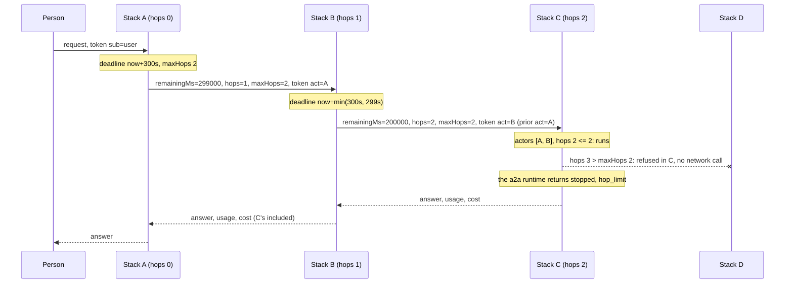

# 0002. Every agent bounds its own run and knows who delegated it

Status: Accepted · Date: 2026-11-02 · Decided by: project owner · Supersedes: none · Extends: [0001](0001-sdk-language.md)

Each agent enforces three things at its own boundary, also when it runs alone: a deadline, a budget and a hop limit.
When an agent calls another agent, it passes on what is left of them, and the agent it calls can only make them
tighter. The caller carries the verified chain of agents that acted on its behalf. Multi-agent orchestration stays out
of agent-layers; these are the boundary primitives that make a chain of stacks safe whatever orchestrates it.

## Context

A stack can be called by another agent (inbound `a2a`, `mcp`, `openai-compatible` with `agent:<name>`) and can call
one (the outbound `a2a` runtime, any tool that reaches an agent). Before this record, what crossed that boundary was the
caller, the trace context and, on the way back, usage and cost. Four things were missing.

| # | Gap | Where it showed | Effect |
|---|---|---|---|
| 1 | Who acted in between is lost | `oidc` credentials sent `subject_token` only (`packages/adapters/src/oidc/credentials.ts`); the `act` claim was not read into `Caller` | A tool or a policy saw the user, never the agent chain that reached it. Least privilege per agent could not be expressed. |
| 2 | No deadline that shrinks across hops | Time limits were per hop: `gateway.requestTimeoutMs` 300000, `a2a` `timeoutMs` 300000 | A chain of three agents could run for three times the limit; a caller that gave up still paid for the work below it. |
| 3 | No budget that crosses a hop | Budgets lived in one runtime adapter (`reinloop` `options.budget.*`, `basic-runtime` `maxTurns`); usage and cost came back after the fact (`metadata["agent-layers"]`) | A delegated agent could spend more than the caller had left. Swapping the runtime removed the budget. |
| 4 | No hop count, no stop reason for it | Nothing counted agent-to-agent calls; `stopCode` had no value for it | A loop A → B → A was stopped only by timeouts. An orchestrator could not tell "too deep" from "out of budget". |

Neither standard fills the gap: A2A 1.0 and MCP 2026-07-28 define no deadline, budget, hop limit or delegation chain
(MCP carries only trace context in `_meta`), and no OAuth working group has adopted an agent delegation draft. The
established practice is outside agent work: gRPC sends the remaining time on each call, SIP decrements `Max-Forwards`
and refuses with a distinct error, Envoy makes retries consume the same deadline.

Constraints from the rest of the design: the core speaks one language and never reads adapter keys (0001); standards
appear only in adapters; every limit is configurable, has a safe range and is checked by the readiness gate
([limits.md](../limits.md)); identity, authorization and guards fail closed.

## Decision

1. **The caller carries its actor chain.** `Caller.actors` lists the agents that acted for the caller, verified from
   the credential by the identity adapter. Asserted data in a request never becomes an actor.
2. **Every run has bounds.** `CallContext.bounds` holds the deadline, the remaining budget and the hop count of the
   run. The host computes them when a run starts, from `limits.run` and from what a calling agent sent
   (`CallContext.delegation`). A run started in process (a trigger, an embedding application, an agent-plexus member)
   gets the stack's defaults.
3. **Tighten only.** Bounds sent by a caller can lower the stack's own limits, never raise them. A caller that lies can
   only stop its own work sooner (trust model below).
4. **The core enforces them, not the runtime.** The host, `guardedModel` and `governedTools` check the bounds, so a
   swapped runtime keeps them. Runtime budgets stay as extra limits: the first one reached stops the run.
5. **Delegation passes on what is left.** An adapter that calls another agent sends the remaining bounds through one
   core helper, `outboundBounds(ctx)`; the wire format belongs to the adapter.
6. **One new stop code.** `hop_limit` joins the core `stopCode` values; deadline and budget reuse `timeout` and
   `limit`.

### Shapes

| Shape | Field | Type | Req | Notes |
|---|---|---|---|---|
| `Caller` | `actors` | [`Actor`] | | Agents that acted for this caller, first delegate first, the agent presenting the credential last. Absent or empty: no delegation known. Part of `PublicCaller`, so guards, events and `AccessQuestion.caller` see it. |
| `Actor` | `id` | S | yes | Identifier of the acting agent at the issuer (an OAuth client id, a workload id). |
| | `kind` | `callerKind` | yes | `agent` in practice; `user` when a person acts for another (support staff). |
| | `name` | S | | Display name. |
| | `issuer` | S | | Who vouches for this entry, when it differs from the credential's issuer. |
| `CallContext` | `bounds` | `Bounds` | | Filled by the host inside a run: a read view of the run's ledger (below); absent in calls made outside a run. |
| | `lineage` | `Lineage` | | Present when the run was started by another agent's run. |
| | `delegation` | `Delegation` | | What a calling agent sent, as a channel received it. Read by the host when the run starts and removed from the run's context. |
| `Lineage` | `rootRunId`, `parentRunId` | S, S | yes | Correlation across stacks without a trace backend. |
| `Bounds` | `deadlineAt` | S | | ISO 8601 time, local clock, by which the run must end. Absent only when `limits.run.timeoutMs` is unbounded and no caller sent a deadline. |
| | `hops` | N | yes | Agent-to-agent calls before this run: 0 for a run a person or an event started. |
| | `maxHops` | N | yes | Largest `hops` this chain accepts. |
| | `tokens` | N | | Tokens (input plus output) the run may still spend, delegated runs included. Absent: no token budget. |
| | `costUsd` | N | | Spend the run may still incur, delegated runs included. Absent: no cost budget. |
| | `reserved` | {`tokens`?: N, `costUsd`?: N} | | What calls in flight have reserved and not yet settled. |
| `Delegation` | `remainingMs`, `hops`, `maxHops` | N, N, N | yes | Time as remaining milliseconds, hops including the call that carries it. |
| | `tokens`, `costUsd`, `rootRunId`, `parentRunId` | N, N, S, S | | What is left of the budget, and the lineage. |

`Actor` order is chronological on purpose: it reads like the path the request took. Adapters translate: in an RFC 8693
token the outermost `act` claim is the current actor and nested ones are prior actors, so the `oidc` adapter reverses
the nesting. The principal stays `Caller.id` (`sub`); the agent talking to this stack is `actors[actors.length - 1]`.

Vocabulary change: `stopCode` gains the core value `hop_limit`.

| Stop | `RunResult` |
|---|---|
| Deadline reached | `stopped`, `{code: "timeout", layer: "harness", by: "sdk.deadline"}` |
| Token or cost budget spent | `stopped`, `{code: "limit", layer: "harness", by: "sdk.budget"}` |
| Too many hops, refused before the run starts | `stopped`, `{code: "hop_limit", layer: "harness", by: "sdk.hops"}` |
| Too little time left to start | `stopped`, `{code: "timeout", layer: "harness", by: "sdk.deadline"}` |

`sdk.*` names in `by` are the core's own, like `sdk.approval` in `ext`. They are for people and telemetry; consumers
branch on `code` only, as the language requires.

### Computing the bounds of a run

```
now            = local clock when the run starts
deadlineAt     = now + min(limits.run.timeoutMs, delegation.remainingMs)        delegation part only when sent
tokens         = min(limits.run.maxTokens, delegation.tokens)                   absent when both are absent
costUsd        = min(limits.run.maxCostUsd, delegation.costUsd)                 absent when both are absent
verifiedHops   = length(caller.actors) + (caller.kind == "agent" ? 1 : 0)       an agent principal is one hop itself
hops           = max(delegation.hops, verifiedHops)                             0 when neither is known
maxHops        = min(limits.run.maxHops, delegation.maxHops)
refuse         when hops > maxHops                                              → hop_limit
refuse         when deadlineAt - now < min(limits.delegation.minRemainingMs, limits.run.timeoutMs)   → timeout
```

`startRun` in `packages/core/src/bounds.ts` implements this table. With `limits.delegation.inbound: "ignore"` the
delegation is dropped, its lineage included, and `hops` comes from the verified chain only. A run started with the
context of a run in progress (an in-process delegate) derives its delegation from the parent's ledger as
`outboundBounds` would (hops plus one, a reservation, the parent as lineage), tightened by any delegation passed along.

The wire carries time as remaining milliseconds, never as a clock time, so clock skew between hosts cannot extend a
deadline. Network latency only shortens it. `hops` takes the larger of the asserted count and the verified actor
chain, so a caller cannot reset it by sending 0 when its credential says otherwise.

### Trust model

Bounds stop bugs everywhere: a loop, a runaway fan-out, a delegate that forgets the caller's deadline. They stop an
adversary only as far as they are verified. Without delegation tokens, `hops`, `remainingMs` and the budget are
asserted by the caller: a hostile intermediate can send `hops=0` and receive this stack's full `limits.run.timeoutMs`,
so a chain of such intermediates is bounded per hop by each stack's own limits, not end to end. With the `oidc`
adapter reading `act`, `hops` comes from the issuer and cannot be reset. Asserted values never become `Caller.actors`:
a policy that trusts an actor trusts the issuer, not the request.

### Enforcement points

| Where | Check | On failure |
|---|---|---|
| Host, when a run starts (`run`, `stream`; channels, triggers and in-process calls all go through it) | Computes `bounds`; refuses on `hop_limit` or too little time; arms an abort at the deadline, merged with `ctx.signal` | `stopped` result (a single `run.end` for a stream), never an exception; the runtime is not called |
| Host, when a run ends | A run that did not complete because of a bound, or that ended while the deadline had passed and the caller was still waiting, reports the bound's reason; `usage` and `costUsd` the runtime does not report come from the ledger | |
| `guardedModel`, before each model call | Deadline not passed; `tokens` and `costUsd` above zero (after reservations) | Throws `BoundsExceeded` (`timeout` or `limit`); the model is not called. Runtimes end the run `stopped` with it (`runEndOf`), or the host does |
| `guardedModel`, after each reply from the model | Debits `usage`, and the cost from `pipeline.pricing`; a cache hit spends nothing | The next call stops |
| `governedTools`, before each tool call | Deadline not passed; the tool gets `ctx.bounds` and a signal that aborts at the deadline | Error result the model can read (`ok: false`) |
| Outbound adapters that call an agent | Refuse locally, without a network call, when `hops + 1 > maxHops` or too little time is left; send `outboundBounds(ctx)`; their own time limit caps the sent time; settle the reservation with the remote run's reported usage and cost | A `stopped` run (the `a2a` runtime) or an error result, with the same codes |
| Retries, in any adapter | A retry uses the same reservation and what is left of the same deadline; it never gets a fresh one | |

The runtime still owns its loop and may enforce its own, tighter budgets. What changes is that a runtime without
budgets is no longer unbounded.

### The ledger

Pipelines copy `CallContext` (`{...ctx}`), so a value in it cannot be debited. The host keeps one ledger per run
(`RunLedger`); `ctx.bounds` is a read view of it (getters, no setters), and every copy of the context points to the
same view. A debit is a single synchronous update, so concurrent calls in one process cannot lose one; a remote agent
has its own ledger and reports what it spent.

Concurrent delegation (parallel branches, a runtime that calls several tools at once) must not let each call see the
whole budget. `outboundBounds(ctx, {share?})` therefore **reserves** what it sends: by default everything not yet spent
or reserved, or the `share` (a fraction) the caller asks for. The sum of reservations never exceeds what is left, so
the run cannot overspend. When the call returns, `reservation.settle(report)` debits the reported usage and cost and
releases the rest. A call whose remote side reports nothing keeps its whole reservation spent, the safe side. Spend
crosses back only through a reservation, so it is never counted twice.

### Passing bounds on

`outboundBounds(ctx, opts)` is the one core helper adapters use. It returns `{bounds, reservation}` (undefined outside a
run):

| Field | Value |
|---|---|
| `remainingMs` | `deadlineAt - now - limits.delegation.marginMs`, capped by the adapter's own time limit (`opts.timeoutMs`); the call is not made when this is below `minRemainingMs` |
| `tokens`, `costUsd` | The reservation: what is left after other reservations, or the requested `share` of it |
| `hops` | `bounds.hops + 1` |
| `maxHops` | `bounds.maxHops` |
| `rootRunId` | `lineage.rootRunId`, or this run's id when it is the root |
| `parentRunId` | This run's id |

`opts.budget: false` sends time and hops only; `opts.refuse: false` never refuses locally (for a tool protocol whose
server is usually not an agent: the receiving agent refuses on its side).

The wire format is the adapter's:

| Adapter | Outbound | Inbound |
|---|---|---|
| `a2a` | The [bounds extension](../../spec/extensions/bounds-v1.md): declared in the card's `capabilities.extensions` with `required: false`, requested with the `A2A-Extensions` header and `message.extensions`, data in `message.metadata` under the extension URI | Read from the same key when the client activated the extension (either URI, see below); malformed data is refused with invalid params; the task reports `usage`, `costUsd` and a bounds `stop` under the URI, next to the older `metadata["agent-layers"]` |
| gateway (for `openai-compatible`, `mcp` and every mounted channel) | — | `Agent-Bounds: remaining-ms=..., hops=..., max-hops=..., tokens=..., cost-usd=...` and `Agent-Lineage: root="...", parent="..."`, RFC 9651 dictionaries, bounded by `gateway.maxTraceChars`; malformed headers answer 400; parsed into `InboundContext.delegation` |
| `mcp` | `params._meta["agent-layers/bounds"]` on every tool call (time and hops, no budget, no local refusal) | Same key on `tools/call`, combined with the gateway's (the tighter values) |
| `oidc` | Token exchange sends `actor_token` (the stack's own client-credentials token) when `options.actor` is `self`, so the issuer can nest `act` | Reads `act` into `Caller.actors` (at most `options.maxActors`, a malformed chain rejects the token); `may_act` stays in `ext["oidc.may_act"]` |

The bounds extension has the URI `https://github.com/aantenore/agent-layers/blob/main/spec/extensions/bounds-v1.md`.
Its data format was first published by agent-plexus under
`https://github.com/aantenore/agent-plexus/blob/main/spec/extensions/bounds-v1.md`; the `a2a` adapter accepts that URI
inbound as an alias and can send under it (`options.extensions`).

W3C Baggage was considered and rejected as the carrier: it is forwarded by telemetry libraries to every downstream
service, including third parties, and every hop can change it without any checking.

### Limits

Declared in `STACK_LIMITS` (`RUN_LIMITS`, `DELEGATION_LIMITS`), documented in [limits.md](../limits.md#limits),
checked by the readiness gate.

| Setting | Default | Accepted | Safe range | On production | Why |
|---|---|---|---|---|---|
| `limits.run.timeoutMs` | `300000` ms | 1–∞ or unbounded | 1–3600000 | fail if unbounded | Deadline of a run when the caller sends none; the same default as the `a2a` and gateway time limits. |
| `limits.run.maxHops` | `4` | 0–∞ or unbounded | 0–10 | fail if unbounded | Agent-to-agent calls a chain may make; `0` refuses every delegated run. |
| `limits.run.maxTokens` | unbounded | 1–∞ or unbounded | — | warn if unbounded | Tokens one run may spend, delegated runs included. |
| `limits.run.maxCostUsd` | unbounded | 0–∞ or unbounded | — | warn if unbounded | Spend one run may incur, delegated runs included. |
| `limits.delegation.marginMs` | `1000` ms | 0–60000 | — | — | Time kept back on each outbound call for the answer to travel back. |
| `limits.delegation.minRemainingMs` | `1000` ms | 0–60000 | — | — | A run, or an outbound call, does not start with less time than this. |

`limits.delegation.inbound` is a setting next to these, not a number: `"tighten"` (default) or `"ignore"`.
`pipeline.pricing` is the price table of the cost budget: prices by model id in US dollars per million tokens, matched
on the model a reply names, else the requested one. `agent-layers check` warns when `limits.run.maxCostUsd` is set
without prices.

### Telemetry

| Kind | Name |
|---|---|
| attribute on `agent.run` | `agent.run.hops`, `agent.run.max_hops`, `agent.run.root`, `agent.run.parent`, `agent.run.deadline_ms` (remaining when the run started) |
| attribute on `agent.run` | `agent.caller.actors` (actor ids, in order) |
| metric | `agent.bounds.stops`, by `agent.run.reason` (`timeout`, `limit`, `hop_limit`) |

### Authorization

`AccessQuestion.caller` carries `actors`, so a policy can allow a tool only when a given agent is the current actor, or
refuse calls that went through an agent it does not trust. RFC 8693 states that only the current actor counts for
access control and prior actors are informational; the core policy rules (and so `rules-authorization`) follow that:
`when.actor` matches the current actor's id, `when.actors` any actor of the chain (asked for explicitly),
`when.delegated` any chain or none. `opa` passes `input.caller.actors` on; `authzen` sends them as
`subject.properties.actors`.

## Diagram



## Consequences

- Language 1.0 → 1.1, additive: optional fields on `Caller` and `CallContext`, four shapes (`Actor`, `Bounds`,
  `Lineage`, `Delegation`) in `common.json`, one core `stopCode` value. Strict validators of the old schemas (with
  `additionalProperties: false`) reject a `Caller` with `actors` and a `stack-config.json` with the new settings: a
  breaking change for them, called out in the changelog.
- Ports whose shapes gain fields take a minor version:

| Port | Now | New | What changes |
|---|---|---|---|
| ModelPort | 1.0.0 | 1.1.0 | `CallContext.bounds`; the governed model refuses and debits |
| RouterPort | 1.0.0 | 1.1.0 | `CallContext` fields reach `select` |
| ToolPort | 1.0.0 | 1.1.0 | `CallContext.bounds`; the governed tools refuse after the deadline |
| KnowledgePort | 1.0.0 | 1.1.0 | `caller.actors` in queries |
| IdentityPort | 1.0.0 | 1.1.0 | `Caller.actors` |
| AuthorizationPort | 1.0.0 | 1.1.0 | `AccessQuestion.caller.actors`; actor rules |
| RuntimePort | 1.1.0 | 1.2.0 | Every run is bounded; `BoundsExceeded` ends a run `stopped`; conformance checks both |
| ChannelPort | 1.0.0 | 1.1.0 | `InboundContext.delegation`; channels pass bounds on; conformance `sendBounds` |

- `packages/core`: `bounds.ts` (ledger, `startRun`, `outboundBounds` with reservations, `delegationProblems`,
  `tighterDelegation`), the host in `compose.ts`, checks in `guardedModel` and `governedTools`, `BoundsExceeded`, actor
  conditions in policy rules, six limits in `STACK_LIMITS`, `pipeline.pricing`.
- Adapters: `a2a` (both directions), `oidc` (`act` in, `actor_token` out), `openai-compatible` and `mcp` inbound, `mcp`
  outbound, the gateway, `rules-authorization` (schema), `opa` and `authzen` (actors kept). Runtimes need no change
  beyond honouring `ctx.signal` and passing `ctx` on, which they already do.
- Conformance: `checkRuntime` gains bounds checks from RuntimePort 1.2.0; `checkChannel` gains a `sendBounds` fixture
  from ChannelPort 1.1.0 (bounds reach the host never looser, a run over the hop limit shows as stopped).
- A stack used alone behaves as before except that every run now has a deadline (`limits.run.timeoutMs`, five
  minutes by default) and a hop limit, and a caller of kind `agent` counts as one hop.

### Adapted from the proposal

The proposal this record comes from was written against an earlier state of the code. What changed while landing it:

| Proposal | Landed | Why |
|---|---|---|
| `limits.delegation.maxHops` | `limits.run.maxHops` | The hop limit refuses a run, like the other run bounds; `limits.delegation` keeps only how bounds travel. |
| `Bounds.deadlineAt` required | Optional | `limits.run.timeoutMs` may be `"unbounded"` on prototype profiles; production fails the readiness gate then. |
| `Lineage.path` | Not carried | The bounds extension (version 1) has no path, and `Caller.actors` is the verified chain; an asserted path adds nothing a policy may trust. |
| `limits.delegation.trustedCallers` and a production warning for unverified chains | Not added | The core cannot tell whether an identity adapter verifies an actor chain, and with tighten-only a trusted caller gains nothing over another. |
| `governedTools` debits `ext["sdk.usage"]` and `ext["sdk.costUsd"]` of tool results | Settlement through reservations only | One path for spend that crosses back, so it is never counted twice. |
| `minRemainingMs` refuses below it | Below `min(minRemainingMs, timeoutMs)` | A stack configured with a timeout shorter than the margin would refuse every run. |
| `cloudevents` inbound | Not in this change | Triggers are accepted through `TriggerSink`, which takes no delegation yet; trigger runs get the stack's defaults. |
| `otlp` attribute mapping | No change | The new names are `agent.*` attributes and pass through like the existing ones. |

### Open questions, answered

1. **Does the stop code leave the stack?** Yes, for the bounds only: the A2A task reports `stop` (`timeout`, `limit`,
   `hop_limit`) under the extension URI when the stack's own bounds stopped the run, never `layer`, `by` or `detail`.
   Guard and denial codes stay inside.
2. **Where does the cost of a model call come from?** A price table in the stack config, `pipeline.pricing`, applied by
   `guardedModel`, plus what remote agents report. Runtimes that price on their own keep their prices for their own
   reports.
3. **Is `maxHops` 4 right, and is a repeated agent refused?** 4 stays. A repeated agent in `actors` is counted, not
   refused: the hop limit already stops the loop, and a policy can refuse a chain with `when.actors`.
4. **Should `actor: "self"` be the default of `oidc` credentials?** Not yet: it stays opt-in until the reference
   identity provider nests `act` on token exchange.

## Alternatives considered

| Alternative | Why not |
|---|---|
| Bounds in `ext` | The core must read them to enforce them; 0001 keeps `ext` unread by the core. |
| Absolute deadline on the wire | Clock skew between hosts would extend or cut deadlines silently. |
| Trust the caller's bounds as sent | A caller could raise its own limits; tighten only costs nothing. |
| Enforce only in an orchestrator | An agent reachable over A2A must defend itself whoever calls it. |
| Enforce in each runtime | Swapping the runtime would remove the bounds; the core's model pipeline sees every call of every runtime. |
| Signed hop limit in the token (an individual draft defines `del_max_depth`) | Not adopted by any working group yet; an identity adapter can map it to `maxHops` when it is. |
| Hop count from the token only | Not every deployment issues delegation tokens; the asserted count still bounds loops, and the token, when present, stops a caller from resetting it. |
| A stop code per bound (`deadline`, `budget`) | `timeout` and `limit` already mean that; `by` tells them apart. Hops are different: they point at the topology, not at the spending. |
| Asserted actors from the wire into `Caller.actors` | A caller could forge the chain a policy trusts; the chain comes from the credential only. |
