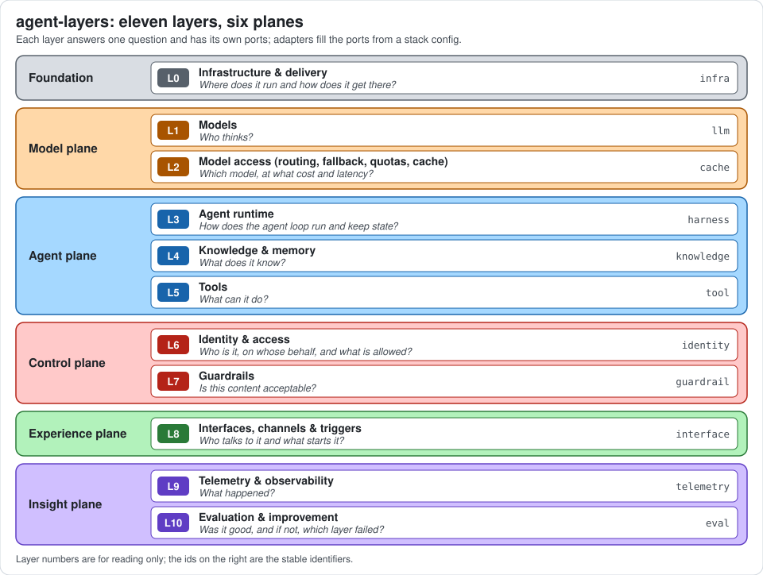

# Diagrams

Conventions for the diagrams in these docs, and an index of all of them. Diagrams are [Mermaid](https://mermaid.js.org)
blocks, which GitHub renders, plus one static figure.



The figure is `docs/assets/stack-overview.svg`, a hand-written SVG on a neutral background so it reads in light and
dark themes. It lists the layers from `LAYERS` in `packages/core/src/layers.ts`; keep both in step.

## Conventions

- **One colour per plane.** Every layer node takes the class of its plane. Nodes that are not a layer (a caller, a
  backend, an adapter, a step of a process) use the neutral `external` class, dashed.
- **Labels carry the layer.** A layer node reads `L4 knowledge` plus a short role. Ports use their exact names from
  [spec/ports](../spec/ports/README.md); adapters use their names from [adapters.md](adapters.md).
- **Small.** About fifteen nodes at most; split a diagram instead of growing it.
- **Arrows.** A solid arrow is a call or a flow of data. A dotted arrow is observation (telemetry, audit), governance
  or an optional or planned path. A plain line joins an adapter to the port it fills.
- **Sequence diagrams** take no plane colours. Participants are named `layer (Ln)`.
- **Accuracy.** A diagram must match `LAYERS`, the port pages and the adapter catalog. `npm run docs:check` does not
  read inside diagram blocks, so check them by hand when the stack changes.

### Palette

Paste only the lines for the classes a diagram uses, unchanged, at the end of the block, and assign a class with
`:::name` on the node.

| Plane | Class | Fill | Stroke | Layers |
|---|---|---|---|---|
| Foundation | `foundation` | `#d9dde3` | `#57606a` | `infra` |
| Model plane | `model` | `#ffd8a8` | `#a85400` | `llm`, `cache` |
| Agent plane | `agent` | `#a5d8ff` | `#1864ab` | `harness`, `knowledge`, `tool` |
| Control plane | `control` | `#ffc9c9` | `#b42318` | `identity`, `guardrail` |
| Experience plane | `experience` | `#b2f2bb` | `#2a7a38` | `interface` |
| Insight plane | `insight` | `#d0bfff` | `#5f3dc4` | `telemetry`, `eval` |
| Not a layer | `external` | `#ffffff` | `#57606a` | callers, backends, steps |

```text
classDef foundation fill:#d9dde3,stroke:#57606a,color:#1f2328
classDef model fill:#ffd8a8,stroke:#a85400,color:#1f2328
classDef agent fill:#a5d8ff,stroke:#1864ab,color:#1f2328
classDef control fill:#ffc9c9,stroke:#b42318,color:#1f2328
classDef experience fill:#b2f2bb,stroke:#2a7a38,color:#1f2328
classDef insight fill:#d0bfff,stroke:#5f3dc4,color:#1f2328
classDef external fill:#ffffff,stroke:#57606a,color:#1f2328,stroke-dasharray:4 3
```

Fills are light and the text is dark in every class, so nodes stay readable in light and dark themes.

### Checking a diagram

```bash
npx -y @mermaid-js/mermaid-cli@11.4.2 -i docs/layers/identity.md -o /tmp/identity-check.md
```

The command renders every Mermaid block of a Markdown file and fails on a syntax error.

## Index

### Overview

| Diagram | Where | Shows |
|---|---|---|
| Stack figure | [README](../README.md), [stack.md](stack.md), this page | Eleven layers in six planes, one question per layer |
| Request through the stack | [README](../README.md#request-through-the-stack) | A request across the layers, with telemetry, eval and infra around it |
| Planes at a glance | [stack.md](stack.md#planes-at-a-glance) | How the six planes relate |
| Request flow | [stack.md](stack.md#request-flow) | Which layer calls which, in more detail |
| Ports and adapters | [stack.md](stack.md#ports-and-adapters) | Core ports, standard adapters, native adapters |
| Developer journey | [product.md](product.md#the-developer-journey) | `init`, `dev`, `check`, `test`, `eval`, `deploy` |
| Profile ladder | [product.md](product.md#profile-ladder) | The layers that change from prototype to pilot to production |
| Lifecycle | [lifecycle.md](lifecycle.md) | Design, build, test, release, operate, improve |
| Hexagonal model, run modes, data flow of one run | [architecture.md](architecture.md) | Core, inbound and outbound adapters; in-process and gateway; one run end to end |
| Two modes | [gateway.md](gateway.md#two-modes) | In process versus hosted by the gateway |
| Gateway topology | [gateway.md](gateway.md#what-the-gateway-exposes) | Callers, Origin and Host check, identity, mounted routes, the governed ports behind them |
| A runtime in another language | [gateway.md](gateway.md#a-runtime-in-another-language) | Model calls at `/v1`, tool calls at `/mcp` with the caller's identity; a remote agent as runtime over A2A |

### Layers

Each layer page has a **Where it sits** diagram: its ports, what calls it and what it calls. Some pages add one more.

| Layer | Where it sits | Additional diagram |
|---|---|---|
| `infra` (L0) | [infra.md](layers/infra.md#where-it-sits) | [Deploy targets](layers/infra.md#deploy-targets): compose, Kubernetes with Helm and Argo CD, OpenTofu |
| `llm` (L1) | [llm.md](layers/llm.md#where-it-sits) | |
| `cache` (L2) | [cache.md](layers/cache.md#where-it-sits) | [Decision flow](layers/cache.md#decision-flow): cache, route, model |
| `harness` (L3) | [harness.md](layers/harness.md#where-it-sits) | |
| `knowledge` (L4) | [knowledge.md](layers/knowledge.md#where-it-sits) | [Transport and result](layers/knowledge.md#transport-and-result): MCP, HTTP or function to `Passage` |
| `tool` (L5) | [tool.md](layers/tool.md#where-it-sits) | |
| `identity` (L6) | [identity.md](layers/identity.md#where-it-sits) | [On-behalf-of flow](layers/identity.md#on-behalf-of-flow): sequence from caller token to user-scoped tool token |
| `guardrail` (L7) | [guardrail.md](layers/guardrail.md#where-it-sits) | [Where guards run](layers/guardrail.md#where-guards-run): the four stages and the block and redact outcomes |
| `interface` (L8) | [interface.md](layers/interface.md#where-it-sits) | |
| `telemetry` (L9) | [telemetry.md](layers/telemetry.md#where-it-sits) | [Span tree](layers/telemetry.md#span-tree): `invoke_agent` and its children, each with `agent.layer` |
| `eval` (L10) | [eval.md](layers/eval.md#where-it-sits) | [Improvement loop](layers/eval.md#improvement-loop): failures attributed to a layer |

### Cross-cutting

| Diagram | Where | Shows |
|---|---|---|
| Threat map | [security.md](cross-cutting/security.md#threat-map) | Which layer mitigates which threat |
