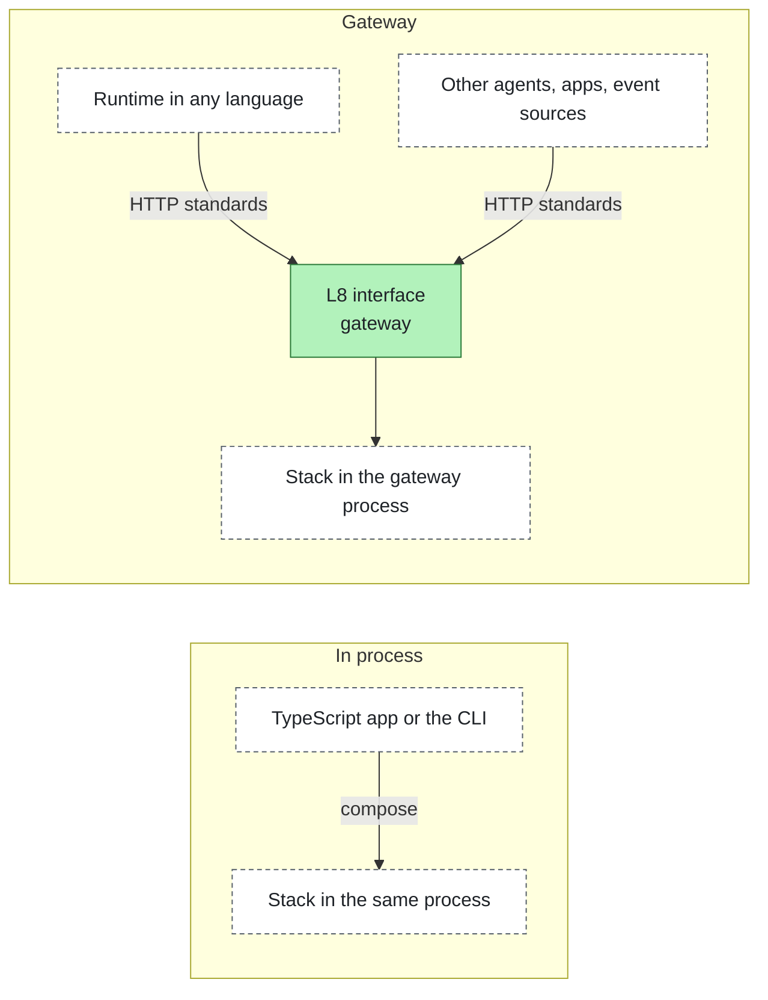
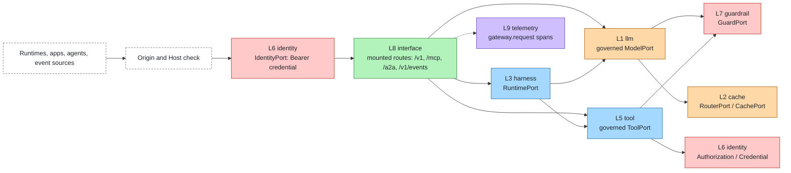
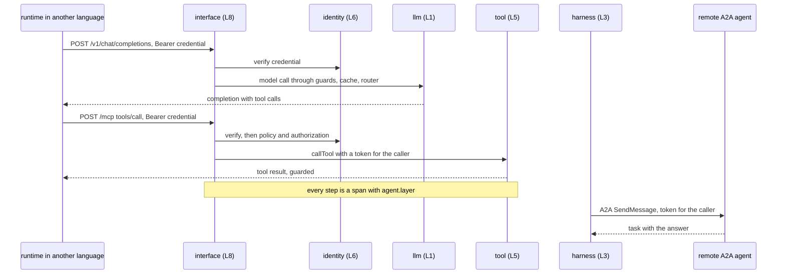

# Gateway

The gateway is the production mode of a stack. It hosts a composed stack on the network, so a runtime or an app in
any language reaches every layer through standards, and identity, authorization, guardrails and telemetry run in the
gateway, outside the agent's process. Package: [`@agent-layers/gateway`](../packages/gateway); command:
`agent-layers gateway --profile <name>`.

## Two modes



| | In process | Gateway |
|---|---|---|
| How | `compose(config)` returns a `Stack` | `serveStack(stack, options)` or `agent-layers gateway` |
| Who can use it | TypeScript code in the same process | Any language, any process, other agents |
| Where enforcement runs | In the process that runs the agent | In the gateway; the agent process holds no stack credentials |
| Use it for | Development, tests, TypeScript apps | Shared environments and production |

The stack config is the same in both modes: the gateway is one more way to host it, not a different stack.

## What the gateway exposes

Inbound adapters that implement `mount` (see [ChannelPort](../spec/ports/ChannelPort.md) and
[TriggerPort](../spec/ports/TriggerPort.md)) share one server. Each one exposes a governed port of the stack through a
standard.

| Endpoint | Standard | Adapter | Reaches | Enforced on the way |
|---|---|---|---|---|
| `GET /v1/models`, `POST /v1/chat/completions` | OpenAI Chat Completions | [`openai-compatible`](../adapters/openai-compatible) | ModelPort (model aliases); RuntimePort (`agent:<name>`) | input and output guards, cache, router, token usage, traces |
| `POST /mcp` | Model Context Protocol (streamable HTTP) | [`mcp`](../adapters/mcp) | ToolPort, KnowledgePort as read-only tools | policy, approval, authorization, `tool_args` and `tool_result` guards, credentials for the caller |
| `GET /.well-known/agent-card.json`, `POST /a2a/<agent>` | Agent2Agent (A2A) 1.0, 0.3 accepted | [`a2a`](../adapters/a2a) | RuntimePort | everything a run goes through |
| `POST /v1/events` | CloudEvents 1.0 HTTP binding | [`cloudevents`](../adapters/cloudevents) | TriggerPort, then RuntimePort | the trigger's caller; everything a run goes through |
| `GET /healthz`, `GET /readyz` | | gateway | liveness; readiness gate of the profile | |



## Authentication and limits

Every request goes through the same steps before any route runs (details in the
[package README](../packages/gateway/README.md)):

1. **Origin and Host.** A request with an `Origin` header must come from the gateway's own origin, from
   `gateway.allowedOrigins` or from `gateway.cors.origins`: 403 otherwise. Bound to loopback, the gateway answers only
   loopback `Host` names; `gateway.allowedHosts` sets the names elsewhere. This closes cross-site calls and DNS
   rebinding against a local gateway.
2. **Identity.** `Authorization: Bearer <credential>` is verified through the IdentityPort into a `Caller`; the caller is
   passed to the route and to every model call, tool call and run. A credential that does not verify is a 401 with
   `WWW-Authenticate`, and the adapter's error text is never returned. A request without a credential is a 401 unless
   `gateway.anonymous: true`. On the production tier the gateway refuses to start without an identity adapter or with
   `anonymous: true`.
3. **Limits.** Body size (`maxBodyBytes`, 413), time limit (`requestTimeoutMs`, 504, streams included), header and
   body upload time (`headersTimeoutMs`, `bodyTimeoutMs`), JSON content types (415). Defaults and safe ranges are in
   [limits.md](limits.md#gateway). An error inside a route is a 500 without its message.
4. **Access log.** One `gateway.request` span on the `interface` layer per request: method, path without the query
   string, route, inbound adapter, status, duration, whether the caller was authenticated. Runs and tool calls nest
   under it. When the request carries a W3C `traceparent` (and `tracestate`), the gateway copies them unchanged into
   `ctx.trace` (`{ parent, state? }`, opaque to the core) and the telemetry adapter joins that trace; a value it cannot
   parse is ignored and starts a new trace.

Agent cards and the health endpoints are public. Sessions (MCP) and tasks (A2A) belong to the caller that created
them: another caller presenting their id gets "not found".

Triggers run in the background with the trigger's own caller (a service credential in its options, verified per
event) or, without one, with the caller that sent the event; never anonymously unless `gateway.anonymous: true`.

## Configure

```json
{
  "gateway": { "port": 8787 },
  "layers": {
    "identity": { "adapter": "oidc", "options": { "issuer": "${env:OIDC_ISSUER}", "audience": "agent-gateway" } },
    "channels": [
      { "adapter": "openai-compatible", "options": { "models": { "default": "qwen3:4b" }, "agents": ["assistant"] } },
      { "adapter": "mcp" },
      { "adapter": "a2a" }
    ],
    "triggers": [
      { "adapter": "cloudevents", "options": { "credential": "${secret:EVENTS_TOKEN}", "routes": [{ "type": "com.example.order.*", "agent": "assistant" }] } }
    ]
  },
  "profiles": { "production": { "tier": "production", "gateway": { "host": "0.0.0.0", "publicOrigin": "https://agents.example.com" } } }
}
```

`gateway` takes `port`, `host`, `inbound` (instance names to mount; every mountable channel and trigger by default),
`anonymous`, `publicOrigin`, `cors`, `allowedOrigins`, `allowedHosts` and the limits `maxBodyBytes`, `requestTimeoutMs`,
`headersTimeoutMs`, `bodyTimeoutMs`, `closeGraceMs`, `corsMaxAgeS` and `maxRequestIdChars`, and a profile can override
any of them. `agent-layers gateway --profile production [--port n] [--host h]` composes the
profile, refuses to start a production-tier profile that fails the readiness gate, prints the mounted routes, and
stops gracefully on SIGINT or SIGTERM. `agent-layers dev` keeps using only the channels that serve themselves (the
terminal), so the same profile works in both.

## A runtime in another language

Point the runtime's model client and tool client at the gateway, and give it a credential the identity layer accepts.
Model calls and tool calls then carry that caller, and the stack enforces everything around them.



With the prototype profile of the minimal template (`agent-layers gateway`, token `dev-token`):

```python
from openai import OpenAI

llm = OpenAI(base_url="http://127.0.0.1:8787/v1", api_key="dev-token")
reply = llm.chat.completions.create(model="mock", messages=[{"role": "user", "content": "Hello"}])
agent = llm.chat.completions.create(model="agent:assistant", messages=[{"role": "user", "content": "Hello"}])
```

- **Model**: any OpenAI-compatible client, `base_url = <gateway>/v1`, `api_key = <credential>`. `model` is an alias
  from the adapter's `models` option, or `agent:<name>` to run a whole agent of the stack.
- **Tools and knowledge**: any MCP client over streamable HTTP at `<gateway>/mcp`, with the header
  `Authorization: Bearer <credential>`.
- **Agents**: any A2A client, starting from `<gateway>/.well-known/agent-card.json`.
- **Events**: `POST <gateway>/v1/events` with a CloudEvent (structured or binary mode).

The other direction works too: the `a2a` runtime adapter turns an agent written in any language, served over A2A,
into the stack's runtime (`"runtime": { "adapter": "a2a", "options": { "url": "<its agent card>" } }`). The stack
sends each run to it with a token for the caller, from the credentials slot. That agent can in turn use the gateway
for its model and tools, so the stack's controls apply to it as well.
