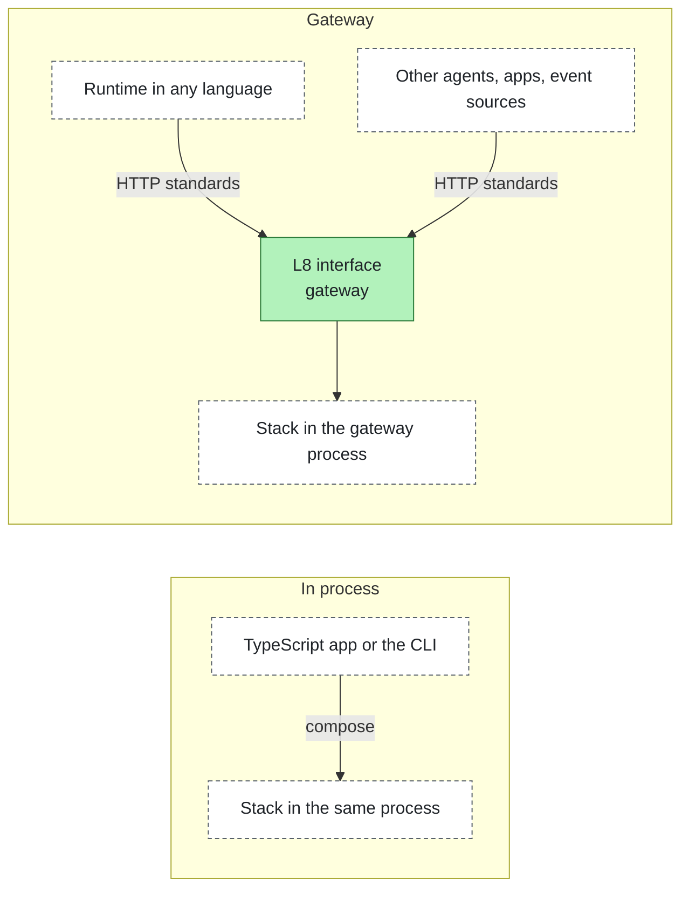
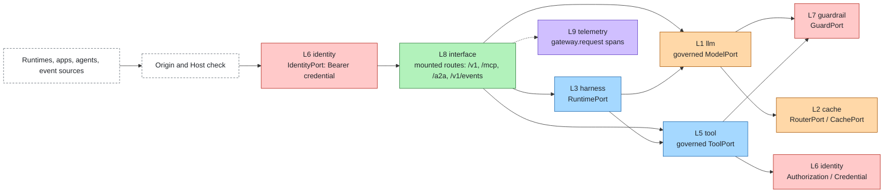
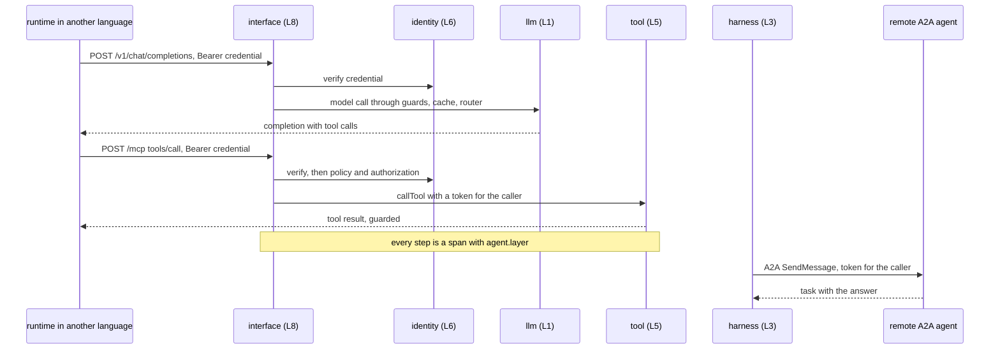

# Gateway

The gateway is the production mode of a stack. It hosts a composed stack on the network, so a runtime or an app in
any language reaches every layer through standards, and identity, authorization, guardrails and telemetry run in the
gateway, outside the agent's process. Package: [`@agent-layers/gateway`](../packages/gateway); command:
`agent-layers gateway --profile <name>`.

## Two modes



| | In process | Gateway |
|---|---|---|
| How | `compose(config)` returns a `Stack` | `serveStack(stack, options)` or `agent-layers gateway` |
| Who can use it | TypeScript code in the same process | Any language, any process, other agents |
| Where enforcement runs | In the process that runs the agent | In the gateway; the agent process holds no stack credentials |
| Use it for | Development, tests, TypeScript apps | Shared environments and production |

The stack config is the same in both modes: the gateway is one more way to host it, not a different stack.

## What the gateway exposes

Inbound adapters that implement `mount` (see [ChannelPort](../spec/ports/ChannelPort.md) and
[TriggerPort](../spec/ports/TriggerPort.md)) share one server. Each one exposes a governed port of the stack through a
standard.

| Endpoint | Standard | Adapter | Reaches | Enforced on the way |
|---|---|---|---|---|
| `GET /v1/models`, `POST /v1/chat/completions` | OpenAI Chat Completions | [`openai-compatible`](../packages/adapters/src/openai-compatible) | ModelPort (model aliases); RuntimePort (`agent:<name>`) | input and output guards, cache, router, token usage, traces |
| `POST /mcp` | Model Context Protocol (streamable HTTP) | [`mcp`](../packages/adapters/src/mcp) | ToolPort, KnowledgePort as read-only tools | policy, approval, authorization, `tool_args` and `tool_result` guards, credentials for the caller |
| `GET /.well-known/agent-card.json`, `POST /a2a/<agent>` | Agent2Agent (A2A) 1.0, 0.3 accepted | [`a2a`](../packages/adapters/src/a2a) | RuntimePort | everything a run goes through |
| `POST /v1/events` | CloudEvents 1.0 HTTP binding | [`cloudevents`](../packages/adapters/src/cloudevents) | TriggerPort, then RuntimePort | the trigger's caller; everything a run goes through |
| `GET /approvals`, `GET`/`POST`/`DELETE /approvals/<id>` (off by default) | JSON over HTTP | gateway | ApprovalPort | authorization of every request (actions `list`, `decide`); see [Approvals](#approvals) |
| `POST /runs/<id>/resume`, `POST /runs/<id>/cancel` (off by default) | JSON over HTTP | gateway | RuntimePort (`Stack.resume`, `Stack.cancel`) | authorization of every request (actions `resume`, `cancel`), then the stack's own rules; see [Runs](#runs) |
| `GET /healthz`, `GET /readyz` | | gateway | liveness; readiness gate of the profile | |



## Authentication and limits

Every request goes through the same steps before any route runs (details in the
[package README](../packages/gateway/README.md)):

1. **Origin and Host.** A request with an `Origin` header must come from the gateway's own origin, from
   `gateway.allowedOrigins` or from `gateway.cors.origins`: 403 otherwise. Bound to loopback, the gateway answers only
   loopback `Host` names; `gateway.allowedHosts` sets the names elsewhere. This closes cross-site calls and DNS
   rebinding against a local gateway.
   A non-loopback bind without `allowedHosts` skips the Host check and prints a warning. On the prototype tier, or with the
   `static-identity` adapter (well-known tokens such as `dev-token`), the gateway refuses to listen on a non-loopback
   host unless `gateway.allowInsecureBind` (`--allow-insecure-bind`) is set.
2. **Identity.** `Authorization: Bearer <credential>` is verified through the IdentityPort into a `Caller`; the caller is
   passed to the route and to every model call, tool call and run. A credential that does not verify is a 401 with
   `WWW-Authenticate`, and the adapter's error text is never returned. A request without a credential is a 401 unless
   `gateway.anonymous: true`. On the production tier the gateway refuses to start without an identity adapter or with
   `anonymous: true`. With `gateway.auth: { "scheme": "header", "header": "X-Api-Key" }` the credential is the raw
   value of that header instead (an API key), verified the same way, and `Authorization` is not read.
3. **Limits.** Body size (`maxBodyBytes`, 413), time limit (`requestTimeoutMs`, 504, streams included), header and
   body upload time (`headersTimeoutMs`, `bodyTimeoutMs`), JSON content types (415). Defaults and safe ranges are in
   [limits.md](limits.md#gateway). An error inside a route is a 500 without its message.
   **Abuse protection** runs before a credential is verified or a body is read: at most `maxInflight` requests in
   flight (503 with `Retry-After`), at most `maxInflightPerSubject` for one caller (429), at most `rateLimitRequests`
   per `rateLimitWindowMs` for one client (the subject when authenticated, the client address otherwise; 429), and at
   most `rateLimitAuthFailures` credentials that fail verification per window from one address, after which every
   credential from that address is a 429 until the window ends (a request without a credential is not counted). The
   counters live in the gateway process: with several instances, or to limit by anything else, keep a rate limit in
   the proxy in front too. Behind a reverse proxy the client address is the proxy unless `gateway.trustProxy` says how
   many proxies to trust in `X-Forwarded-For` ([limits.md](limits.md#gateway)).
4. **Access log.** One `gateway.request` span on the `interface` layer per request: method, path without the query
   string, route, inbound adapter, status, duration, whether the caller was authenticated. Runs and tool calls nest
   under it. When the request carries a W3C `traceparent` (and `tracestate`), the gateway copies them unchanged into
   `ctx.trace` (`{ parent, state? }`, opaque to the core) and the telemetry adapter joins that trace; a value it cannot
   parse is ignored and starts a new trace. The gateway bounds them only: longer than `gateway.maxTraceChars` (512) or
   outside printable ASCII, a value is dropped.

5. **Run bounds.** `Agent-Bounds` (`remaining-ms=45000, hops=2, max-hops=4, tokens=1000, cost-usd=0.5`) and
   `Agent-Lineage` (`root="run-a1", parent="run-b7"`) are RFC 9651 dictionaries a calling agent may send. The gateway
   parses them into the route's `ctx.delegation`, each bounded by `gateway.maxTraceChars`, before the body is read; a
   malformed or repeated header, or invalid values, is a 400. Every channel passes them on to the run, where they can
   only tighten `limits.run` ([0002](decisions/0002-delegation-bounds.md)). A2A clients send the same values in the
   [bounds extension](../spec/extensions/bounds-v1.md) instead; when both are present, the tighter values apply. A
   sender builds the headers with `formatAgentBounds` and `formatAgentLineage` (`@agent-layers/core`), which write what
   this parser accepts: integers capped at 15 digits (an unbounded max hops is sent as the cap) and the cost rounded
   down to 3 decimals.

Agent cards and the health endpoints are public. Sessions (MCP) and tasks (A2A) belong to the caller that created
them: another caller presenting their id gets "not found".

Triggers run in the background with the trigger's own caller (a service credential in its options, verified per
event) or, without one, with the caller that sent the event; never anonymously unless `gateway.anonymous: true`.

A client continues a session, so that a call waiting for an approval finds the decision in a later run: the
`Agent-Session` header or the `user` field on `/v1/chat/completions`, the MCP session (or
`params._meta["agent-layers/session"]` on a stateless request), the A2A context id, the `agentsession` CloudEvents
extension. Each is scoped to the verified caller; an anonymous request (`gateway.anonymous: true`) gets no client
session, so two anonymous clients sending the same value never share approvals. A run that waits for an approval answers `X-Agent-Run-Status: waiting` and
`X-Agent-Approval: <id>` on `/v1/chat/completions` (not streamed), `input-required` over A2A, and a tool result with
`_meta["agent-layers/approval"] = {id}` over MCP.

A session id names its owner by a digest of the caller id (`<channel>-<digest>-<value>`), and it can leave the
process: an `a2a` runtime sends it as the context id to the remote agent. Set `sessions.secret` to a secret
reference (`"sessions": { "secret": "${secret:SESSION_KEY}" }`, resolved through the secrets layer like adapter
options) and the digest is an HMAC-SHA-256 keyed with it, which nobody outside can match against known caller ids.
Without it the digest is a plain SHA-256 of the caller id, and `agent-layers check` warns on a production-tier
profile with channels or triggers. A profile can override `sessions`; changing the secret starts new sessions.

The gateway mounts routes and never starts triggers: a trigger that only starts in its own process, such as
`cron-trigger`, does not fire under it. The gateway reports each one at start-up (`agent.config.warning` and a line
in the `agent-layers gateway` output); run schedules with `agent-layers dev` or `stack.start()` in a process of their
own.

## Approvals

A pending approval can be answered over HTTP, by a web page, a chat bot or a command, without access to the stack's
process. The routes are off unless `gateway.approvals.enabled` is `true`; `gateway.approvals.path` moves them
(default `/approvals`). They need an approval adapter and an authorization adapter, or the gateway refuses to start.

| Request | Does | Action asked | Answers |
|---|---|---|---|
| `GET /approvals?status=pending&limit=50` | lists approvals, oldest first (status `pending` by default; `limit` capped by the approval adapter) | `list` | `{ "approvals": [...] }` |
| `GET /approvals/<id>` | reads one | `list` | the approval |
| `POST /approvals/<id>` with `{ "decision": "approve" \| "deny", "reason"?: "..." }` | decides | `decide` | the approval, or 409 when it is no longer pending |
| `DELETE /approvals/<id>` (body `{ "reason"?: "..." }` optional) | cancels: withdraws a pending approval | `decide` | the approval, or 409 |

Every request is authenticated like any route (401 without a valid credential), then the AuthorizationPort is asked
with the verified caller, the action and a target of kind `approval` (the call's risk and agent for one approval;
`id: "*"`, risk `read` for the list; risk `exec` for an id that does not exist, so a refused caller cannot probe ids).
No allowing answer, or an error, is a 403. A rule written for tool calls never matches: policy rules match an action
only when they name it in `actions` (see [AuthorizationPort](../spec/ports/AuthorizationPort.md)), and
`rules-authorization` never applies its `default` to these actions. The decision is recorded with `decidedBy` set to
the verified caller as `kind:id` (`user:olga`); the body cannot choose it. Listed approvals show the access question,
arguments included, so a person can decide; the request key and any credential are left out. The list route and
`DELETE` exist only when the approval adapter implements `list` and `cancel` (ApprovalPort 1.2.0). Each decision is the
telemetry event `gateway.approval.decided`, and each authorization answer counts in `agent.access.decisions`.

```json
{
  "gateway": { "approvals": { "enabled": true } },
  "layers": {
    "approval": { "adapter": "sqlite-approval" },
    "authorization": {
      "adapter": "rules-authorization",
      "options": { "rules": [{ "effect": "allow", "actions": ["decide", "list"], "when": { "roles": ["operator"] } }] }
    }
  }
}
```

## Runs

A run that ended `waiting` can be continued, and any run cancelled, over HTTP
([0003](decisions/0003-run-resume.md)). The routes are off unless `gateway.runs.enabled` is `true`;
`gateway.runs.path` moves them (default `/runs`). They need an authorization adapter, or the gateway refuses to start.

| Request | Does | Action asked | Answers |
|---|---|---|---|
| `POST /runs/<id>/resume` with `{ "approval": { "id", "approved", "reason"? } }` or `{ "input": "..." }` | decides the approval the run waits for, then continues it (`Stack.resume`) | `resume` | `{ runId, status, output, reason?: { code }, usage?, costUsd?, approval? }` |
| `POST /runs/<id>/cancel` with `{ "reason"?: "..." }` | aborts the run in flight in this process, or withdraws a waiting run and its approval (`Stack.cancel`) | `cancel` | `{ runId, outcome: "aborted" \| "cancelled" }` |

Every request is authenticated, then the AuthorizationPort is asked with the verified caller, the action and a target
`{ kind: "run", id: <run id>, layer: "harness", risk: "exec", agent: <the run's agent>, attrs?: { tool } }` (`tool`: the
call the run waits for), so a policy scoped to an agent or a tool applies; a run the stack does not know is asked about
with `agent: "*"`, so an unknown id and a refused one answer alike: that answer opens the route. The stack
then applies its own rules: only the caller that started the run may continue or cancel it, unless the
AuthorizationPort allows the caller `decide` on the approval the run waits for (on the run, target kind `run`, when it
waits for none); an approval answer is a decision, so it needs `decide` as on `POST /approvals/<id>`, owner included,
and is recorded with `decidedBy` set to the verified caller. Refusals are 404 (no waiting run with this id, or no
longer kept), 403, 409 (a cancelled run, a run being resumed, an input answer while its approval is still pending, a
decision that contradicts the one already taken) and 400 (an answer that does not fit). The run keeps its id, session
and caller; reasons never carry `detail`. Each resume is the telemetry event `agent.run.resumed`, each cancel
`agent.run.cancelled`.

```json
{
  "gateway": { "runs": { "enabled": true }, "approvals": { "enabled": true } },
  "layers": {
    "store": { "adapter": "sqlite-store" },
    "authorization": {
      "adapter": "rules-authorization",
      "options": { "rules": [
        { "effect": "allow", "actions": ["resume", "cancel"], "when": { "authenticated": true } },
        { "effect": "allow", "actions": ["decide", "list"], "when": { "roles": ["operator"] } }
      ] }
    }
  }
}
```

Waiting runs are kept in the store (`layers.store`) when there is one, for `limits.run.resumeTtlMs`; without it they
are kept in the gateway's memory, lost on restart and not shared by replicas.

## Configure

```json
{
  "gateway": { "port": 8787 },
  "layers": {
    "identity": { "adapter": "oidc", "options": { "issuer": "${env:OIDC_ISSUER}", "audience": "agent-gateway" } },
    "channels": [
      { "adapter": "openai-compatible", "options": { "models": { "default": "qwen3:4b" }, "agents": ["assistant"] } },
      { "adapter": "mcp" },
      { "adapter": "a2a" }
    ],
    "triggers": [
      { "adapter": "cloudevents", "options": { "credential": "${secret:EVENTS_TOKEN}", "routes": [{ "type": "com.example.order.*", "agent": "assistant" }] } }
    ]
  },
  "profiles": { "production": { "tier": "production", "gateway": { "host": "0.0.0.0", "publicOrigin": "https://agents.example.com" } } }
}
```

`gateway` takes `port`, `host`, `inbound` (instance names to mount; every mountable channel and trigger by default),
`anonymous`, `auth` (`scheme`: `bearer` by default or `header`, with `header` the header name), `approvals`
(`enabled`, `path`; see [Approvals](#approvals)), `runs` (`enabled`, `path`; see [Runs](#runs)), `publicOrigin`, `cors`,
`allowedOrigins`, `allowedHosts`, `allowInsecureBind` and the limits `maxBodyBytes`, `requestTimeoutMs`,
`headersTimeoutMs`, `bodyTimeoutMs`, `closeGraceMs`, `corsMaxAgeS`, `maxRequestIdChars`, `maxTraceChars`, `maxInflight`,
`maxInflightPerSubject`, `rateLimitRequests`, `rateLimitAuthFailures` and `rateLimitWindowMs`, plus `trustProxy`, and a profile can override
any of them. `agent-layers gateway --profile production [--port n] [--host h]` composes the
profile, refuses to start a production-tier profile that fails the readiness gate, prints the mounted routes, and
stops gracefully on SIGINT or SIGTERM. `agent-layers dev` keeps using only the channels that serve themselves (the
terminal), so the same profile works in both.

`publicOrigin` is the address clients reach the gateway at; the A2A agent card advertises its interfaces under it, and
the Host check accepts its host next to `allowedHosts` (a gateway on a non-loopback host checks `Host` only when
`allowedHosts` is set). Without it the origin comes from `host` and `port`, and a gateway listening on
every interface (`0.0.0.0` or `::`) advertises `http://localhost:<port>`, which no remote client can call. Set it
whenever the host is not a loopback address and an `a2a` channel is mounted, and whenever a proxy, a load balancer or
a TLS terminator stands in front of the gateway. The production profile of the `init` template reads it from
`GATEWAY_PUBLIC_ORIGIN`, which has no default.

## A runtime in another language

Point the runtime's model client and tool client at the gateway, and give it a credential the identity layer accepts.
Model calls and tool calls then carry that caller, and the stack enforces everything around them.



With the prototype profile of the minimal template (`agent-layers gateway`, token `dev-token`):

```python
from openai import OpenAI

llm = OpenAI(base_url="http://127.0.0.1:8787/v1", api_key="dev-token")
reply = llm.chat.completions.create(model="mock", messages=[{"role": "user", "content": "Hello"}])
agent = llm.chat.completions.create(model="agent:assistant", messages=[{"role": "user", "content": "Hello"}])
```

- **Model**: any OpenAI-compatible client, `base_url = <gateway>/v1`, `api_key = <credential>`. `model` is an alias
  from the adapter's `models` option, or `agent:<name>` to run a whole agent of the stack.
- **Tools and knowledge**: any MCP client over streamable HTTP at `<gateway>/mcp`, with the header
  `Authorization: Bearer <credential>`.
- **Agents**: any A2A client, starting from `<gateway>/.well-known/agent-card.json`.
- **Events**: `POST <gateway>/v1/events` with a CloudEvent (structured or binary mode).

The other direction works too: the `a2a` runtime adapter turns an agent written in any language, served over A2A,
into the stack's runtime (`"runtime": { "adapter": "a2a", "options": { "url": "<its agent card>" } }`). The stack
sends each run to it with a token for the caller, from the credentials slot. That agent can in turn use the gateway
for its model and tools, so the stack's controls apply to it as well.
