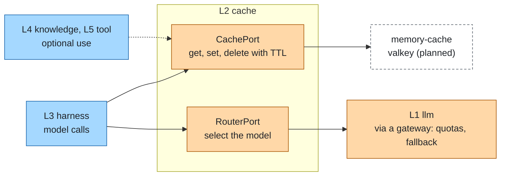
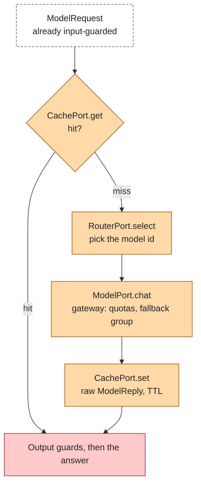

# Model access

Layer id `cache` (L2), Model plane. *Which model, at what cost and latency?*

## Responsibility

Reduce cost and latency and choose the model per request: exact-match caching, routing between models, fallbacks and
quotas. The agent sees an ordinary [llm](llm.md) endpoint.

## Ports

| Port | What it does |
|---|---|
| [RouterPort](../../spec/ports/RouterPort.md) | `select` picks the model for a `ModelRequest` |
| [CachePort](../../spec/ports/CachePort.md) | `get` / `set` / `delete` with a TTL; usable by any layer (tool results, embeddings, retrieval); model-reply keys are computed over the `ModelRequest` |

### Where it sits



## Standards

An OpenAI-compatible gateway is the standard way to provide routing, fallback and quotas outside the process. Cache
stores that speak the Redis protocol are interchangeable.

## Decision flow

A hit skips the router and the model. Quotas and fallback live in the gateway behind the model.



## Boundaries

- Output guards also run on cached answers: the cache stores the raw model reply, see [architecture](../architecture.md#composition-pipelines).
- Semantic caching is deliberately not part of the agent loop; exact-match caching is safe for tests and repeated
  identical requests.
- Rate and spend limits per key are quotas; see [cost](../cross-cutting/cost.md).

## How to swap

- A gateway replaces or complements the in-process router: set the `openai-compatible` adapter's base URL to it.
- Any Redis-protocol store replaces Valkey; a custom cache implements CachePort.
- A custom routing policy implements RouterPort.

## Reference adapters

| Adapter | Maps |
|---|---|
| `static-router` | A static model mapping |
| `rule-router` | Rule-based choice, for example by prompt size or agent |
| `memory-cache` | An in-process map (prototype) |

A model gateway sits behind `openai-compatible`. Full list: [adapters.md](../adapters.md).

## Reference setup

[`reference/cache/`](../../reference/cache/README.md) runs the LiteLLM proxy (MIT core; the `enterprise/` directory is
under a separate commercial license and is not used) with Valkey (BSD-3-Clause) as the cache. The gateway exposes model
groups, a fallback group and an exact-match cache. Variables: `GATEWAY_URL`, `GATEWAY_KEY`, `VALKEY_URL`.

```bash
make up LAYER=cache
make test LAYER=cache
make down LAYER=cache
```

The test sends the same request twice through the gateway and checks that the second is a cache hit.
