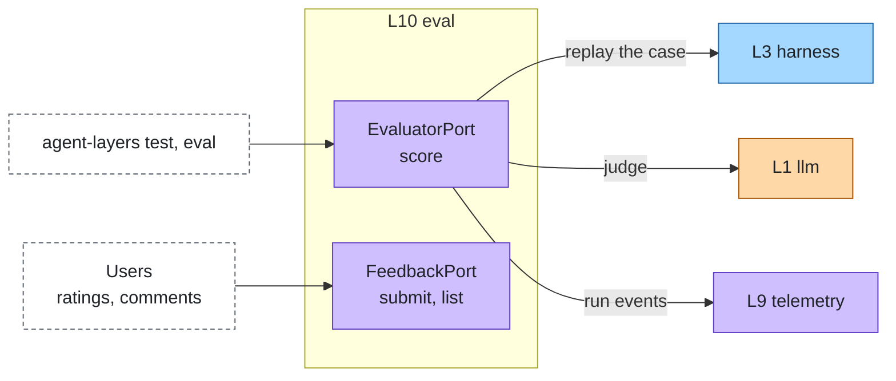
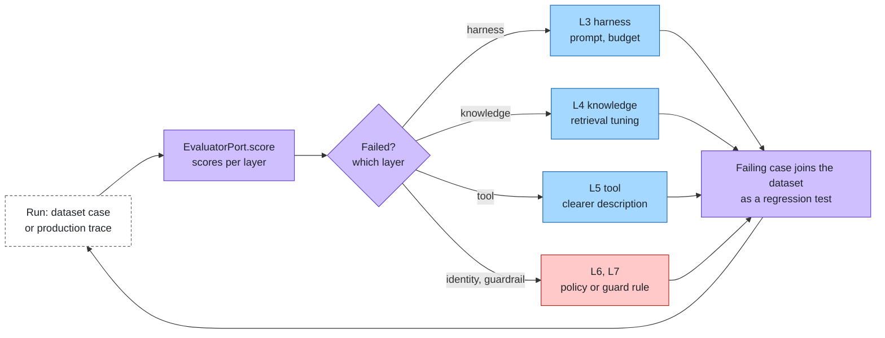

# Evaluation & improvement

Layer id `eval` (L10), Insight plane. *Was it good, and if not, which layer failed?*

## Responsibility

Measure quality continuously and find which layer a failure belongs to, so fixes land in the right place.

## Ports

| Port | What it does |
|---|---|
| [EvaluatorPort](../../spec/ports/EvaluatorPort.md) | `score` a run of a dataset case into `EvalScore` values, each optionally attributed to a layer |
| [FeedbackPort](../../spec/ports/FeedbackPort.md) | `submit` and `list` user feedback attached to runs, as evaluation data |

Data shapes: [eval-case.json](../../spec/schemas/eval-case.json), [eval-result.json](../../spec/schemas/eval-result.json),
[feedback.json](../../spec/schemas/feedback.json).

### Where it sits



## Standards

None. The data formats (dataset and result JSON Lines) are defined by this repository, so any runner that reads
`EvalCase` and writes the result format works.

## Improvement loop

Each failure is attributed to one layer, fixed there, and kept as a regression case.



## Boundaries

- One evaluator per concern: answer quality, retrieval quality, tool correctness, policy decisions, guardrail false
  positives, cache hit rate.
- **Replay.** Re-running stored inputs with another agent or model gives regression runs and A/B comparisons without
  new data.
- **Improvement loop.** Failures become dataset cases, fixes land in the owning layer, regression tests keep them fixed.
  Red-team cases belong here too; see [governance](../cross-cutting/governance-compliance.md).
- A diagnose agent reads a failing run and attributes the failure to one layer id.

## How to swap

Dataset and results are plain JSONL. Other frameworks (RAGAS, DeepEval, Opik, promptfoo, custom scripts) plug in as
evaluators on EvaluatorPort, checked with the conformance suite.

## Reference adapters

| Adapter | Maps |
|---|---|
| `expected-eval` | Expected answers |
| `judge-eval` | Model-as-judge |
| `layer-signals` | Per-layer health scores from run events |

Planned: promptfoo. Full list: [adapters.md](../adapters.md).

## Reference setup

[`reference/eval/`](../../reference/eval/README.md) uses promptfoo (MIT) as the test runner with a provider that runs
the agent in process, a smoke dataset (`EVAL_DATASET`) and a diagnose agent. Replay and layer attribution come from the
reinloop runtime.

```bash
make test LAYER=eval
```

The test runs the smoke dataset, validates the result file, and checks that the diagnose agent returns a layer id.
