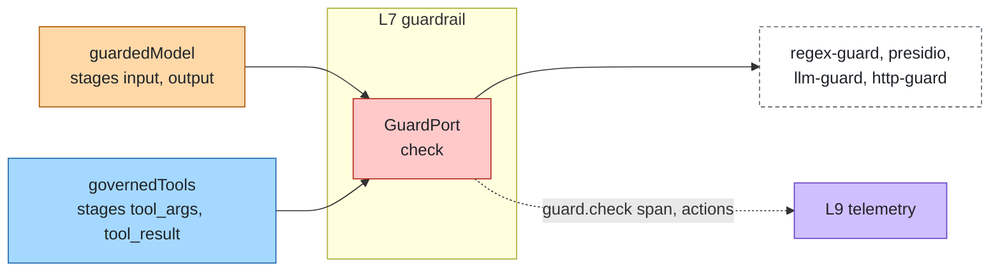
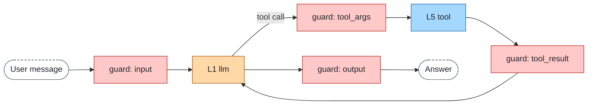
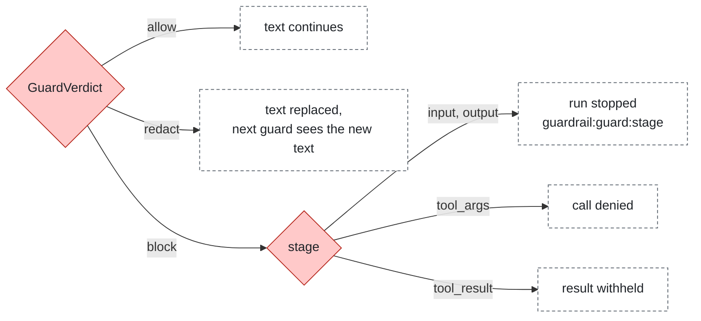

# Guardrails

Layer id `guardrail` (L7), Control plane. *Is this content acceptable?*

## Responsibility

Inspect what goes into and comes out of the agent, and what tools receive and return: PII, prompt injection, policy
violations. A guard can allow, block or redact.

## Ports

| Port | What it does |
|---|---|
| [GuardPort](../../spec/ports/GuardPort.md) | `check` a `GuardInput` at one of four stages and return a `GuardVerdict` |

Stages: `input`, `output`, `tool_args`, `tool_result`. Data shapes: [guard-request.json](../../spec/schemas/guard-request.json),
[guard-verdict.json](../../spec/schemas/guard-verdict.json). `GuardInput.subject` is the caller's identity without its
token (an object, not a string).

### Where it sits



## Standards

None. The contract is defined by this repository; any service that accepts a `GuardInput` as a JSON `POST` and answers
with a `GuardVerdict` can be a guard, in any language.

## Where guards run

Four stages cover the model and the tool traffic. The verdict decides what happens next.





## Boundaries

- Whether the content is acceptable is guardrail; who may do what is [identity](identity.md).
- `block` on `input` or `output` ends the run with status `stopped` and reason `guardrail:<guard>:<stage>`; on
  `tool_args` the call is denied; on `tool_result` the result is withheld. `redact` replaces the text.
- Guards of a stage run in configuration order; a guard that fails counts as a block (fail closed).
- Every block and redact is emitted to [telemetry](telemetry.md) without the sensitive text.

## How to swap

Any HTTP guard works through `http-guard`; a function or a local classifier is an adapter on GuardPort, checked with
the conformance suite (known-good and known-bad samples per stage). Other engines (NeMo Guardrails, Guardrails AI,
Granite Guardian) fit behind a small HTTP shim.

## Reference adapters

| Adapter | Maps |
|---|---|
| `regex-guard` | Regular expressions (emails, keys, simple injection phrases); coarse, but works everywhere |
| `http-guard` | The guard HTTP contract |
| `presidio` | Microsoft Presidio analyzer and anonymizer (PII) |
| `llm-guard` | LLM Guard API (prompt injection, secrets) |

Full list: [adapters.md](../adapters.md).

## Reference setup

[`reference/guardrail/`](../../reference/guardrail/README.md) runs Presidio (MIT) and LLM Guard (MIT). Llama Guard is
deliberately not used: it is under the Llama Community License, which is not OSI-approved. Variables:
`PRESIDIO_ANALYZER_URL`, `PRESIDIO_ANONYMIZER_URL`, `LLM_GUARD_URL`, `LLM_GUARD_TOKEN`.

```bash
make up LAYER=guardrail
make test LAYER=guardrail
make down LAYER=guardrail
```
