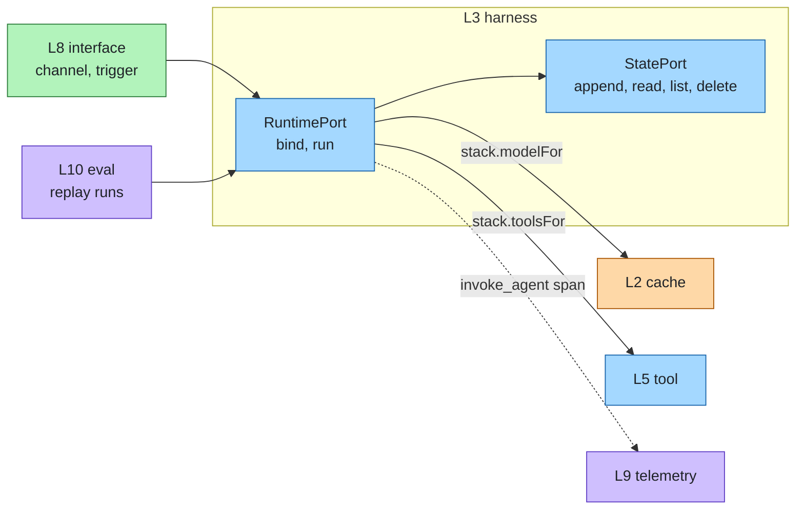

# Agent runtime

Layer id `harness` (L3), Agent plane. *How does the agent loop run and keep state?*

## Responsibility

Run the agent loop: prompts, tool calls, policy and approvals, budgets, durability and multi-agent patterns.
Everything above the model and below the interface.

agent-layers is the container; the runtime is one component that fills this slot and is swappable like every other
layer. A runtime receives the composed stack, so guards, cache, routing, knowledge, authorization, credentials and
telemetry are already applied to its model and tool calls.

## Ports

| Port | What it does |
|---|---|
| [RuntimePort](../../spec/ports/RuntimePort.md) | `bind` an agent spec to a runnable agent that streams run events |
| [StatePort](../../spec/ports/StatePort.md) | `append` / `read` / `list` / `delete` the event log of a session |

Data shapes: [agent-spec.json](../../spec/schemas/agent-spec.json), [run-result.json](../../spec/schemas/run-result.json).

### Where it sits



## Standards

- Markdown agent files with the common subagent front matter (`name`, `description`, `tools`, `model`).
- Agent Skills (`SKILL.md` folders) for procedural know-how.
- MCP, for serving agents as tools.
- CloudEvents for event triggers (see [interface](interface.md)).

## Boundaries

- The runtime owns the loop; the layers around it own everything else. It adds no policy of its own: authorization is
  [identity](identity.md), content checks are [guardrail](guardrail.md).
- Budgets (tokens, tool calls, spend) are enforced here; see [cost](../cross-cutting/cost.md).
- Workers, queues and scheduled triggers start runs through [interface](interface.md) triggers.

## How to swap

A runtime adapter implements RuntimePort: it takes the stack and an agent spec and returns an agent whose `run` uses
`stack.modelFor` and `stack.toolsFor`. A runtime written in another language plugs in as a remote adapter (for example
over an agent-to-agent protocol) or through the gateway's endpoints. Writing one: [guide.md](../guide.md#write-a-runtime-adapter).

## Reference adapters

| Adapter | Maps |
|---|---|
| `basic-runtime` | An in-process tool-calling loop (prototype) |
| `memory-state` | An in-process event log (prototype) |

[reinloop](https://github.com/aantenore/reinloop) (MIT) is one runtime adapter; it is planned as a first full runtime
and is used by the reference setup. LangGraph, Pydantic AI, the OpenAI Agents SDK and Google ADK are candidates.
Full list: [adapters.md](../adapters.md).

## Reference setup

[`reference/harness/`](../../reference/harness/README.md) runs a sample agent file on the reinloop runtime against the
local model:

```bash
make test LAYER=harness
```

The live test loads `reference/harness/agents/assistant.md`, runs it against Ollama (`LLM_BASE_URL`, `LLM_MODEL`) and
asserts a completed run with non-empty output. It skips with a message if Ollama or the model is unavailable. The
runtime exposes an HTTP and SSE API on `REINLOOP_SERVE_PORT` (default 8700).
