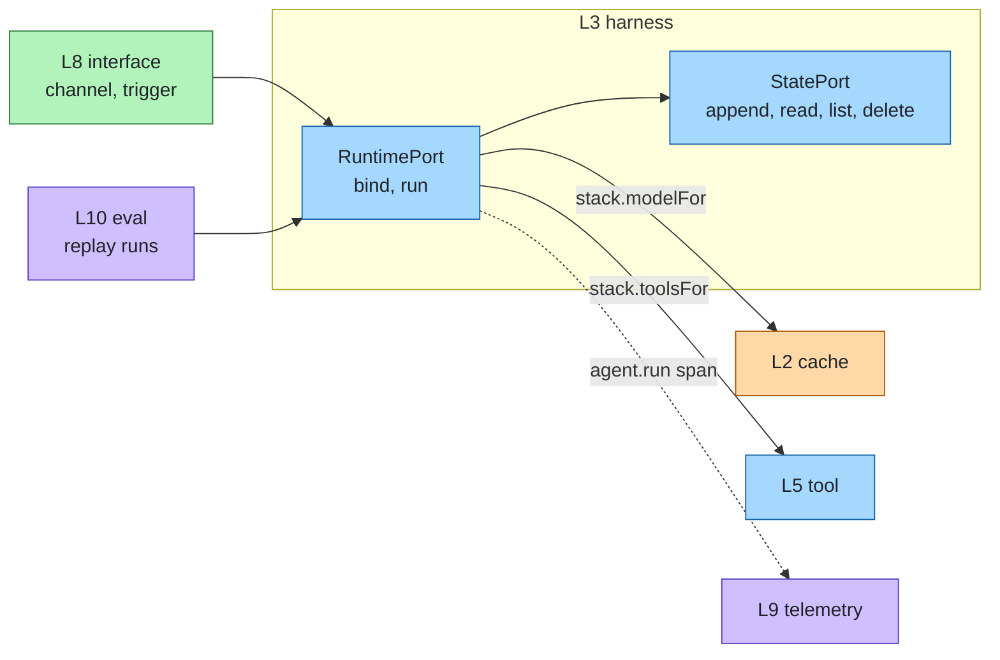
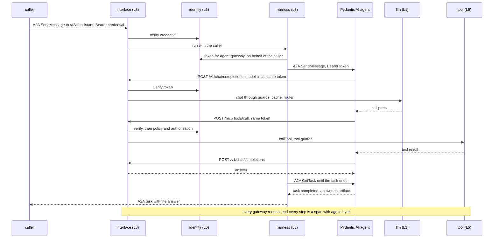

# Agent runtime

Layer id `harness` (L3), Agent plane. *How does the agent loop run and keep state?*

## Responsibility

Run the agent loop: prompts, tool calls, policy and approvals, budgets, durability and multi-agent patterns.
Everything above the model and below the interface.

agent-layers is the container; the runtime is one component that fills this slot and is swappable like every other
layer. A runtime receives the composed stack, so guards, cache, routing, knowledge, authorization, credentials and
telemetry are already applied to its model and tool calls.

## Ports

| Port | What it does |
|---|---|
| [RuntimePort](../../spec/ports/RuntimePort.md) | `bind` an agent spec to a runnable agent that streams run events |
| [StatePort](../../spec/ports/StatePort.md) | `append` / `read` / `list` / `delete` the event log of a session |

Data shapes: [agent-spec.json](../../spec/schemas/agent-spec.json), [run-result.json](../../spec/schemas/run-result.json),
[run-event.json](../../spec/schemas/run-event.json).

An `AgentSpec` carries `name`, `instructions`, `model`, `tools`, `knowledge`, `settings` (`temperature`,
`maxOutputTokens`, `stop`) and `ext`; `params` was removed at 1.0. A run ends with a `RunResult`
(`runId`, `status`, `output`, `reason?`, `usage?`, `costUsd?`, `events?`) and its events have fixed types:
`run.start`, `model.reply`, `tool.call`, `tool.result`, `text`, `run.end`. Adapter events are `<adapter>.<name>`.

| Status | Meaning |
|---|---|
| `completed` | The agent answered. |
| `failed` | An error ended the run. |
| `stopped` | Something ended the run on purpose: a guard, a denial, a limit, a cancellation. |
| `waiting` | The run stopped for a human answer (an approval, input, authentication). A later run in the same session that makes the same call gets the decision. |

Whenever the status is not `completed`, `reason` is structured: `{ code, layer?, by?, stage?, detail? }`. Consumers
branch on `code` only: `guard_block`, `denied`, `aborted`, `timeout`, `limit`, `needs_input`, `needs_auth`, `rejected`,
`error` (config can add values that behave like one of them); `detail` is internal text and never parsed. A pending
approval ends the run `waiting` with `{ code: "needs_input", layer: "identity", by: <approval adapter>, detail: <approval id> }`.
Approvals are keyed by session id, caller and the access question with its arguments. A later run in the same
session, by the same caller, that makes the same call uses the decision: `approved` lets the call run once, `denied`
refuses it, still `pending` returns the same approval id, `expired` asks again. The session carries the decision, not
the conversation: `basic-runtime` and `reinloop` start each run from its input, so the follow-up message must lead
the model to the same call. Inbound adapters set the session: A2A uses the context id (per caller), the MCP server
its MCP session; a call without a session is keyed by its run.

### Where it sits



## Standards

- Markdown agent files with the common subagent front matter (`name`, `description`, `tools`, `model`).
- Agent Skills (`SKILL.md` folders) for procedural know-how.
- MCP, for serving agents as tools.
- CloudEvents for event triggers (see [interface](interface.md)).

## Boundaries

- The runtime owns the loop; the layers around it own everything else. It adds no policy of its own: authorization is
  [identity](identity.md), content checks are [guardrail](guardrail.md).
- Budgets (tokens, tool calls, spend) are enforced here and end the run `stopped` with reason code `limit`; see [cost](../cross-cutting/cost.md).
- Workers, queues and scheduled triggers start runs through [interface](interface.md) triggers.

## How to swap

A runtime adapter implements RuntimePort: it takes the stack and an agent spec and returns an agent whose `run` uses
`stack.modelFor` and `stack.toolsFor`. A runtime written in another language plugs in as a remote adapter (for example
over an agent-to-agent protocol) or through the gateway's endpoints. Writing one: [guide.md](../guide.md#write-a-runtime-adapter).

## Runtimes

The same agent file (`examples/minimal/agents/assistant.md`) runs on a runtime in the stack's process and on one in
another process and language. The agent file, the tools and the policies stay as they are; the profile picks the
runtime.

| Runtime | Runs | Reaches the model and tools through | Slot |
|---|---|---|---|
| [`reinloop`](../../adapters/reinloop) | In process (TypeScript) | `stack.modelFor` and `stack.toolsFor` | `"runtime": { "adapter": "reinloop" }` |
| [Pydantic AI](../../runtimes/pydantic-ai/README.md) | Own process (Python), served over A2A 1.0 | The gateway: `/v1` (OpenAI-compatible, model alias) and `/mcp` | `"runtime": { "adapter": "a2a", "options": { "url": "http://localhost:9100", "auth": { "audience": "agent-gateway" } } }` |

### Remote: Pydantic AI over A2A

Two processes. The gateway hosts the stack; the stack's runtime is the `a2a` adapter, which sends each run to the
Python agent; the Python agent calls the gateway back for its model and its tools, with the caller's credential. The
loop runs in Python; guards, cache, router, authorization, credentials for the caller and telemetry run in the
gateway, as for any other runtime. Profile `polyglot` of the minimal example; package
[`runtimes/pydantic-ai`](../../runtimes/pydantic-ai/README.md).



- **Model alias, never `agent:<name>`.** The Python agent calls `/v1` with an alias (`model` in the agent file); an
  `agent:` model would make the gateway run the stack's agent, which is the Python agent again.
- **Identity.** The `a2a` adapter's `auth.audience` names the gateway. In the prototype the static credentials table
  hands out the dev token for it; in production the `oidc` credentials adapter in `on-behalf-of` mode exchanges the
  caller's token. The gateway verifies the token on every call, so a token it rejects leaves the agent without
  model and tools.
- **Try it.** Start the Python agent (`uv run agent-layers-pydantic-ai` in `runtimes/pydantic-ai`, with
  `AGENT_FILE`), then `npx agent-layers gateway --profile polyglot` in `examples/minimal`. The end-to-end test runs
  both: `node --test runtimes/pydantic-ai/test-e2e.mjs`.

## Reference adapters

| Adapter | Maps |
|---|---|
| `basic-runtime` | An in-process tool-calling loop (prototype) |
| [`reinloop`](../../adapters/reinloop) | The [reinloop](https://github.com/aantenore/reinloop) (MIT) agent loop: budgets, compaction, parallel tool batches (prototype, production) |
| `memory-state` | An in-process event log (prototype) |
| [`sqlite-state`](../../adapters/sqlite-state) | An event log in one SQLite file through `node:sqlite` (prototype, production on a single node) |

**Runtime.** `reinloop` runs the loop and leaves governance to the stack: its model is `stack.modelFor` wrapped as a
reinloop provider and its tools are `stack.toolsFor`, so guards, cache, routing, knowledge, authorization, approvals,
credentials and the `agent.model.call` and `agent.tool.call` spans apply as for any runtime. reinloop's own guardrails, identity,
policy and knowledge features are not configured, so nothing runs twice. Budgets end a run `stopped` with reason
code `limit`, a guardrail block with `guard_block`; run cost is a `costUsd` field of `run.end` and of the run result. Pydantic AI runs as a remote runtime (see [Runtimes](#runtimes)); LangGraph, the OpenAI
Agents SDK and Google ADK are candidates.

**State.** When a call carries a `sessionId`, the stack appends the run's events to the state slot. `memory-state`
loses them on restart. `sqlite-state` keeps them in a WAL-journaled file with a versioned schema (default
`.agent-layers/state.db`, relative to the stack config); several processes on one host may share it, and a cluster
needs a networked database behind another StatePort adapter.

Full list: [adapters.md](../adapters.md).

## Reference setup

[`reference/harness/`](../../reference/harness/README.md) runs a sample agent file on the reinloop runtime against the
local model:

```bash
make test LAYER=harness
```

The live test loads `reference/harness/agents/assistant.md`, runs it against Ollama (`LLM_BASE_URL`, `LLM_MODEL`) and
asserts a completed run with non-empty output. It skips with a message if Ollama or the model is unavailable. The
runtime exposes an HTTP and SSE API on `REINLOOP_SERVE_PORT` (default 8700).
