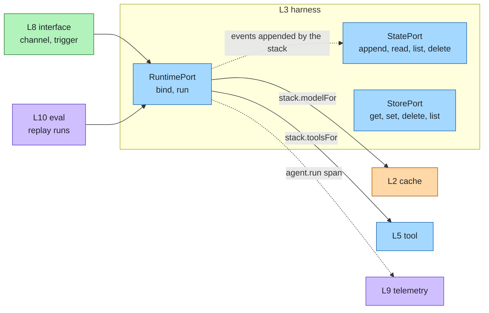
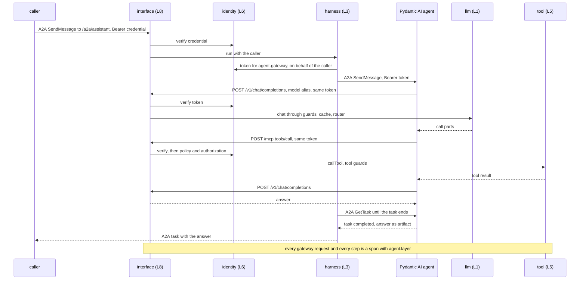

# Agent runtime

Layer id `harness` (L3), Agent plane. *How does the agent loop run and keep state?*

## Responsibility

Run the agent loop: prompts, tool calls, policy and approvals, budgets, durability and multi-agent patterns.
Everything above the model and below the interface.

agent-layers is the container; the runtime is one component that fills this slot and is swappable like every other
layer. A runtime receives the composed stack, so guards, cache, routing, knowledge, authorization, credentials and
telemetry are already applied to its model and tool calls.

## Ports

| Port | What it does |
|---|---|
| [RuntimePort](../../spec/ports/RuntimePort.md) | `bind` an agent spec to a runnable agent that streams run events |
| [StatePort](../../spec/ports/StatePort.md) | `append` / `read` / `list` / `delete` the event log of a session |
| [StorePort](../../spec/ports/StorePort.md) | `get` / `set` / `delete` / `list` small JSON values by key, with versions for compare-and-set |

Data shapes: [agent-spec.json](../../spec/schemas/agent-spec.json), [run-result.json](../../spec/schemas/run-result.json),
[run-event.json](../../spec/schemas/run-event.json), [store-entry.json](../../spec/schemas/store-entry.json).

An `AgentSpec` carries `name`, `instructions`, `model`, `tools`, `knowledge`, `settings` (`temperature`,
`maxOutputTokens`, `stop`) and `ext`; `params` was removed at 1.0. A run ends with a `RunResult`
(`runId`, `status`, `output`, `reason?`, `usage?`, `costUsd?`, `events?`) and its events have fixed types:
`run.start`, `model.reply`, `tool.call`, `tool.result`, `text`, `run.end`. Adapter events are `<adapter>.<name>`.

| Status | Meaning |
|---|---|
| `completed` | The agent answered. |
| `failed` | An error ended the run. |
| `stopped` | Something ended the run on purpose: a guard, a denial, a limit, a cancellation. |
| `waiting` | The run stopped for a human answer (an approval, input, authentication). `Stack.resume` continues it (see [Resume and cancel](#resume-and-cancel)); a later run in the same session that makes the same call also gets the decision. |

Whenever the status is not `completed`, `reason` is structured: `{ code, layer?, by?, stage?, detail? }`. Consumers
branch on `code` only: `guard_block`, `denied`, `aborted`, `timeout`, `limit`, `needs_input`, `needs_auth`, `rejected`,
`error` (config can add values that behave like one of them); `detail` is internal text and never parsed. A pending
approval ends the run `waiting` with `{ code: "needs_input", layer: "identity", by: <approval adapter>, detail: <approval id> }`.
Approvals are keyed by session id, caller and the access question with its arguments. A later run in the same
session, by the same caller, that makes the same call uses the decision: `approved` lets the call run once, `denied`
refuses it, still `pending` returns the same approval id, `expired` asks again. The session carries the decision, not
the conversation: `basic-runtime` and `reinloop` start each run from its input, so the follow-up message must lead
the model to the same call. Inbound adapters set the session, scoped to the verified caller: the `Agent-Session`
header or the `user` field (`openai-compatible`), the MCP session or `params._meta["agent-layers/session"]` on a
stateless MCP request, the A2A context id, the `agentsession` CloudEvents extension. An anonymous request gets no
client session, and a call without a session is keyed by its run.

### Where it sits



## Standards

- Markdown agent files with the common subagent front matter (`name`, `description`, `tools`, `model`).
- Agent Skills (`SKILL.md` folders) for procedural know-how.
- MCP, for serving agents as tools.
- CloudEvents for event triggers (see [interface](interface.md)).

## Boundaries

- The runtime owns the loop; the layers around it own everything else. It adds no policy of its own: authorization is
  [identity](identity.md), content checks are [guardrail](guardrail.md).
- Budgets (tokens, tool calls, spend) are enforced here and end the run `stopped` with reason code `limit`; see [cost](../cross-cutting/cost.md).
  The run bounds below are enforced by the core for every runtime; a runtime's own budgets are extra limits.
- Workers, queues and scheduled triggers start runs through [interface](interface.md) triggers.

## Run bounds

Every run has a deadline, a token and a cost budget, and a hop count, also when it runs alone
([0002](../decisions/0002-delegation-bounds.md)). The host computes them when the run starts, from `limits.run` and from
what a calling agent sent, which can only tighten them, and passes them in `ctx.bounds`:

| Bound | Set by | When it is reached |
|---|---|---|
| Deadline | `limits.run.timeoutMs` (300000 ms), or less when the caller sent less | The run's signal aborts; the model pipeline refuses further calls; the run ends `stopped`, `timeout` (`by: "sdk.deadline"`) |
| Tokens, cost | `limits.run.maxTokens`, `limits.run.maxCostUsd` (unbounded by default), priced with `pipeline.pricing` | The next model call is refused: `stopped`, `limit` (`by: "sdk.budget"`) |
| Hops | `limits.run.maxHops` (4); a run's hops are what the caller sent or its verified actor chain, whichever is larger | The run is refused before it starts: `stopped`, `hop_limit` (`by: "sdk.hops"`) |

The core checks them in the governed model and tools, so swapping the runtime keeps them. Runtime budgets stay as
extra limits, and the first limit reached stops the run: `basic-runtime` `maxTurns` (8), `reinloop` `budget.*`. When a
runtime reports no usage or cost, the host fills them from the run's ledger, only when every spend was known: a
reservation kept for a remote run that reported nothing counts against the budget but is never reported as a cost. A
runtime that calls another agent, like the `a2a` runtime, passes on what is left with `outboundBounds(ctx)`: the time
left (capped by its own time limit) minus `limits.delegation.marginMs`, hops plus one, a reservation of the budget; it
refuses locally, without a network call, when the next agent would be over the hop limit, and settles the reservation
with what the remote run reports. An agent that calls another one in the same process passes its own context to
`run`: the nested run is its delegate (hops plus one, a reservation, the parent as lineage, its own run id). A tool
call received with bounds (MCP `tools/call`) runs under them like a run, so a loop over MCP stops at the hop limit too. Limits are in [limits.md](../limits.md#limits).

## Resume and cancel

A run that ends `waiting` can be continued as the same run ([0003](../decisions/0003-run-resume.md)). The host keeps
its input, its caller (never the credential), its session, the call that waits (tool, arguments, approval id) and the
runtime's checkpoint: in the stack's store (`layers.store`) when there is one, for `limits.run.resumeTtlMs`, else in
memory (prototype; readiness warns on the production tier when approvals have no store).

```ts
const r = await (await stack.agent('assistant')).run('refund A1', { caller });
// r.status === 'waiting', r.ext['sdk.approval'].id === 'ap-1'
await stack.resume(r.runId, { approval: { id: 'ap-1', approved: true } }, { caller: reviewer });
await stack.resume(otherRun, { input: 'the order number is A2' }, { caller });
await stack.cancel(runId, { by: caller, reason: 'no longer needed' });
```

| Answer | Does |
|---|---|
| `{ approval: { id, approved, reason? } }` | decides the approval the run waits for (`ApprovalPort.decide`, `by` the resumer, authorized with `decide`), then continues |
| `{ input }` | continues a run waiting for input; refused while its approval is still pending (decide it first, here or on the gateway) |

Only the caller that started the run may resume or cancel it, unless the authorization port allows the caller
`decide` for it. The run keeps its id, session and caller, so the stack's tools find the decision for the call that
waited. `basic-runtime` and `reinloop` implement `resume`: `basic-runtime` keeps the conversation and the calls left
of the last answer, `reinloop` its own event log; each runs exactly the call that waited, adds an input answer after
its result, and goes on with the next turn, so the model is not asked the first answer again. The `a2a` runtime
continues the remote task with a follow-up message (input only: the remote agent decides its own approvals). A
runtime without `resume` is run again from its input, which with a real model is not deterministic. `cancel` aborts a
run in flight in this process, or withdraws a waiting run and its approval; a cancelled run cannot be resumed. Over the
network: the gateway's [run routes](../gateway.md#runs), A2A follow-ups that name an `input-required` task, and A2A
CancelTask.

## How to swap

A runtime adapter implements RuntimePort: it takes the stack and an agent spec and returns an agent whose `run` uses
`stack.modelFor` and `stack.toolsFor`. A runtime written in another language plugs in as a remote adapter (for example
over an agent-to-agent protocol) or through the gateway's endpoints. Writing one: [guide.md](../guide.md#write-a-runtime-adapter).

## Runtimes

The same agent file (`examples/minimal/agents/assistant.md`) runs on a runtime in the stack's process and on one in
another process and language. The agent file, the tools and the policies stay as they are; the profile picks the
runtime.

| Runtime | Runs | Reaches the model and tools through | Slot |
|---|---|---|---|
| [`reinloop`](../../adapters/reinloop) | In process (TypeScript) | `stack.modelFor` and `stack.toolsFor` | `"runtime": { "adapter": "reinloop" }` |
| [Pydantic AI](../../runtimes/pydantic-ai/README.md) | Own process (Python), served over A2A 1.0 | The gateway: `/v1` (OpenAI-compatible, model alias) and `/mcp` | `"runtime": { "adapter": "a2a", "options": { "url": "http://localhost:9100", "auth": { "audience": "agent-gateway" } } }` |

### Remote: Pydantic AI over A2A

Two processes. The gateway hosts the stack; the stack's runtime is the `a2a` adapter, which sends each run to the
Python agent; the Python agent calls the gateway back for its model and its tools, with the caller's credential. The
loop runs in Python; guards, cache, router, authorization, credentials for the caller and telemetry run in the
gateway, as for any other runtime. Profile `polyglot` of the minimal example; package
[`runtimes/pydantic-ai`](../../runtimes/pydantic-ai/README.md).



- **Model alias, never `agent:<name>`.** The Python agent calls `/v1` with an alias (`model` in the agent file); an
  `agent:` model would make the gateway run the stack's agent, which is the Python agent again.
- **Identity.** The `a2a` adapter's `auth.audience` names the gateway. In the prototype the static credentials table
  hands out the dev token for it; in production the `oidc` credentials adapter in `on-behalf-of` mode exchanges the
  caller's token. The gateway verifies the token on every call, so a token it rejects leaves the agent without
  model and tools.
- **Try it.** Start the Python agent (`uv run agent-layers-pydantic-ai` in `runtimes/pydantic-ai`, with
  `AGENT_FILE`), then `npx agent-layers gateway --profile polyglot` in `examples/minimal`. The end-to-end test runs
  both: `node --test runtimes/pydantic-ai/test-e2e.mjs`.

## Reference adapters

| Adapter | Maps |
|---|---|
| `basic-runtime` | An in-process tool-calling loop (prototype) |
| [`reinloop`](../../adapters/reinloop) | The [reinloop](https://github.com/aantenore/reinloop) (MIT) agent loop: budgets, compaction, parallel tool batches (prototype, production) |
| `memory-state` | An in-process event log (prototype) |
| [`sqlite-state`](../../adapters/sqlite-state) | An event log in one SQLite file through `node:sqlite` (prototype, production on a single node) |

**Runtime.** `reinloop` runs the loop and leaves governance to the stack: its model is `stack.modelFor` wrapped as a
reinloop provider and its tools are `stack.toolsFor`, so guards, cache, routing, knowledge, authorization, approvals,
credentials and the `agent.model.call` and `agent.tool.call` spans apply as for any runtime. reinloop's own guardrails, identity,
policy and knowledge features are not configured, so nothing runs twice. Budgets end a run `stopped` with reason
code `limit`, a guardrail block with `guard_block`; run cost is a `costUsd` field of `run.end` and of the run result. Pydantic AI runs as a remote runtime (see [Runtimes](#runtimes)); LangGraph, the OpenAI
Agents SDK and Google ADK are candidates.

**State.** When a call carries a `sessionId`, the stack appends the run's events to the state slot. The log is the
session's audit and replay record: no runtime reads it back yet, so a run does not see the earlier runs of its session
(conversation continuity from the log is planned). `memory-state`
loses them on restart. `sqlite-state` keeps them in a WAL-journaled file with a versioned schema (default
`.agent-layers/state.db`, relative to the stack config); several processes on one host may share it, and a cluster
needs a networked database behind another StatePort adapter.

**Store.** The `store` slot (`layers.store`, `stack.ports.store`) keeps the current value of named things: a host's
per-session state, a cursor, a counter. It belongs here, beside the event log, because this layer answers how the
agent keeps state: the log records what happened, append-only; the store holds what is true now, read and replaced.
It is not the cache layer's CachePort, which may drop an entry at any time. Keys are `<namespace>.<name>`, values are
small JSON (65536 bytes by default), and every write returns a version: `set(key, value, { ifVersion })` writes only
over that version (`0`: only a new key) and otherwise answers a conflict with the current version, so two writers never
overwrite each other unseen. `ttlMs` makes a key expire. Nothing in the core writes to it; it is there for hosts and
adapters. `memory-store` is for development; on the production tier the readiness gate refuses it (prototype only), so
a profile that configures a store needs a durable adapter: `sqlite-store` (one SQLite file, compare-and-set across the
processes sharing it, default `.agent-layers/store.db`). The slot is optional and not in the production requirements.

Full list: [adapters.md](../adapters.md).

## Reference setup

[`reference/harness/`](../../reference/harness/README.md) runs a sample agent file on the reinloop runtime against the
local model:

```bash
make test LAYER=harness
```

The live test loads `reference/harness/agents/assistant.md`, runs it against Ollama (`LLM_BASE_URL`, `LLM_MODEL`) and
asserts a completed run with non-empty output. It skips with a message if Ollama or the model is unavailable. The
runtime exposes an HTTP and SSE API on `REINLOOP_SERVE_PORT` (default 8700).
