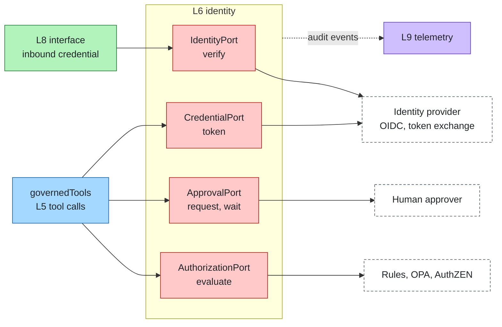
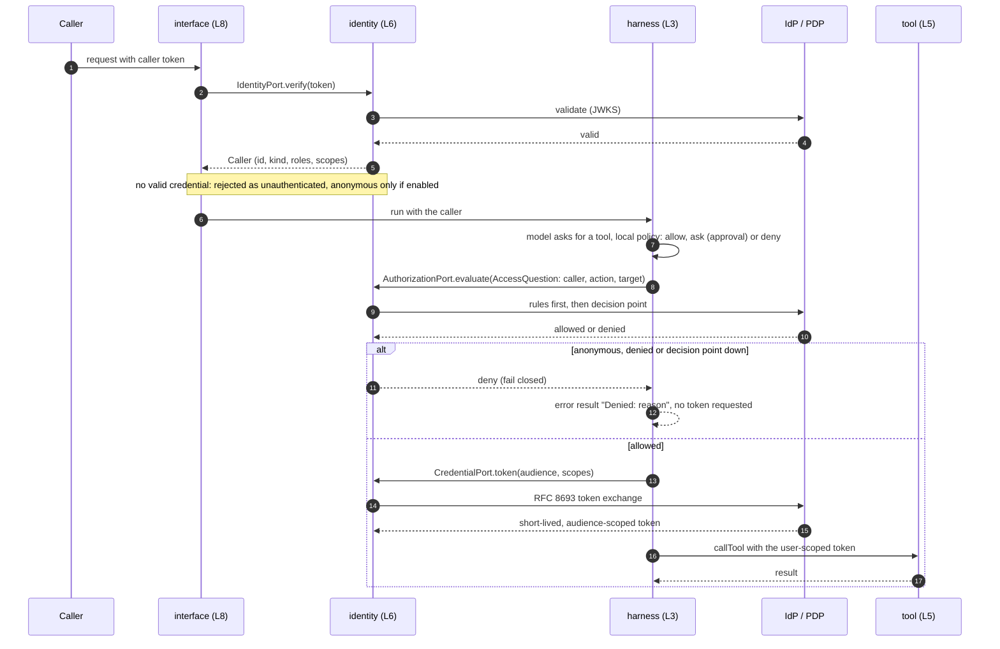

# Identity & access

Layer id `identity` (L6), Control plane. *Who is it, on whose behalf, and what is allowed?*

## Responsibility

Know who is calling, act with the right credentials, and decide what is allowed. An agent acts either on behalf of a
user or as its own identity.

## Ports

| Port | What it does |
|---|---|
| [IdentityPort](../../spec/ports/IdentityPort.md) | `verify` an inbound credential into a `Caller` |
| [CredentialPort](../../spec/ports/CredentialPort.md) | `token` for an outbound call, on behalf of the caller or as the agent |
| [AuthorizationPort](../../spec/ports/AuthorizationPort.md) | `evaluate` an `AccessQuestion` into an `AccessDecision` |
| [ApprovalPort](../../spec/ports/ApprovalPort.md) | Human approval for actions the policy marks `ask` |

Data shapes: [caller.json](../../spec/schemas/caller.json), [access-question.json](../../spec/schemas/access-question.json),
[access-decision.json](../../spec/schemas/access-decision.json), [approval.json](../../spec/schemas/approval.json).

A `Caller` is `{ id, kind, roles, scopes, name?, credential? }` (`kind` is `user` or `agent`); the inbound `credential`
lives in memory only. An `AccessQuestion` is `{ caller, action, target: { kind, id, layer, risk, agent, attrs? }, args? }`
and an `AccessDecision` is `{ allowed, reason? }`. An unauthenticated call is the explicit anonymous caller, never the
agent. Policy engines read these names: an OPA policy sees them as `input.caller` and `input.target`.

### Where it sits



## Standards

Mapped by the adapters, not by the ports:

- OIDC / OAuth 2: JWT access tokens verified through discovery and JWKS.
- RFC 8693 token exchange: on-behalf-of.
- Client credentials: the agent's own identity.
- OpenID AuthZEN for authorization requests (the `authzen` adapter translates an `AccessQuestion` to AuthZEN and back).
- Open Policy Agent: policies are written against the SDK names (`input.caller.roles`, `input.target.risk`).

## On-behalf-of flow

A user calls, the agent acts with that user's rights. Tools receive a token scoped to them, never the caller's inbound credential.



## Boundaries

- Who may do what is identity; whether the content is acceptable is [guardrail](guardrail.md).
- Authorization is local rules first (`allow` / `ask` / `deny` by tool, risk and `when: {roles, scopes, kind}`), then
  the external decision point. A local `deny` is final, and a failing decision point denies (fail closed).
- Credentials and tokens never appear in events, logs or traces. Telemetry masks attribute keys that look like secrets.
- Every access decision is emitted to [telemetry](telemetry.md) as an audit event (`agent.access.check` span,
  `agent.access.decisions` metric).
- When a call needs a person (`ask`), the run ends with status `waiting` and reason `needs_input` (layer `identity`,
  `by` the approval adapter, `detail` the approval id). A later run in the same session, by the same caller, that
  makes the same call (same arguments) gets the decision: approved runs once, denied is refused, pending keeps its
  id. See [harness](harness.md) and [ApprovalPort](../../spec/ports/ApprovalPort.md).

## How to swap

- Any OIDC provider (Keycloak, Entra ID, Auth0, Zitadel, Authentik) works through the same adapter by changing the
  issuer and client; on-behalf-of needs RFC 8693 support at the token endpoint.
- Any AuthZEN-compliant decision point, or OPA, implements AuthorizationPort.
- Corporate identity is a profile change, not a code change; see [guide.md](../guide.md#from-prototype-to-production).

## Reference adapters

| Adapter | Maps |
|---|---|
| `static-identity` | A static token table (development only); IdentityPort and CredentialPort |
| `rules-authorization` | A local rule list |
| `memory-approval` | An in-process approval store |
| `oidc` | OIDC / OAuth 2.0: JWT verification, RFC 8693 token exchange, client credentials |
| `authzen` | OpenID AuthZEN access evaluation |
| `opa` | Open Policy Agent data API |

Full list: [adapters.md](../adapters.md).

## Reference setup

[`reference/identity/`](../../reference/identity/README.md) runs Keycloak (Apache-2.0, realm `agents`) and Open Policy
Agent (Apache-2.0). Keycloak listens on `KEYCLOAK_PORT` (default 8080; use 18080 when 8080 is busy and set
`OIDC_ISSUER` to match); OPA on 8181. Variables: `OIDC_ISSUER`, `OIDC_CLIENT_ID`, `OIDC_CLIENT_SECRET`,
`TOOLS_AUDIENCE`, `OPA_URL`.

```bash
make up LAYER=identity
make test LAYER=identity
make down LAYER=identity
```

The test gets a real token from Keycloak, exchanges it, and checks allow and deny decisions from OPA.
