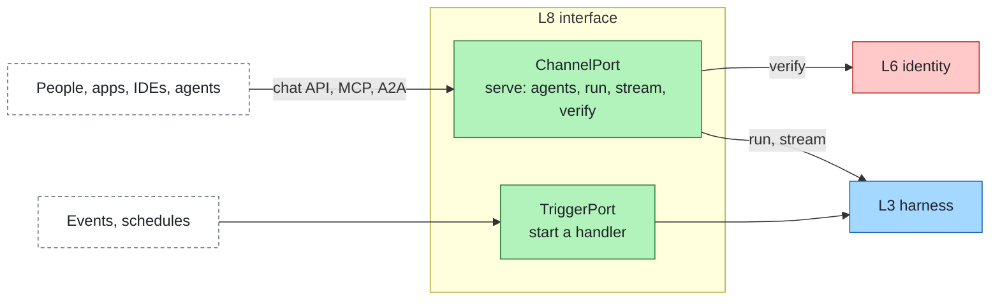

# Interfaces, channels & triggers

Layer id `interface` (L8), Experience plane. *Who talks to it and what starts it?*

## Responsibility

How people, apps and other agents talk to an agent, and what starts a run without a person. A channel turns a chat UI,
an IDE, another agent or a web frontend into a call to the [harness](harness.md) and streams the run back. A trigger
starts runs from events and schedules. Neither adds agent logic.

## Ports

| Port | What it does |
|---|---|
| [ChannelPort](../../spec/ports/ChannelPort.md) | `serve` a stack host to people, apps and agents; the host exposes `agents`, `run`, `stream` and `verify` |
| [TriggerPort](../../spec/ports/TriggerPort.md) | `start` a handler that receives events and schedules |

Data shapes: [trigger.json](../../spec/schemas/trigger.json), [run-result.json](../../spec/schemas/run-result.json). A
`Trigger` is `{ id, kind, source, at?, agent?, data? }`; an event standard's own id and extra attributes (the
CloudEvents `id` and `subject`) are kept in `ext`. The channel envelope (`InboundContext`) carries the `caller` and an
opaque trace context `{ parent, state? }` that the channel copies in and out unchanged.

### Where it sits

## Standards

| Audience | Standard |
|---|---|
| Any chat UI | OpenAI-compatible chat API |
| IDEs and MCP clients | MCP server |
| Other agents | A2A (Agent2Agent, Linux Foundation, Apache-2.0) |
| Agent to frontend event streaming | AG-UI (MIT) |
| Events | CloudEvents |

## Boundaries

- **Identity.** The channel passes the caller's credential through; [identity](identity.md) verifies it into a
  `Caller`. The interface never invents an identity.
- **Standards stay at the edge.** A channel translates its standard (OpenAI Chat Completions, MCP, A2A) to the SDK
  language and back; a run status maps to the standard's own state (`waiting` to A2A `input-required`, for example).
- **Ingress.** Traffic enters through the ingress of [infra](infra.md).
- **Transparency.** The channel tells users they are talking to an agent; see
  [governance](../cross-cutting/governance-compliance.md).

## How to swap

Any chat UI that speaks the OpenAI API replaces another with a base URL change. MCP clients and A2A agents connect to
the same agents through their own endpoints. Where a channel has no standard, write a channel adapter; the conformance
suite checks that the run carries the caller, that streamed output reassembles to the final output, and
that errors surface as channel-native errors.

## Reference adapters

| Adapter | Maps |
|---|---|
| `terminal-channel` | A terminal (stdin and stdout) |
| `openai-compatible` | OpenAI Chat Completions: model aliases and `agent:<name>`, mounted by the gateway |
| `mcp` | Model Context Protocol server: the governed tools and knowledge, mounted by the gateway |
| `a2a` | Agent2Agent (A2A) 1.0: agent cards and JSON-RPC, mounted by the gateway |
| `cloudevents` | CloudEvents 1.0 HTTP binding as a trigger, mounted by the gateway |

How the gateway hosts them: [gateway.md](../gateway.md). Full list: [adapters.md](../adapters.md).

## Reference setup

None yet. LibreChat (MIT) pointed at the OpenAI-compatible endpoint is the planned reference. The planned test starts the
stack, sends a chat completion with an agent name as `model`, and checks the streamed answer against the same run's
final output.
