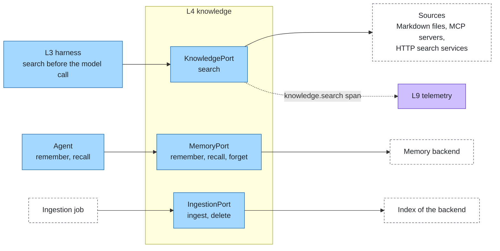
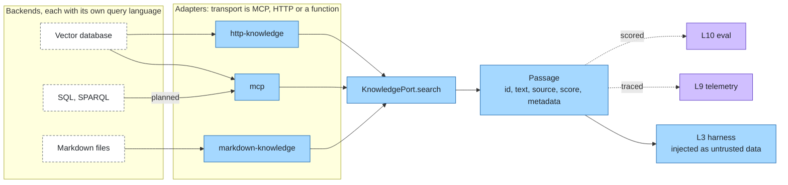

# Knowledge & memory

Layer id `knowledge` (L4), Agent plane. *What does it know?*

## Responsibility

Give agents information that is not in the model. That is more than RAG over documents: it includes structured data,
graphs and ontologies, a curated wiki, long-term memory and procedural know-how. Retrieval returns passages; the
runtime decides how to present them.

## Ports

| Port | What it does |
|---|---|
| [KnowledgePort](../../spec/ports/KnowledgePort.md) | `search` a source and answer with passages |
| [MemoryPort](../../spec/ports/MemoryPort.md) | `remember` / `recall` / `forget` long-term memory in a scope |
| [IngestionPort](../../spec/ports/IngestionPort.md) | `ingest` / `delete` documents in a backend |

Data shapes: [passage.json](../../spec/schemas/passage.json), [knowledge-document.json](../../spec/schemas/knowledge-document.json).

### Where it sits



## Standards

There is no single standard, because the sources differ:

| Knowledge type | Query standard |
|---|---|
| Documents | none; each vector database has its own API |
| Structured data | SQL |
| Graphs and ontologies | SPARQL + RDF / OWL / SKOS (W3C); ISO GQL, Cypher |
| Curated wiki | files + git |
| Long-term memory | none |
| Procedural know-how | Agent Skills |

**Transport is standardised, the result is not.** MCP defines how an agent reaches a source (tools, resources) but not
what a search returns: every MCP server answers in its own shape. So the layer has two parts:

- **Transport:** MCP, HTTP or a function.
- **Result contract:** `KnowledgePort.search` returns `Passage { id, text, source, score, metadata }`.

Adapters translate each backend into `Passage`. The uniform result is what lets [telemetry](telemetry.md) trace and
[eval](eval.md) score retrieval the same way for every backend.

## Transport and result

Backends differ and so does their transport. The result is always a `Passage`.



## Boundaries

- Read-only context retrieval is knowledge; anything with side effects is a [tool](tool.md).
- The stack injects the top passages before the model call as a delimited block marked untrusted, so retrieved text is
  data and not instructions (see [security](../cross-cutting/security.md)).
- The caller's identity reaches every source, so a source can enforce per-user access.
- **Ingestion.** Converting PDF, DOCX and other formats to Markdown or chunks happens before indexing and is not part
  of the search contract.
- **Graph retrieval.** Graph-plus-vector systems sit behind an adapter; nothing in the contract changes.

## How to swap

- Any MCP server whose tool returns passages works through the `mcp` adapter.
- Any HTTP service implementing `POST {url} {query,k,filter}` → `{passages}` works through `http-knowledge`.
- Anything else is an adapter implementing KnowledgePort, checked with the conformance suite (fixed corpus, `k` is
  respected, a filter narrows the result, results validate against `passage.json`).

## Reference adapters

| Adapter | Maps |
|---|---|
| `markdown-knowledge` | A folder of Markdown files, split by heading (zero infrastructure) |
| `http-knowledge` | Any HTTP search service returning passages |
| `mcp` | MCP servers as knowledge sources |

Planned: Qdrant, SQL and SPARQL sources. Full list: [adapters.md](../adapters.md).

## Reference setup

[`reference/knowledge/`](../../reference/knowledge/README.md) runs Qdrant (Apache-2.0) with `mcp-server-qdrant`
(Apache-2.0) for documents, and a Markdown wiki folder that needs no services. Docling (MIT) is the suggested
converter for PDFs and Office files; Graphiti (Apache-2.0) and LightRAG (MIT) are optional graph backends; Apache Jena
Fuseki and MCP Toolbox for Databases (both Apache-2.0) are the next references for SPARQL and SQL. Variables:
`QDRANT_URL`, `QDRANT_COLLECTION`, `WIKI_DIR`.

```bash
make up LAYER=knowledge
make test LAYER=knowledge
make down LAYER=knowledge
```

The wiki tests run without Docker.
