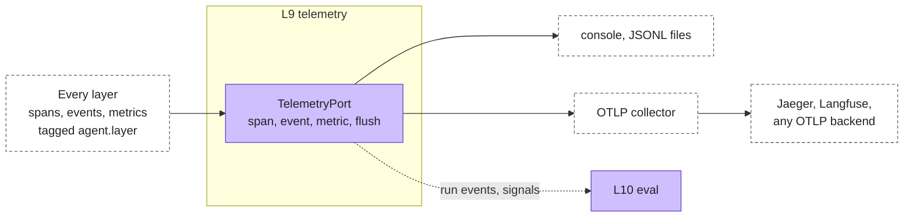
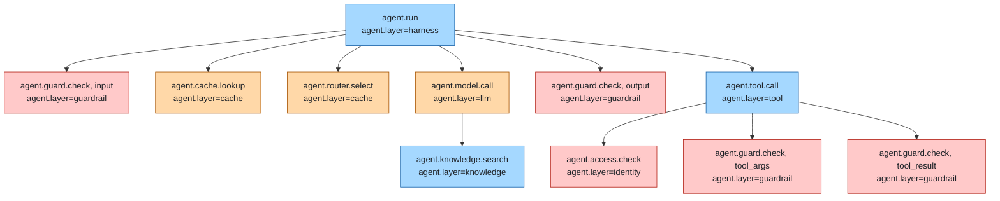

# Telemetry & observability

Layer id `telemetry` (L9), Insight plane. *What happened?*

## Responsibility

See what agents do: traces for every run, metrics for cost, tokens, tool calls, access and guardrail activity. It is
also the input of [eval](eval.md).

## Ports

| Port | What it does |
|---|---|
| [TelemetryPort](../../spec/ports/TelemetryPort.md) | `span`, `event` and `metric` calls, each tagged with `agent.layer`; several adapters can run at once |

### Where it sits



## Standards

The core emits only `agent.*` names (spans, events, metrics and attributes, listed in
[TelemetryPort](../../spec/ports/TelemetryPort.md#names)). The `otlp` adapter translates them to OpenTelemetry OTLP
with the GenAI semantic conventions (`gen_ai.*`), so existing dashboards keep working. `console-telemetry` and
`jsonl-telemetry` write the `agent.*` names.

## Span tree

One run, as the stack records it. Every span carries `agent.layer`.



## Boundaries

- **`agent.layer` on every span, event and metric**, so any trace can be filtered or attributed by layer. The values are
  the layer ids.
- Spans: `agent.run`, `agent.model.call`, `agent.tool.call`, `agent.access.check`, `agent.guard.check`,
  `agent.knowledge.search`, `agent.cache.lookup`, `agent.router.select`. Metrics: `agent.model.tokens` (with
  `agent.tokens.kind`: `input` or `output`), `agent.tool.calls`, `agent.access.decisions`, `agent.guard.actions`.
  Attributes such as `agent.run.id`, `agent.model.finish`, `agent.tool.outcome` and `agent.guard.action` are listed in
  the port page. The `otlp` adapter exports `gen_ai.*` names (`gen_ai.client.token.usage`,
  `gen_ai.client.operation.duration`, `invoke_agent`, `chat`, `execute_tool`) for dashboards; other `agent.*` names go
  out unchanged.
- No tokens or secrets in attributes; the stack masks keys that look like secrets before adapters see them.
- **One trace across processes.** The core treats the trace context (`CallContext.trace`, `{ parent, state? }`) as an
  opaque value. The gateway copies the W3C `traceparent` and `tracestate` of each request into it and starts its
  request span under it; the telemetry adapter that wrote the value (`otlp`) owns the format and parses it; the `a2a` runtime, `openai-compatible` models and `mcp` servers over HTTP send the
  context of the active span. A remote runtime that forwards the header it received (the Pydantic AI runtime does) puts
  its model and tool calls back at the gateway into the same trace. `otlp` and `jsonl-telemetry` keep the ids.
- **Audit.** Denials and guard actions are visible here; see [governance](../cross-cutting/governance-compliance.md).

## How to swap

An OTLP adapter exports to one endpoint. Change the collector's exporters to send to Tempo, Grafana, Datadog or any
OTLP backend; no agent change is needed. A custom adapter is only for destinations OTLP cannot reach.

## Reference adapters

| Adapter | Maps |
|---|---|
| `console-telemetry` | Terminal output, one line per span |
| `jsonl-telemetry` | JSON Lines files |
| `otlp` | OTLP; writes `agent.*` as the GenAI semantic conventions (`gen_ai.*`) |

Full list: [adapters.md](../adapters.md).

## Reference setup

[`reference/telemetry/`](../../reference/telemetry/README.md) runs the OpenTelemetry Collector (Apache-2.0) fanning
out to Jaeger (Apache-2.0) and Langfuse (MIT core; the `ee/` directories are under a separate commercial license and
are not used). Phoenix (Elastic License 2.0) is deliberately not used. Variables: `OTEL_EXPORTER_OTLP_ENDPOINT`,
`LANGFUSE_URL`, `LANGFUSE_PUBLIC_KEY`, `LANGFUSE_SECRET_KEY`, `JAEGER_UI`.

```bash
make up LAYER=telemetry
make test LAYER=telemetry
make down LAYER=telemetry
```

The test runs an agent, then looks up its trace in Jaeger and Langfuse and checks the span names and `agent.layer`.
