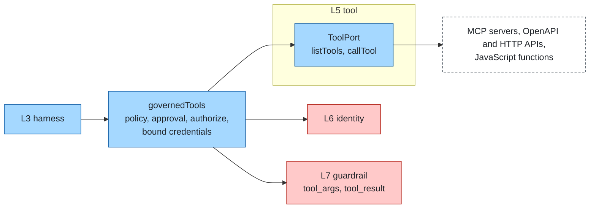

# Tools

Layer id `tool` (L5), Agent plane. *What can it do?*

## Responsibility

Let agents act: call APIs, read systems, run code. Tools are the main place where agents touch the outside world, so
they are also where [identity](identity.md) and [guardrail](guardrail.md) apply.

## Ports

| Port | What it does |
|---|---|
| [ToolPort](../../spec/ports/ToolPort.md) | `listTools` and `callTool`; a `ToolResult` is `{ ok, text, data?, ext? }`, and errors are results, not exceptions |

Data shapes: [tool-spec.json](../../spec/schemas/tool-spec.json), [tool-result.json](../../spec/schemas/tool-result.json).

A `ToolSpec` has `name`, `description`, `params` (JSON Schema of the arguments object), and optionally `risk`, `layer`,
`audience` and `attrs` (plain attributes a policy may read, such as an owner). Arguments reach the tool as an object.

### Where it sits



## Standards

Mapped by adapters, not by the port:

- MCP (stdio and streamable HTTP).
- OpenAPI 3.

## Boundaries

- Every call goes through the `governedTools` pipeline: prefixed names, local policy, approval, authorization,
  `tool_args` guards, the call with credentials bound to the caller, `tool_result` guards.
- A tool that needs a token declares an audience; the stack obtains it for the caller. Agents and prompts never see it.
- **Sandbox.** Tools that run code do it in an OCI container with the network off; gVisor is an optional stronger
  boundary. See [security](../cross-cutting/security.md).
- **Egress.** HTTP tools reach only allowed hosts.

## How to swap

Point the stack at any MCP server, describe any HTTP API in config, import an OpenAPI description, or write a function.
Each way is an adapter on ToolPort; none needs a core change.

## Reference adapters

| Adapter | Maps |
|---|---|
| `functions` | JavaScript functions with a JSON Schema for the arguments and a risk level |
| `http-tools` | Declarative HTTP calls |
| `mcp` | MCP servers as tools |
| `openapi` | An OpenAPI 3 document, one tool per operation |

Full list: [adapters.md](../adapters.md).

## Reference setup

[`reference/tool/`](../../reference/tool/README.md) runs go-httpbin (MIT) as the API under test and an OpenAPI-to-MCP
bridge (FastMCP, Apache-2.0) generated from a small OpenAPI description. The tests call httpbin through declarative
tools, native OpenAPI import and the MCP bridge. Variables: `HTTPBIN_URL`, `HTTPBIN_PORT`, `OPENAPI_MCP_URL`,
`OPENAPI_MCP_PORT`.

```bash
make up LAYER=tool
make test LAYER=tool
make down LAYER=tool
```
