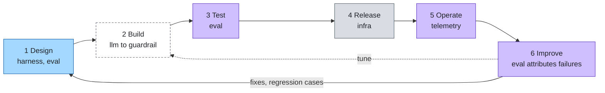

# Lifecycle

How an agent moves from idea to production and back. Each phase maps to the layers that do the work. Overview in
[stack.md](stack.md).

## 1. Design (harness, eval)

Start with the agent file and its evaluation criteria, together.

- **Agent file (`harness`).** A Markdown file: purpose, instructions, tools, model, `settings` (temperature, output limit, stop), budget. It is the unit of review and
  release.
- **Eval criteria (`eval`).** A first dataset of `EvalCase` lines: what a good answer is, and which cases must be
  refused. Writing them first makes "done" testable.

## 2. Build (llm to guardrail)

Wire the layers the agent needs, each through its port:

- `llm` model and `cache` gateway (routing, cache, quotas)
- `knowledge` sources and `tool` sources
- `identity`: who calls, which credentials the tools get, the authorization policy
- `guardrail` guards for the stages that matter

Cross-cutting rules apply here: [security](cross-cutting/security.md),
[governance](cross-cutting/governance-compliance.md), [cost](cross-cutting/cost.md).

## 3. Test (eval)

Run the dataset through the agent, score it with per-layer evaluators, and replay stored runs against the new
version. A change ships only if the score does not regress. Include red-team cases.

## 4. Release (infra)

The `infra` pipeline deploys through the chosen target (`compose` or `k8s`, GitOps with Argo CD). Agents are
versioned files in git, so the repository is the agent registry: a release is a tag, a rollback is a revert, and every
behaviour change has an author and a review.

## 5. Operate (telemetry)

Traces and metrics for every run (`agent.*` names), audit events for denials and guard actions, cost per agent. Alerts on error rate,
latency and spend.

## 6. Improve (eval, back to harness, knowledge and tool)

Production traces become evaluation data. The diagnose agent attributes each failure to one layer, and the fix lands
there: a prompt in `harness`, retrieval tuning in `knowledge`, a clearer tool description in `tool`, a policy or guard
rule in `identity` or `guardrail`. The failing case stays in the dataset as a regression test, and the loop starts
again. See [eval](layers/eval.md).
