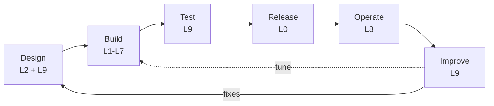

# Lifecycle

How an agent moves from idea to production and back. Each phase maps to the layers that do the work. Overview in
[stack.md](stack.md).

## 1. Design (L2, L9)

Start with the agent file and its evaluation criteria, together.

- **Agent file (L2).** A Markdown file: purpose, instructions, tools, model, budget. It is the unit of review and
  release.
- **Eval criteria (L9).** A first dataset of `EvalCase` lines: what a good answer is, and which cases must be refused.
  Writing them first makes "done" testable.

## 2. Build (L1-L7)

Wire the layers the agent needs, each through its extension point:

- L1 model and L7 gateway (routing, cache, quotas)
- L3 knowledge sources and L4 tools
- L5 identity: who calls, which credentials the tools get, the authorization policy
- L6 guards for the stages that matter

Cross-cutting rules apply here: [security](cross-cutting/security.md),
[governance](cross-cutting/governance-compliance.md), [cost](cross-cutting/cost.md).

## 3. Test (L9)

Run the dataset through the agent, score it with per-layer evaluators, and replay stored runs against the new
version. A change ships only if the score does not regress. Include red-team cases.

## 4. Release (L0)

The L0 pipeline builds images and deploys through the chosen target (`compose` or `k8s`, GitOps with Argo CD).
Agents are versioned files in git, so the repository is the agent registry: a release is a tag, a rollback is a
revert, and every behaviour change has an author and a review.

## 5. Operate (L8)

Traces and metrics for every run, audit events for denials and guard actions, cost per agent. Alerts on error rate,
latency and spend.

## 6. Improve (L9, back to L2-L4)

Production traces become evaluation data. The diagnose agent attributes each failure to one layer, and the fix lands
there: a prompt in L2, retrieval tuning in L3, a clearer tool description in L4, a policy or guard rule in L5 or L6.
The failing case stays in the dataset as a regression test, and the loop starts again. See the
[improvement loop](../README.md#improvement-loop).
