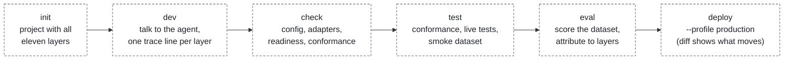
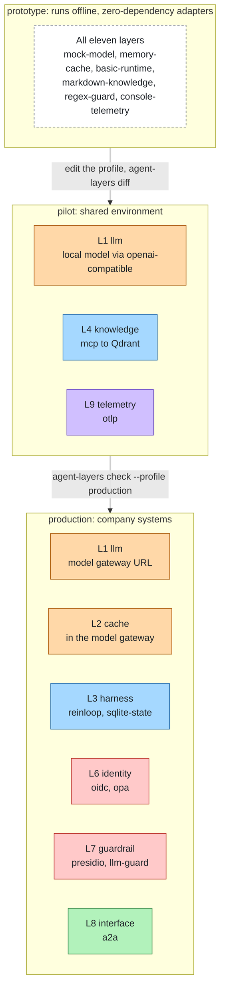

# Product

## Who it is for

Teams that build an agent and have to run it in production: application developers who want to start on a laptop
in minutes, and platform teams who have to plug that agent into the company's identity, observability, model
gateway and policy systems.

## The problem

Every agent framework ships its own integrations, and choosing the framework chooses them too: its vector store
wrappers, its tracing, its way of calling tools. Moving to another runtime, or to the company's own systems, means
rewriting the glue.

Production needs more than a loop around a model. It needs eleven layers (infrastructure, models, model access,
runtime, knowledge, tools, identity, guardrails, interfaces, telemetry, evaluation), and nobody assembles them
coherently: identity does not reach the tools, guardrails see the prompt but not the tool traffic, traces cannot say
which layer failed.

## What agent-layers promises

- **Swap any technology by changing one line of config.** Every layer is a port; every technology is an adapter
  that passes the same conformance suite.
- **Same stack from development to production.** Profiles extend each other and list only what differs; a
  readiness gate refuses a production profile that still uses prototype adapters or lacks identity, authorization,
  guardrails, telemetry or state.
- **Every layer observable and evaluable.** Each step is traced with the layer it belongs to, so evaluation can say
  which layer caused a failure.
- **Enforcement outside the agent.** In gateway mode, guards, authorization, credentials and telemetry run in the
  gateway, not in the agent's process.
- **Any runtime, any language.** The spec is language neutral (JSON Schemas and port pages). The runtime is an
  adapter; a runtime in another language uses the gateway's standard endpoints or a remote runtime adapter.

## The developer journey

1. `agent-layers init` — a project with all eleven layers wired and a prototype profile that runs offline.
2. `agent-layers dev` — talk to the agent in the terminal and see one trace line per layer.
3. `agent-layers check` — config, adapters, readiness and conformance.
4. `agent-layers test` and `agent-layers eval` — conformance, live reference tests, the project's dataset.
5. Promote one layer at a time to the company's systems by editing a profile; `agent-layers diff` shows what moves.
6. `agent-layers deploy --profile production`.

## Profile ladder

Profiles extend each other and list only what differs. Adapters marked planned are named in the example config but
not installed yet.

## Non-goals

- Not an agent runtime: it binds runtimes; the loop belongs to them.
- Not a model gateway: it routes and caches through adapters, and can sit in front of one.
- Not a vector database, an identity provider or an observability backend: it composes them.

## How it compares

| | Scope | Runtime | Language |
|---|---|---|---|
| Frameworks with their own integration layers (LangChain, LlamaIndex, Haystack, Semantic Kernel / Agent Framework, Spring AI, Genkit) | Many integrations, mostly models, knowledge and tools | The framework owns the loop | One language each (two for some) |
| Model gateways, MCP gateways | One or two layers (model access, or tool access) | Any | Any, over HTTP |
| agent-layers | All eleven layers, with identity and guardrails applied to model and tool traffic | Replaceable adapter | Any, through a language-neutral spec |

agent-layers can use all of these: a framework as a runtime adapter, a gateway behind the model port. What it adds
is the composition across layers and the path from prototype to production without changing the agent.
