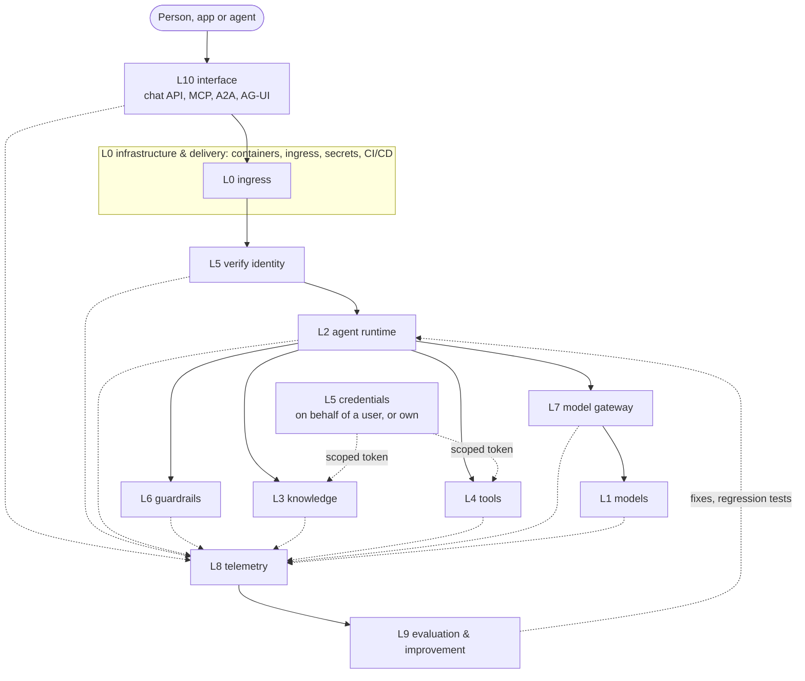

# The stack on one page

agent-layers is an open-source, runtime-agnostic agent platform. It has eleven layers, L0 to L10. L0-L9 cover what
runs; L10 is the interface. The reference runtime is [reinloop](https://github.com/aantenore/reinloop).

One rule applies to every layer:

> **Standard where it exists. SDK + conformance check where it does not. The reference is always free and swappable.**

Each layer is described with the same five fields:

1. **Responsibility.** What the layer does and nothing else.
2. **Standard.** The open standard it speaks, if one exists.
3. **Extension point.** The code you write to plug in something new.
4. **Reference implementation.** A free, open-source default you can replace.
5. **Adapter SDK + conformance.** Where no standard exists, a typed interface plus a check that proves an adapter
   behaves.

## Layers

| L | Layer | Responsibility | Standard | Extension point | Reference (free, swappable) | Adapter SDK + conformance | Around it |
|---|---|---|---|---|---|---|---|
| 0 | [Infrastructure & delivery](layers/L0-infra.md) | Run, provision and ship everything else | OCI, Compose Spec, Kubernetes API / Helm, OpenTofu (HCL), Vault-compatible secrets API | Deploy target adapter: `compose` or `k8s`; OpenTofu modules per cloud | Docker Compose, Traefik, OpenBao, OpenTofu | Deploy-target contract (images, env, secret refs in; endpoints out) | Ingress (Traefik), secrets (OpenBao), CI/CD + GitOps (Argo CD) |
| 1 | [Models](layers/L1-llm.md) | Generate completions and tool calls | OpenAI Chat Completions, Anthropic Messages | `Provider` | Ollama + `qwen3:4b` (Apache-2.0) | Provider conformance check | - |
| 2 | [Agent runtime](layers/L2-harness.md) | Run the agent loop: prompts, tools, policy, budgets, durability | Markdown agent files, Agent Skills | Middleware, patterns, `RunStore` | reinloop | - | Session state (Postgres store), workers, queues and scheduled triggers (CloudEvents), know-how as Skills |
| 3 | [Knowledge & memory](layers/L3-knowledge.md) | Give agents information that is not in the model | Per source type (see below); MCP for transport | `KnowledgeSource` | Qdrant, wiki folder, Apache Jena Fuseki, MCP Toolbox for Databases | `KnowledgeSource` + conformance | Ingestion (Docling), long-term memory, optional GraphRAG (Graphiti, LightRAG) |
| 4 | [Tools](layers/L4-tools.md) | Let agents act on the outside world | MCP, OpenAPI 3 | Any JS function (`defineTool`) | MCP reference servers, declarative HTTP tools | - | OpenAPI import, sandbox for code-executing tools |
| 5 | [Identity & access](layers/L5-identity.md) | Know who calls, act with the right credentials, decide what is allowed | OIDC / OAuth 2, RFC 8693, client credentials, OpenID AuthZEN | `IdentityVerifier`, `CredentialProvider`, `Authorizer` | Keycloak + OPA | Authorizer adapters + conformance | Tokens forwarded to MCP / HTTP tools, never logged |
| 6 | [Guardrails](layers/L6-guardrails.md) | Inspect inputs, outputs and tool traffic; allow, block or redact | none | `Guard` | Presidio + LLM Guard | `Guard` + HTTP guard contract + conformance | Zero-infra regex guard, audit events |
| 7 | [Model gateway (cache & router)](layers/L7-cache-router.md) | Cache, route and cap model calls | OpenAI-compatible gateway | `CacheStore`, `ModelRouter` | LiteLLM + Valkey | `ModelRouter` + conformance | In-process rule router, fallbacks, quotas |
| 8 | [Telemetry & observability](layers/L8-telemetry.md) | Traces and metrics for every run | OpenTelemetry + GenAI semantic conventions | `Sink` | OTel Collector + Langfuse + Jaeger | - | `agent.layer` on every span; metrics for tokens, cost, denials, guardrail actions |
| 9 | [Evaluation & improvement](layers/L9-eval.md) | Measure quality, find the layer a failure belongs to | none (promptfoo is the de facto tool) | `Evaluator` | promptfoo | `Evaluator` + dataset / result JSONL | Replay of stored runs, per-layer signals, diagnose agent, improvement loop |
| 10 | [Interfaces & channels](layers/L10-interface.md) | How people, apps and other agents talk to an agent | OpenAI-compatible chat API, MCP server, A2A, AG-UI | Channel adapters | LibreChat (MIT) | Channel adapter + conformance | - |

### Knowledge is not only RAG

L3 covers several kinds of knowledge, each with its own query standard (or none):

| Knowledge type | Query standard |
|---|---|
| Documents | none; each vector database has its own API |
| Structured data | SQL |
| Graphs and ontologies | SPARQL, RDF / OWL / SKOS (W3C); ISO GQL, Cypher |
| Curated wiki | files + git |
| Long-term memory | none |
| Procedural know-how | Agent Skills |

MCP standardises the transport (how an agent reaches a source), not the result (what a search returns). L3 therefore
fixes the result: `KnowledgeSource.search` returns `Passage { id, text, source, score, metadata }`, and adapters
translate each backend into it. Details in [L3](layers/L3-knowledge.md).

## Request flow

The client reaches the agent through an L10 channel. L0 ingress terminates TLS and routes; L5 verifies the token. L2
runs the agent. L6 checks input and output, and tool traffic; L3 and L4 are called with credentials issued by L5.
Model calls go through L7 to L1. Every layer emits telemetry to L8, which feeds L9, and L9 sends fixes and regression
tests back to L2-L4. L0 runs underneath all of it: every other box is a service it deploys.

## Cross-cutting concerns

These are not layers. They are rules that span several layers and are enforced where each layer already has a hook.

| Concern | Spans | Doc |
|---|---|---|
| Governance & compliance (EU AI Act, GDPR) | L5, L6, L8, L9 | [governance-compliance.md](cross-cutting/governance-compliance.md) |
| Security (threat model) | L4, L5, L6 | [security.md](cross-cutting/security.md) |
| Cost | L2, L7, L8 | [cost.md](cross-cutting/cost.md) |

## Lifecycle

| Phase | What happens | Layers |
|---|---|---|
| Design | Write the agent file and its eval criteria first | L2, L9 |
| Build | Wire models, knowledge, tools, identity, guardrails, gateway | L1-L7 |
| Test | Run the eval dataset, replay stored runs | L9 |
| Release | Pipeline ships the versioned agent file | L0 |
| Operate | Traces, metrics, audit | L8 |
| Improve | Diagnose, fix, add regression cases; loop back | L9, L2-L4 |

Agents are versioned files in git, so the git repository is the agent registry. See [lifecycle.md](lifecycle.md).

## Where to go next

- Data shapes and wire formats: [contracts.md](contracts.md)
- One doc per layer: [L0](layers/L0-infra.md) to [L10](layers/L10-interface.md)
- Quickstart and status: [README](../README.md)
