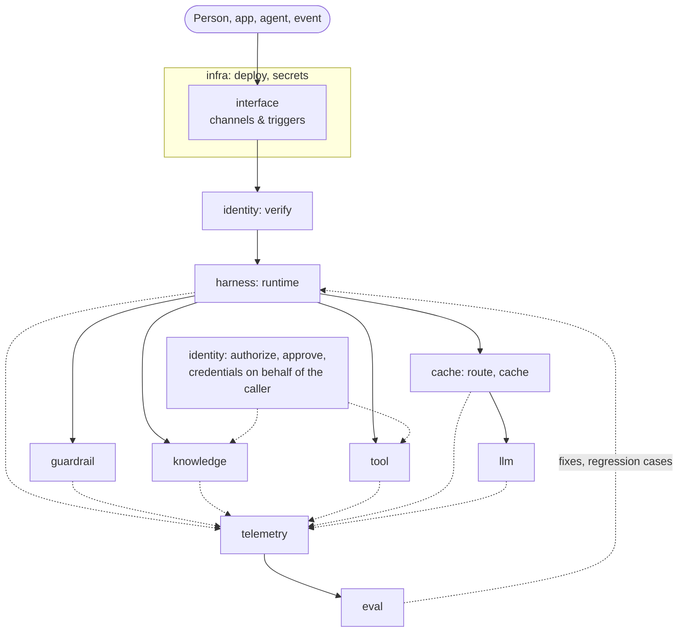

# The stack on one page

An agent in production needs eleven layers. agent-layers names them, gives each one a port, and composes adapters
for them from a config. The core is technology neutral: every technology choice below is an adapter or a reference
setup, and each can be swapped by changing one line of config. The design is in [architecture.md](architecture.md).

## Layers by plane

| Plane | L | Layer (id) | The question it answers | Ports | Reference adapters |
|---|---|---|---|---|---|
| Foundation | L0 | [Infrastructure & delivery](layers/infra.md) (`infra`) | Where does it run and how does it get there? | DeployPort, SecretPort | `compose-deploy` (Compose Spec); OpenBao, Kubernetes and OpenTofu planned |
| Model | L1 | [Models](layers/llm.md) (`llm`) | Who thinks? | ModelPort | `openai-compatible` (Ollama, vLLM, LiteLLM, hosted APIs); `mock-model` for offline work |
| Model | L2 | [Model access](layers/cache.md) (`cache`): routing, fallback, quotas, cache | Which model, at what cost and latency? | RouterPort, CachePort | `static-router`, `rule-router`, `memory-cache`; a model gateway behind `openai-compatible`; Valkey planned |
| Agent | L3 | [Agent runtime](layers/harness.md) (`harness`) | How does the agent loop run and keep state? | RuntimePort, StatePort | `basic-runtime`, `memory-state`; reinloop and agent-to-agent runtimes planned |
| Agent | L4 | [Knowledge & memory](layers/knowledge.md) (`knowledge`) | What does it know? | KnowledgePort, MemoryPort, IngestionPort | `markdown-knowledge`, `http-knowledge`, `mcp`; Qdrant, SQL, SPARQL planned |
| Agent | L5 | [Tools](layers/tool.md) (`tool`) | What can it do? | ToolPort | `functions`, `http-tools`, `mcp`, `openapi` |
| Control | L6 | [Identity & access](layers/identity.md) (`identity`) | Who is it, on whose behalf, and what is allowed? | IdentityPort, CredentialPort, AuthorizationPort, ApprovalPort | `static-identity` (dev only), `rules-authorization`, `memory-approval`, `oidc` (Keycloak or any IdP), `authzen`, `opa` |
| Control | L7 | [Guardrails](layers/guardrail.md) (`guardrail`) | Is this content acceptable? | GuardPort | `regex-guard`, `http-guard`, `presidio`, `llm-guard` |
| Experience | L8 | [Interfaces, channels & triggers](layers/interface.md) (`interface`) | Who talks to it and what starts it? | ChannelPort, TriggerPort | `terminal-channel`; OpenAI-compatible chat API, MCP server, A2A, CloudEvents planned |
| Insight | L9 | [Telemetry & observability](layers/telemetry.md) (`telemetry`) | What happened? | TelemetryPort | `console-telemetry`, `jsonl-telemetry`, `otlp` (to Langfuse, Jaeger or any collector) |
| Insight | L10 | [Evaluation & improvement](layers/eval.md) (`eval`) | Was it good, and if not, which layer failed? | EvaluatorPort, FeedbackPort | `expected-eval`, `judge-eval`, `layer-signals`; promptfoo planned |

The full catalog with status and maturity is in [adapters.md](adapters.md). Layer ids are stable; the numbers are
for reading only. Reference setups (compose files and live tests) live in `reference/<layer id>/`.

Boundary rules: read-only context retrieval is `knowledge`, anything with side effects is `tool`; who may do what is
`identity`, whether the content is acceptable is `guardrail`.

## Request flow

A channel or trigger starts a run. Identity verifies the caller; the runtime runs the agent loop. Guardrails check
input, output and tool traffic; knowledge is retrieved with the caller's identity; tools are authorized and called
with credentials issued for the caller. Model calls go through routing and caching to the model. Every step is
traced with its layer, telemetry feeds evaluation, and evaluation sends fixes back. Infrastructure runs underneath.

## Knowledge is not only RAG

The knowledge layer covers documents, structured data, graphs and ontologies, a curated wiki, long-term memory and
procedural know-how. Each backend has its own query language (or none), so the port fixes the result instead:
`KnowledgePort.search` returns `Passage { id, text, source, score, metadata }` whatever the backend. That uniform
result lets telemetry trace and evaluation score retrieval the same way everywhere.

## Cross-cutting concerns

| Concern | Spans | Doc |
|---|---|---|
| Governance & compliance | identity, guardrail, telemetry, eval | [governance-compliance.md](cross-cutting/governance-compliance.md) |
| Security | tool, identity, guardrail | [security.md](cross-cutting/security.md) |
| Cost | harness, cache, telemetry | [cost.md](cross-cutting/cost.md) |

## Lifecycle

Design (agent file and eval cases) → build (pick adapters per layer) → test (`agent-layers test`, `eval`) → release
(`agent-layers deploy --profile production`) → operate (telemetry) → improve (eval attributes failures to a layer).
Profiles keep the same stack from prototype to production; see [guide.md](guide.md#from-prototype-to-production) and
[lifecycle.md](lifecycle.md).
