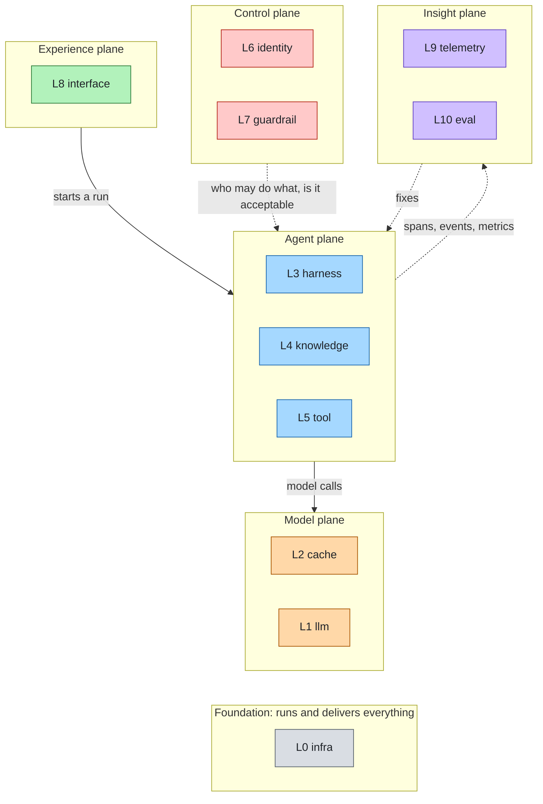
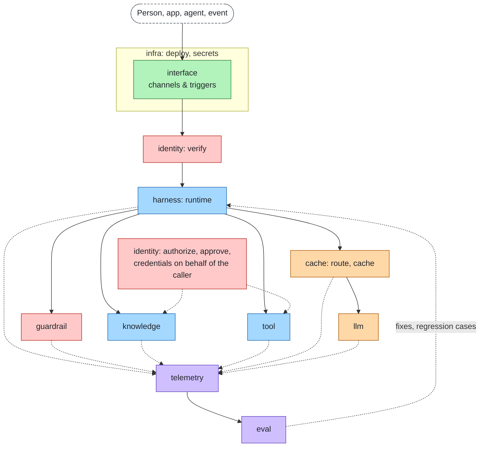
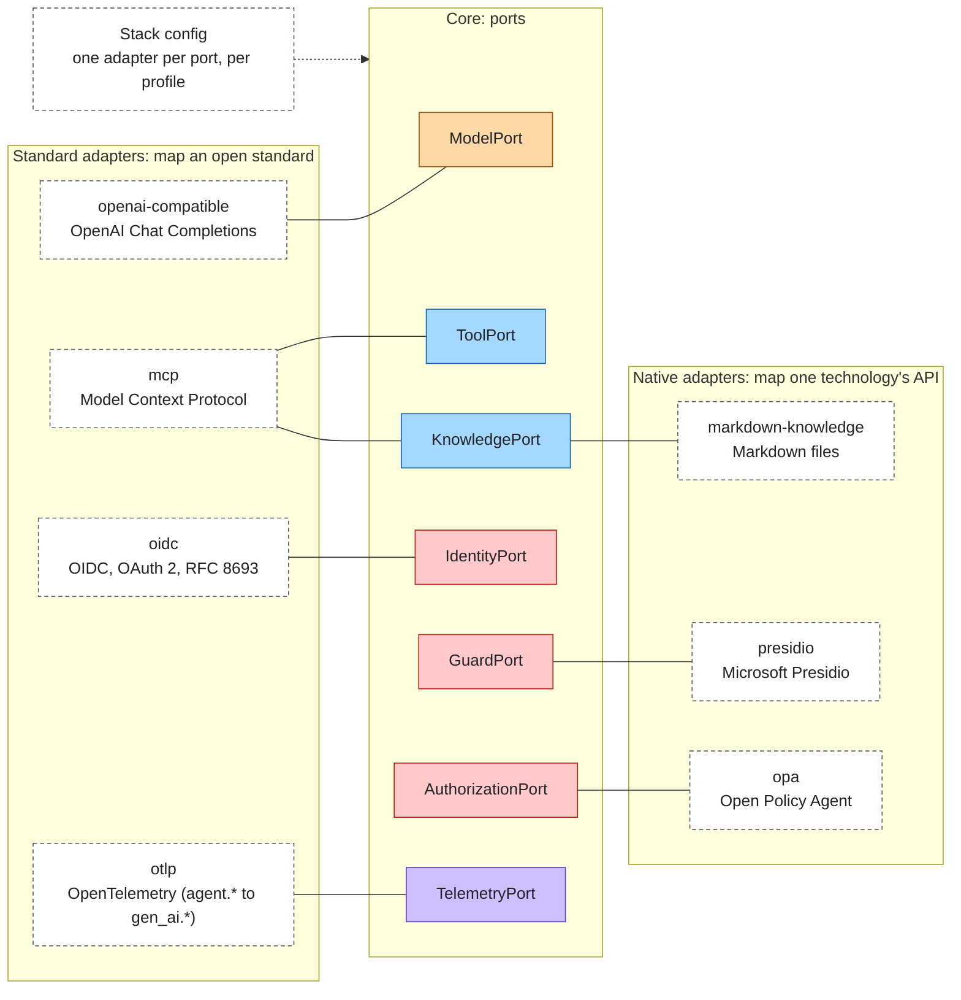

# The stack on one page

An agent in production needs eleven layers. agent-layers names them, gives each one a port, and composes adapters
for them from a config. The core is technology neutral: every technology choice below is an adapter or a reference
setup, and each can be swapped by changing one line of config. The design is in [architecture.md](architecture.md).


## Layers by plane

| Plane | L | Layer (id) | The question it answers | Ports | Reference adapters |
|---|---|---|---|---|---|
| Foundation | L0 | [Infrastructure & delivery](layers/infra.md) (`infra`) | Where does it run and how does it get there? | DeployPort, SecretPort | `compose-deploy` (Compose Spec); OpenBao, Kubernetes and OpenTofu planned |
| Model | L1 | [Models](layers/llm.md) (`llm`) | Who thinks? | ModelPort | `openai-compatible` (Ollama, vLLM, LiteLLM, hosted APIs); `mock-model` for offline work |
| Model | L2 | [Model access](layers/cache.md) (`cache`): routing, fallback, quotas, cache | Which model, at what cost and latency? | RouterPort, CachePort | `static-router`, `rule-router`, `memory-cache`; a model gateway behind `openai-compatible`; Valkey planned |
| Agent | L3 | [Agent runtime](layers/harness.md) (`harness`) | How does the agent loop run and keep state? | RuntimePort, StatePort | `basic-runtime`, `reinloop`, `memory-state`, `sqlite-state`; remote runtimes over `a2a` |
| Agent | L4 | [Knowledge & memory](layers/knowledge.md) (`knowledge`) | What does it know? | KnowledgePort, MemoryPort, IngestionPort | `markdown-knowledge`, `http-knowledge`, `mcp`; Qdrant, SQL, SPARQL planned |
| Agent | L5 | [Tools](layers/tool.md) (`tool`) | What can it do? | ToolPort | `functions`, `http-tools`, `mcp`, `openapi` |
| Control | L6 | [Identity & access](layers/identity.md) (`identity`) | Who is it, on whose behalf, and what is allowed? | IdentityPort, CredentialPort, AuthorizationPort, ApprovalPort | `static-identity` (dev only), `rules-authorization`, `memory-approval`, `oidc` (Keycloak or any IdP), `authzen`, `opa` |
| Control | L7 | [Guardrails](layers/guardrail.md) (`guardrail`) | Is this content acceptable? | GuardPort | `regex-guard`, `http-guard`, `presidio`, `llm-guard` |
| Experience | L8 | [Interfaces, channels & triggers](layers/interface.md) (`interface`) | Who talks to it and what starts it? | ChannelPort, TriggerPort | `terminal-channel`; on the [gateway](gateway.md): `openai-compatible`, `mcp`, `a2a`, `cloudevents` |
| Insight | L9 | [Telemetry & observability](layers/telemetry.md) (`telemetry`) | What happened? | TelemetryPort | `console-telemetry`, `jsonl-telemetry`, `otlp` (to Langfuse, Jaeger or any collector) |
| Insight | L10 | [Evaluation & improvement](layers/eval.md) (`eval`) | Was it good, and if not, which layer failed? | EvaluatorPort, FeedbackPort | `expected-eval`, `judge-eval`, `layer-signals`; promptfoo planned |

The full catalog with status and maturity is in [adapters.md](adapters.md). Layer ids are stable; the numbers are
for reading only. Reference setups (compose files and live tests) live in `reference/<layer id>/`.

Boundary rules: read-only context retrieval is `knowledge`, anything with side effects is `tool`; who may do what is
`identity`, whether the content is acceptable is `guardrail`.

## Planes at a glance

The experience plane starts runs, the control plane governs them, the agent plane does the work, the model plane
answers, the insight plane watches, and the foundation runs everything.



## Request flow



A channel or trigger starts a run. Identity verifies the caller; the runtime runs the agent loop. Guardrails check
input, output and tool traffic; knowledge is retrieved with the caller's identity; tools are authorized and called
with credentials issued for the caller. Model calls go through routing and caching to the model. Every step is
traced with its layer, telemetry feeds evaluation, and evaluation sends fixes back. Infrastructure runs underneath.

## Ports and adapters

The core defines the ports. An adapter maps either an open standard or one technology's native API onto a port, and
the stack config picks one per port.



## Knowledge is not only RAG

The knowledge layer covers documents, structured data, graphs and ontologies, a curated wiki, long-term memory and
procedural know-how. Each backend has its own query language (or none), so the port fixes the result instead:
`KnowledgePort.search` returns `Passage { id, text, source, title?, url?, score?, attrs?, ext? }` whatever the backend.
That uniform result lets telemetry trace and evaluation score retrieval the same way everywhere.

## One language, configurable at the edges

The data that crosses a port is written in one language owned by this project: fixed shapes with fixed field names
(`ModelRequest`, `ToolResult`, `Caller`, `AccessQuestion`, ...). Standards appear only inside adapters. What a stack
owner can tune is the edge: the vocabularies, the mapping rules and the knowledge fusion below, plus `ext`, the
namespaced bag that adapters declare in their descriptors and the core never reads. The reference is
[spec/language.md](../spec/language.md); the reasoning is [ADR 0001](decisions/0001-sdk-language.md).

### Vocabularies and mappings

Both blocks sit at the top level of the config and under `profiles.<name>`.

| Block | What it does |
|---|---|
| `vocabularies` | Adds values or aliases to the extensible sets. `{ "risk": { "add": { "admin": { "like": "exec" } } }, "finish": { "aliases": { "pause": "other" } } }`. An added value is `like` a core value: core logic (a policy rule on `risk: ["exec"]`) sees the core value, adapters and telemetry see the added one. Aliases are resolved by adapters at the edge. Closed sets (`effect`, `stage`, `runStatus`, ...) reject changes. |
| `mappings` | Rules that turn a standard's document into a language shape (`in`) or a shape into a standard's document (`out`), beyond the adapter's built-in translation. |

`mappings` is `{ "<key>": { "in": [rules], "out": [rules] } }`. The key names an adapter instance:

| Slot kind | Key | Example |
|---|---|---|
| single | `<slot>` | `identity`, `authorization` |
| keyed | `<slot>.<instance>` | `tools.crm`, `knowledge.handbook` |
| list | `<slot>.<name>` | `guardrails.pii` |

Rule fields, run in order (`in`: source is the native document, target is the shape; `out`: source is the shape,
target is the wire document):

| Field | Meaning |
|---|---|
| `from` | JSON Pointer into the source, or a list of pointers (for `join`). Omit for a constant. |
| `to` | JSON Pointer into the target. |
| `default` | Used when `from` is missing or null. |
| `map` | `{ "<source value>": <target value>, "*": <fallback> }`. A value not listed, without `"*"`, is not written. |
| `join` | `"union"` merges lists without duplicates; another string joins strings with it. |
| `split` | Separator that turns a string into a list. |
| `drop` | JSON Pointer removed from the target. |
| `fn` | `"<module>#<export>"`: `(source, target, ctx) => target`, synchronous and pure, loaded relative to the config file. |

Merging:

| Case | Result |
|---|---|
| A list in config | Replaces the adapter's default rules (`mappingDefaults` in its descriptor). |
| `{ "$merge": "append", "items": [rules] }` | Appends to the adapter's default rules. |
| Profiles | Override per key and per direction (`in`, `out`); a profile's list replaces the base list for that key and direction. |
| `null` | Removes the rules of a key or of one direction. |

```json
"mappings": {
  "identity": { "in": { "$merge": "append", "items": [
    { "from": "/tenant", "to": "/ext/oidc.tenant" }
  ] } },
  "authorization": { "out": { "$merge": "append", "items": [
    { "from": "/caller/ext/oidc.tenant", "to": "/subject/properties/tenant" }
  ] } }
}
```

Config loading checks that pointers parse, that `to` and `drop` address a field of the shape (or a declared
`/ext/<key>` of the adapter), that `map` targets are valid vocabulary values and that `fn` modules load. A mapping
error in `identity` or `authorization` rejects the credential or denies the call.

### Knowledge fusion

Scores of different sources are not comparable (a keyword score is unbounded, a vector store returns a similarity), so
passages from two or more sources are merged by reciprocal rank fusion. `pipeline.knowledge.fusion` tunes it:

| Key | Default | Meaning |
|---|---|---|
| `method` | `rrf` | `rrf`: sum of `weight / (rrfK + rank)` over sources. `raw`: sort by each source's own `score`, only for sources that share one scorer. |
| `rrfK` | `60` | Rank constant; a higher value flattens the difference between ranks. |
| `weights` | `1` per source | `{ "<source>": weight }`. |

After fusion `Passage.score` is the fused score; the source's own score and rank are kept in `ext["sdk.raw_score"]` and
`ext["sdk.rank"]`. Knowledge exposed as tools (`mode: "tools"`) is not fused. Limits: [limits.md](limits.md).

### Agents and limits

| Key | Meaning |
|---|---|
| `agents.<name>.settings` | Model settings: `temperature`, `maxOutputTokens`, `stop`. In a Markdown agent file, a one-line flow map in the front matter: `settings: { temperature: 0 }`. `params` was removed at 1.0; the loader rejects it. |
| `agents.<name>.ext` | Namespaced, adapter-specific settings (`<adapter>.<name>` keys). |
| `limits.extBytes` | Largest `ext` bag the core keeps on a shape; a larger one is dropped and an `agent.ext.dropped` event is emitted. |

## Cross-cutting concerns

| Concern | Spans | Doc |
|---|---|---|
| Governance & compliance | identity, guardrail, telemetry, eval | [governance-compliance.md](cross-cutting/governance-compliance.md) |
| Security | tool, identity, guardrail | [security.md](cross-cutting/security.md) |
| Cost | harness, cache, telemetry | [cost.md](cross-cutting/cost.md) |

## Lifecycle

Design (agent file and eval cases) → build (pick adapters per layer) → test (`agent-layers test`, `eval`) → release
(`agent-layers deploy --profile production`) → operate (telemetry) → improve (eval attributes failures to a layer).
Profiles keep the same stack from prototype to production; see [guide.md](guide.md#from-prototype-to-production) and
[lifecycle.md](lifecycle.md).
